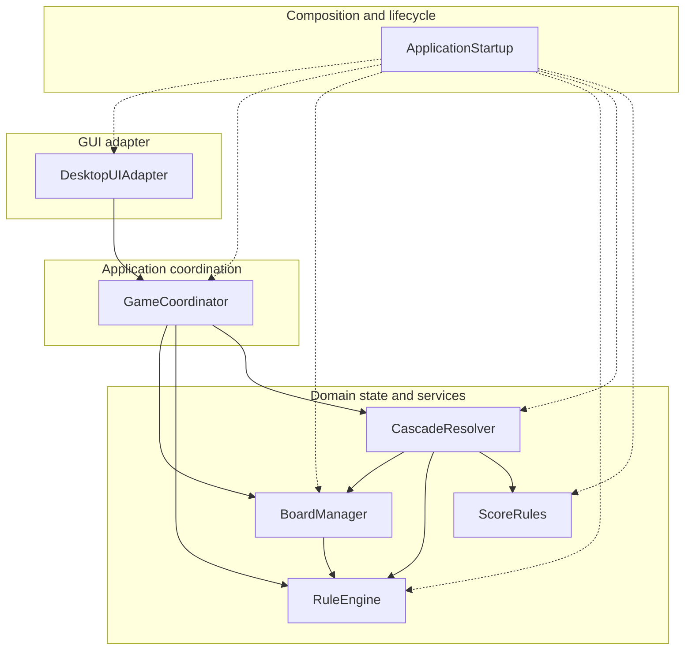
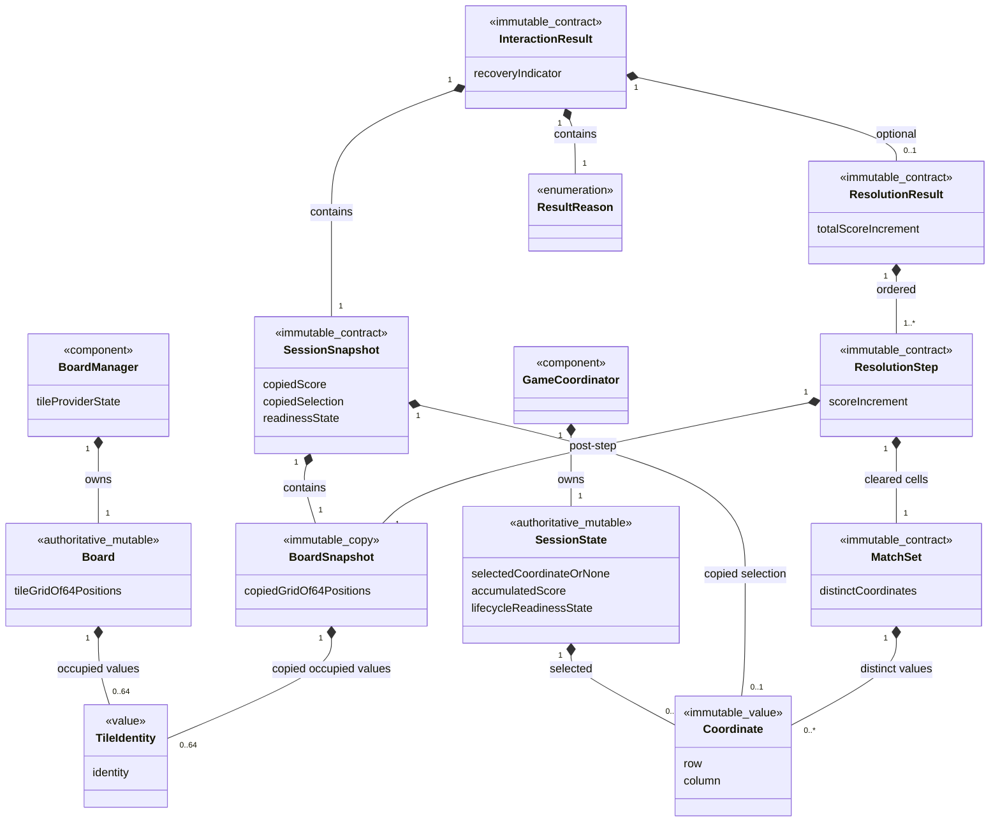
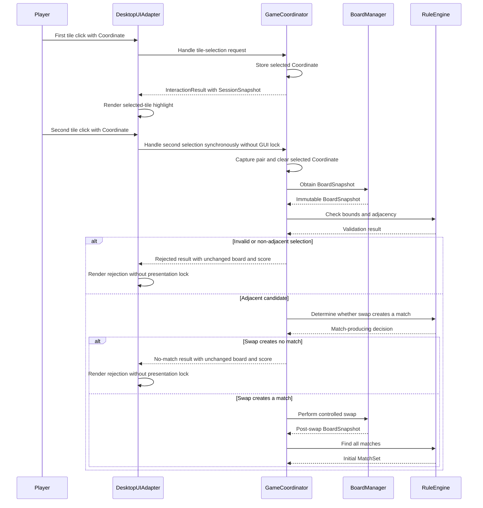
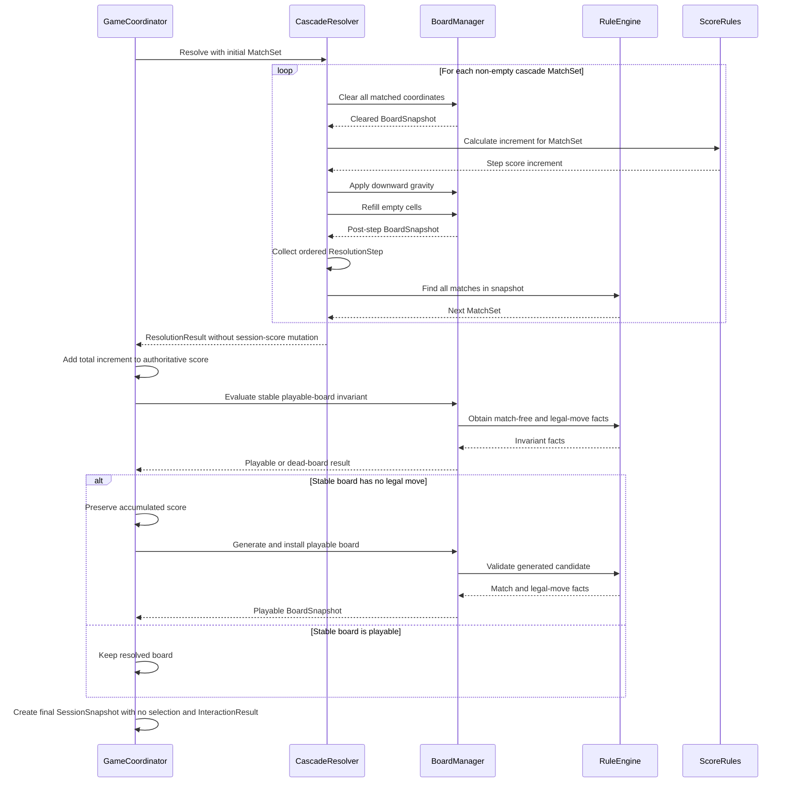

# Exercise 2: Software Architecture

## TODO 1: Core Responsibilities

### Responsibility Overview

| Responsibility | Purpose | Owns | Must Not Own | GUI-independent | Requirement IDs |
| --- | --- | --- | --- | --- | --- |
| Board and tile management | Maintain the board and tile data used by the game and generate playable boards for initialization, restart, and dead-board recovery. | Board content; board dimensions and tile identities; board mutation primitives; validation and tile supply; playable-board generation; the invariant that every stable state waiting for input is full, match-free, and has at least one legal move. The invariant is not required during resolution. **ASSUMPTION:** every generated board contains all six tile identities. **ASSUMPTION:** dead-board recovery regenerates a board rather than reshuffling the existing one. | The decision about when initialization, restart, or recovery replaces the current board; selection state; swap legality; scoring; or presentation. | Yes | FR-01, FR-08, FR-11, DR-04 |
| Move and rule processing | Evaluate a requested exchange. | Bounds and orthogonal-adjacency decisions; whether one exchange creates a match; matchless-swap rejection. | The selected tile or selection transitions, board content or its playable invariant, match scanning, score, or feedback text. | Yes | FR-02, FR-03, FR-04, DR-01 |
| Match detection | Identify every current horizontal and vertical run of at least three identical tiles. | The union of matched coordinates, including complete long and simultaneous runs with intersecting coordinates represented once. | Clearing cells, applying gravity, refilling, scoring, or UI feedback. | Yes | FR-05, DR-02 |
| Removal, refill, and cascading | Resolve all matches in the required order until the board is stable. | Simultaneous removal; downward gravity; refill; repeated detection; cascade completion and per-step cleared-cell results. | Initial swap legality, the scoring formula or score total, board replacement after a dead board, or rendering. | Yes | FR-05, FR-06, DR-03 |
| Scoring | Define the points produced by a resolution step. | The rule of exactly 10 points per distinct cleared tile, including cascades and excluding multipliers or bonuses; calculation of the score increment. | The accumulated score total, restart reset, recovery preservation, match membership, or score display. | Yes | FR-07, DR-03, DR-06 |
| Game-state coordination | Coordinate the session and the state-machine workflow. | First/second selection rules and the selected tile; sequencing of move validation and resolution; the accumulated score total; score reset on restart and preservation during recovery; readiness decisions; deciding when initialization, restart, or recovery requests a generated board to replace the current one; dead-board recovery; result reporting. | Board content, playable-board generation and invariant evaluation, the scoring formula, match detection, input-event capture, the input lock, or rendering. | Yes | UR-01, UR-02, UR-04, UR-05, FR-02, FR-03, FR-04, FR-07, FR-08, FR-10, DR-04, DR-05 |
| User input | Translate desktop actions into GUI-independent coordination requests. | Mouse-click and Restart-event translation. **ASSUMPTION:** one move is resolved in one synchronous core call, so User input owns the input lock needed while the GUI presents resolution steps; the lock prevents another click from changing the board before coordination returns to a stable waiting state. | The selected tile, selection rules, swap legality, board content, score, or status wording. | No | UR-01, FR-02, FR-06 |
| Presentation | Show the current game and action outcomes. | Tile colors and symbols; selected-tile highlighting; board and score rendering; accepted, rejected, resolution, and recovery feedback; control appearance. | Selection state, domain equality, swap legality, matching, board mutation, score calculation, or recovery decisions. | No | UR-03, UR-04, FR-07, FR-09, NFR-01 |

### Responsibility Boundaries

Board and tile management is the sole owner of board content, playable-board generation, and invariant evaluation. It generates boards for initialization, restart, and dead-board recovery. Game-state coordination only decides when one of those generated boards replaces the current content. The playable-board invariant applies whenever the game is stable and waiting for input; temporary empty cells and matches are permitted during resolution.

Game-state coordination owns session state: the selected coordinate, selection transitions, score total, and move lifecycle. Move and rule processing makes stateless legality decisions. Scoring produces a score increment but does not store the total. This keeps selection and scoring testable without a GUI.

Match detection only identifies coordinates. Removal, refill, and cascading consumes that result and controls resolution order. Presentation observes results but does not make domain decisions. User input translates events and, under the stated assumption, owns the input lock rather than the selected tile.

### Cross-cutting constraints

- **GUI-independent testability, deterministic verification, and core/GUI separation:** core responsibilities must be exercisable without opening a window, with controlled state or randomness, and must remain independent of graphical input and rendering. This separation is required, not deferred. IDs: UR-07, FR-11, NFR-07.
- **Performance and reliability:** input feedback, generation, recovery, cascade processing, and controlled robustness must meet their validated limits. IDs: UR-09, NFR-02, NFR-03. NFR-04 is deferred (Won't have for this prototype).
- **Further maintainability goals:** responsibilities should remain easy to understand and central gameplay values should not be duplicated. IDs: UR-08 and NFR-05, both deferred (Should have).
- **Documentation and scope control:** the supported environment, commands, dependencies, rules, and design decisions must be documented without adding out-of-scope product features. IDs: NFR-06, NFR-08.
- **Local runtime, offline operation, host integrity, and shutdown:** the architecture must run locally without accounts, services, elevated privileges, or persistent game data and must close cleanly. IDs: UR-06, NFR-09, NFR-10, NFR-12, NFR-13. NFR-11 is deferred (Could have).
- **Concrete TODO 6 delivery constraints:** Python 3.14, standard-library tkinter, and no third-party packages are the documented realization of NFR-06, NFR-09, and NFR-10.

### Requirement Traceability

This list covers the 39 formal requirements in TODO 3. NEED identifiers are stakeholder-need sources rather than requirements.

- UR-01 → User input; Game-state coordination.
- UR-02 → Game-state coordination.
- UR-03 → Presentation.
- UR-04 → Game-state coordination; Presentation.
- UR-05 → Game-state coordination.
- UR-06 → Cross-cutting: local runtime, offline operation, host integrity, and shutdown.
- UR-07 → Cross-cutting: GUI-independent testability, deterministic verification, and core/GUI separation.
- UR-08 → Cross-cutting: further maintainability goals — **deferred (Should have)**.
- UR-09 → Cross-cutting: performance and reliability.
- FR-01 → Board and tile management.
- FR-02 → User input; Game-state coordination; Move and rule processing.
- FR-03 → Move and rule processing; Game-state coordination.
- FR-04 → Move and rule processing; Game-state coordination.
- FR-05 → Match detection; Removal, refill, and cascading.
- FR-06 → Removal, refill, and cascading; User input.
- FR-07 → Scoring; Game-state coordination; Presentation.
- FR-08 → Game-state coordination; Board and tile management.
- FR-09 → Presentation.
- FR-10 → Game-state coordination.
- FR-11 → Board and tile management; Cross-cutting: GUI-independent testability, deterministic verification, and core/GUI separation.
- NFR-01 → Presentation.
- NFR-02 → Cross-cutting: performance and reliability.
- NFR-03 → Cross-cutting: performance and reliability.
- NFR-04 → Cross-cutting: performance and reliability — **deferred (Won't have for this prototype)**.
- NFR-05 → Cross-cutting: further maintainability goals — **deferred (Should have)**.
- NFR-06 → Cross-cutting: documentation and scope control; local runtime.
- NFR-07 → Cross-cutting: GUI-independent testability, deterministic verification, and core/GUI separation.
- NFR-08 → Cross-cutting: documentation and scope control.
- NFR-09 → Cross-cutting: local runtime, offline operation, host integrity, and shutdown.
- NFR-10 → Cross-cutting: local runtime, offline operation, host integrity, and shutdown.
- NFR-11 → Cross-cutting: local runtime diagnostics — **deferred (Could have)**.
- NFR-12 → Cross-cutting: local runtime, offline operation, host integrity, and shutdown.
- NFR-13 → Cross-cutting: local runtime, offline operation, host integrity, and shutdown.
- DR-01 → Move and rule processing.
- DR-02 → Match detection.
- DR-03 → Removal, refill, and cascading; Scoring.
- DR-04 → Board and tile management; Game-state coordination.
- DR-05 → Game-state coordination.
- DR-06 → Scoring.

## TODO 2: Architectural Components

**ASSUMPTION:** The seven fixed component names and boundaries below are the Exercise 2 decomposition of the Exercise 1 responsibilities; Exercise 1 specifies behavior and ownership concepts but does not name software components.

### Proposed component decomposition

The components are grouped only as GUI-independent core or GUI. No architectural pattern or detailed interface is selected here.

#### GUI-independent core components

No component in this group imports tkinter. `GameCoordinator`, including selection rules, move flow, score total, restart, and recovery, remains fully testable without a GUI.

| Fixed component name | Purpose | Main responsibilities | Not responsible for | State | Requirement IDs and cross-cutting constraints |
| --- | --- | --- | --- | --- | --- |
| `BoardManager` | Own the current board, tile-provider state, and playable-board generation. | Store and validate board content; expose controlled mutations; evaluate the stable playable-board invariant; generate boards for initialization, restart, and recovery; own a constructor-injected random, seeded, or deterministic tile provider used for generation and refill. | Deciding when to replace the board, selection, move or match rules, cascade order, scoring, or GUI behavior. | Current board content plus RNG state or deterministic tile-sequence position. | FR-01, FR-06, FR-08, FR-10, FR-11, DR-03, DR-04; GUI-independent testability/core separation; performance and reliability; further maintainability goals (deferred). |
| `RuleEngine` | Own all stateless move-legality and match-detection rules. | Check bounds and orthogonal adjacency; decide whether an exchange creates a match; determine whether a legal move exists; return the distinct coordinates in all horizontal and vertical runs of three or more, including long, simultaneous, and intersecting matches. | Holding selection or board state, mutating the board, clearing matches, controlling cascades, scoring, or presentation. | Stateless. | FR-02, FR-03, FR-04, FR-05, DR-01, DR-02, DR-04; GUI-independent testability/core separation; performance and reliability. |
| `ScoreRules` | Convert a resolution result into a score increment while keeping scoring policy isolated as an explicit evolution concern. | Apply exactly 10 points per distinct cleared coordinate, including cascades and without multipliers or bonuses. | Holding the score total, resetting or preserving it, detecting matches, or displaying score. | Stateless. | FR-07, DR-03, DR-06; GUI-independent testability/core separation. |
| `CascadeResolver` | Resolve accepted matches until the board becomes stable while remaining separate from rule evaluation. | Sequence simultaneous removal, gravity, refill through `BoardManager`, repeated match queries through `RuleEngine`, and score-increment calculation through `ScoreRules`; return per-step results to coordination. | Implementing match detection or move legality, holding selection or accumulated score, deciding dead-board replacement, or updating the GUI. | Stateless between resolution calls. | UR-02, FR-05, FR-06, FR-07, DR-03; GUI-independent testability/core separation; performance and reliability. |
| `GameCoordinator` | Own session state and coordinate the complete game workflow. | Own first/second selection rules and selected coordinate; accept a given board at construction and initialize `BoardManager` with it; sequence `RuleEngine` and `CascadeResolver`; own the score total; decide score reset and preservation; decide when `BoardManager` generates and installs a board; coordinate restart, recovery, readiness, and move results. | Owning board or tile-provider state, generating or validating boards itself, defining move/match/scoring rules, capturing GUI events, owning the input lock, or rendering. | Selected coordinate, accumulated score, and current lifecycle/readiness state; references to core collaborators. | UR-01, UR-02, UR-04, UR-05, FR-02, FR-03, FR-04, FR-07, FR-08, FR-10, DR-04, DR-05; GUI-independent testability/core separation; performance and reliability; further maintainability goals (deferred). |

#### GUI components

| Fixed component name | Purpose | Main responsibilities | Not responsible for | State | Requirement IDs and cross-cutting constraints |
| --- | --- | --- | --- | --- | --- |
| `DesktopUIAdapter` | Adapt tkinter input and presentation to the GUI-independent `GameCoordinator`. | Translate tile clicks and Restart activation into coordination requests; create and update board, tile, score, status, selection-highlight, and Restart widgets; render coordination and cascade results. **ASSUMPTION:** because a move resolves in one synchronous core call, own the GUI input-lock flag while resolution steps are presented and release it only after coordination returns to a stable waiting state. | Holding selected-tile, board, score-total, or workflow state; applying selection, move, match, cascade, or scoring rules; deciding recovery. | Tkinter widget references, derived display state, and the GUI input-lock flag. | UR-01, UR-03, UR-04, FR-02, FR-06, FR-07, FR-09, NFR-01; core/GUI separation; performance and reliability; local runtime constraints. |
| `ApplicationStartup` | Construct the application, wire all six collaborators, run the GUI loop, and close it cleanly. | Create the normal tile provider owned by `BoardManager`; create the remaining core components, `GameCoordinator`, and `DesktopUIAdapter`; start tkinter; route normal close to process termination. | Gameplay rules, session decisions, board or tile-provider state, score, rendering decisions, networking, persistence, or run-time plug-in discovery. | Application/root-window references while the process is running; no game state. | UR-06, NFR-09, NFR-10, NFR-12, NFR-13; documentation/scope control; local runtime/offline/host-integrity/shutdown constraints; concrete TODO 6 delivery constraints. |

### Responsibility-to-component mapping

| TODO 1 responsibility | Component(s) | Merge or split justification |
| --- | --- | --- |
| Board and tile management | `BoardManager` | Board content, playable-board generation, and the replaceable random or deterministic tile provider are merged for this small prototype. `BoardManager` remains their single state owner, and provider injection supports deterministic tests without a plug-in system. |
| Move and rule processing | `RuleEngine` | Merged with match detection because both are stateless rules over board snapshots. `RuleEngine` is the only authority for move legality. |
| Match detection | `RuleEngine` | Merged with move rules, but the match definition still has exactly one implementation in `RuleEngine` and remains outside cascade resolution. |
| Removal, refill, and cascading | `CascadeResolver`, `BoardManager`, `RuleEngine`, `ScoreRules` | `CascadeResolver` alone owns resolution order; `BoardManager` alone mutates/stores board content and supplies tiles; `RuleEngine` alone detects matches; `ScoreRules` alone calculates each score increment. |
| Scoring | `ScoreRules` | Kept separate and stateless; only the scoring formula lives here, while the total remains session state in `GameCoordinator`. |
| Game-state coordination | `GameCoordinator` | Kept as its own GUI-independent component because selection, move flow, score total, restart, and recovery must be testable without tkinter. |
| User input | `DesktopUIAdapter` | Merged with presentation because event translation, widgets, derived display state, and the GUI input lock share the same tkinter boundary; no domain state or rule moves into the adapter. |
| Presentation | `DesktopUIAdapter` | Merged with user input for the same small desktop boundary; the adapter owns rendering and widget state but no domain decision. |

The two merges reduce overhead without creating an all-purpose game-logic component: `RuleEngine` combines only stateless rules, and `DesktopUIAdapter` combines only tkinter-facing concerns. `ScoreRules` and `CascadeResolver` remain separate evolution and workflow boundaries. `ApplicationStartup` is an additional composition/lifecycle component required to create and connect the other six components; it owns no gameplay rule. The Must scope contains no networking, persistence, or general plug-in component.

### Logical versus physical implementation

These seven names define logical ownership, not a required one-class-per-file layout. A later physical implementation may place small stateless components together or keep them in separate modules, but it must preserve the authoritative state and rule owners above. The current TODO 6 code remains described separately in the notes below and does not determine this proposed decomposition. Detailed interfaces, dependency-call shapes, and architectural-pattern selection are intentionally deferred to later TODOs.

## TODO 3: Interfaces and Dependencies

**ASSUMPTION:** The contracts and conceptual operations below are an interface design derived from the validated behavior and TODO 2 ownership; Exercise 1 does not prescribe these interface shapes or names. They define information and dependency boundaries without selecting an architectural pattern or physical implementation.

### Shared Data Contracts

| Contract | Purpose | Producer | Consumers | Immutable or copied | GUI-specific information |
| --- | --- | --- | --- | --- | --- |
| `Coordinate` | Identify one board cell by row and column. | `DesktopUIAdapter`; core components when reporting results | `GameCoordinator`, `RuleEngine`, `BoardManager`, result contracts | Immutable value | None |
| `BoardSnapshot` | Provide a read-only view of all tile identities without sharing mutable board storage. | `BoardManager` | `RuleEngine`, `CascadeResolver`, `GameCoordinator`; `DesktopUIAdapter` only through `SessionSnapshot` or resolution results | Immutable representation or defensive copy | None |
| `MatchSet` | Represent every distinct coordinate matched in one resolution step. | `RuleEngine` | `CascadeResolver`, `ScoreRules` | Immutable set | None |
| `ResolutionStep` | Describe one completed clear/gravity/refill step for ordered presentation and scoring evidence. | `CascadeResolver` | `GameCoordinator`; `DesktopUIAdapter` through `InteractionResult` | Immutable record containing the cleared `MatchSet`, post-step `BoardSnapshot`, and score increment | None |
| `ResolutionResult` | Summarize all cascades from one accepted move. | `CascadeResolver` | `GameCoordinator`; `DesktopUIAdapter` through `InteractionResult` | Immutable ordered collection of `ResolutionStep` values plus total score increment | None |
| `SessionSnapshot` | Expose current session state without transferring ownership. | `GameCoordinator` | `DesktopUIAdapter` | Immutable record containing `BoardSnapshot`, accumulated score, selected coordinate or no selection, and readiness state | None |
| `InteractionResult` | Report the outcome of selection, move, restart, and recovery coordination. | `GameCoordinator` | `DesktopUIAdapter` | Immutable record containing a result code, `SessionSnapshot`, optional `ResolutionResult`, and recovery indicator | None |
| `ResultReason` | Give stable domain outcome/rejection codes that the GUI can translate into text. | `RuleEngine` for rule decisions; `GameCoordinator` for workflow outcomes | `GameCoordinator`, `DesktopUIAdapter` | Immutable enumerated value | None; no widget, color, or complete user-facing string |

Shared contracts carry values only. Passing a `BoardSnapshot`, `SessionSnapshot`, or result does not transfer or create ownership of another component's mutable state.

### Provided Component Interfaces

The operations below are conceptual capabilities, not Python method definitions.

#### BoardManager

| Provided operation | Input | Output | State changed | Allowed caller | Important precondition or postcondition |
| --- | --- | --- | --- | --- | --- |
| Obtain board snapshot | None | `BoardSnapshot` | None | `GameCoordinator`, `CascadeResolver` | Output cannot mutate the owned board. |
| Install supplied initial board | `BoardSnapshot` | Installed `BoardSnapshot` | Board content | `GameCoordinator` | Input is structurally valid; input is copied. Coordination must not expose input until the stable invariant holds. |
| Generate and install playable board | Generation request | `BoardSnapshot` | Board content and tile-provider state | `GameCoordinator` | Postcondition: full, match-free, and at least one legal move; TODO 1 generation assumptions apply. |
| Perform controlled swap | Two `Coordinate` values | `BoardSnapshot` | Board content | `GameCoordinator` | Coordinates are in bounds; only `BoardManager` mutates the stored board. |
| Clear coordinates | `MatchSet` | `BoardSnapshot` | Board content | `CascadeResolver` | Every supplied coordinate is cleared as one conceptual step. |
| Apply downward gravity | None | `BoardSnapshot` | Board content | `CascadeResolver` | Remaining tile order is preserved within each column. |
| Refill empty cells | None | `BoardSnapshot` | Board content and tile-provider state | `CascadeResolver` | Postcondition: all cells are occupied; tiles come from the owned provider. |
| Evaluate stable playable-board invariant | None | Boolean result | None | `GameCoordinator`; internal generation validation | Uses `RuleEngine`; the invariant is required only for a stable state waiting for input. |

#### RuleEngine

| Provided operation | Input | Output | State changed | Allowed caller | Important precondition or postcondition |
| --- | --- | --- | --- | --- | --- |
| Check bounds | `BoardSnapshot`, `Coordinate` | Boolean result | None | `GameCoordinator` | Snapshot is structurally readable. |
| Check orthogonal adjacency | Two `Coordinate` values | Boolean result | None | `GameCoordinator` | No board mutation occurs. |
| Determine whether swap creates a match | `BoardSnapshot`, two `Coordinate` values | Boolean result or rule rejection code | None | `GameCoordinator` | Evaluation uses snapshot data only and never mutates `BoardManager`. |
| Find all matches | `BoardSnapshot` | `MatchSet` | None | `CascadeResolver`, `BoardManager` | Returns the union of every qualifying run with no duplicate coordinate. |
| Determine whether a legal move exists | `BoardSnapshot` | Boolean result | None | `BoardManager` | Snapshot is full and stable when used for the playable-board invariant. |

#### ScoreRules

| Provided operation | Input | Output | State changed | Allowed caller | Important precondition or postcondition |
| --- | --- | --- | --- | --- | --- |
| Calculate score increment | `MatchSet` | Non-negative point increment | None | `CascadeResolver` | Exactly 10 points per distinct coordinate; no multiplier or bonus. |

#### CascadeResolver

| Provided operation | Input | Output | State changed | Allowed caller | Important precondition or postcondition |
| --- | --- | --- | --- | --- | --- |
| Resolve all cascades | Initial non-empty `MatchSet` | `ResolutionResult` | Board content and tile-provider state, only through `BoardManager` | `GameCoordinator` | Precondition: accepted swap is installed. Postcondition: board is full and match-free; accumulated session score is unchanged. |

#### GameCoordinator

| Provided operation | Input | Output | State changed | Allowed caller | Important precondition or postcondition |
| --- | --- | --- | --- | --- | --- |
| Initialize session | Optional supplied `BoardSnapshot` | Initial `SessionSnapshot` | Selected coordinate, score total, lifecycle state; board through `BoardManager` | `ApplicationStartup` | A supplied board is copied; input is exposed only after the stable invariant holds. |
| Handle tile-selection request | `Coordinate` | `InteractionResult` | Selected coordinate; for an accepted move, score total and board through collaborators | `DesktopUIAdapter` | Session is waiting for input. Result is selected, rejected, or accepted with ordered resolution data and a final stable playable snapshot. |
| Restart session | Restart request | `InteractionResult` | Selection cleared, score total set to zero, lifecycle state, board through `BoardManager` | `DesktopUIAdapter` | Postcondition: fresh playable board, zero score, no selection. |
| Obtain session snapshot | None | `SessionSnapshot` | None | `DesktopUIAdapter` | Output is immutable and contains no GUI object. |

#### DesktopUIAdapter

| Provided operation | Input | Output | State changed | Allowed caller | Important precondition or postcondition |
| --- | --- | --- | --- | --- | --- |
| Initialize desktop UI | Window/lifecycle context, `GameCoordinator` | Ready GUI adapter | Widget and derived display state | `ApplicationStartup` | The adapter's only gameplay dependency is `GameCoordinator`. |
| Translate tile event | Pointer event mapped to `Coordinate` | None; renders returned `InteractionResult` | Derived display state; input-lock flag while required | Tkinter event loop | Domain request is sent only to `GameCoordinator`; no board mutation occurs in the adapter. |
| Translate Restart event | Restart event | None; renders returned `InteractionResult` | Derived display state; input-lock flag while required | Tkinter event loop | Restart is sent only to `GameCoordinator`. |
| Render state and interaction result | `SessionSnapshot`, optional `InteractionResult` | Visible GUI update | Widget and derived display state | `DesktopUIAdapter` itself; `ApplicationStartup` for initial display | Domain reason codes are translated to user-facing wording here. |
| Acquire or release GUI input lock | Lock or unlock request | None | GUI input-lock flag | `DesktopUIAdapter` itself | Locked input cannot issue another board-changing request; no domain state is stored. |

#### ApplicationStartup

| Provided operation | Input | Output | State changed | Allowed caller | Important precondition or postcondition |
| --- | --- | --- | --- | --- | --- |
| Create and wire dependencies | Runtime configuration | Constructed application | Application/window references only | Application entry point | Dependencies follow the acyclic table below; no gameplay decision is made. |
| Start application | Constructed application | Running GUI loop | Application lifecycle state | Application entry point | All components are wired before player input is accepted. |
| Close application | Normal close request | Terminated application | Application/window references released | Window manager through startup-installed close handling | Process exits cleanly without persisting game state. |

### Dependency Table

| Caller | Dependency | Information or operation used | Why the dependency is necessary | Why the reverse dependency is forbidden |
| --- | --- | --- | --- | --- |
| `ApplicationStartup` | All other six components | Construction, wiring, GUI start, and close lifecycle | It is the composition root and lifecycle owner. | Components must not construct the application or make startup own gameplay. |
| `DesktopUIAdapter` | `GameCoordinator` | Tile/restart requests and immutable interaction/session results | It must translate GUI events without accessing domain internals. | Core coordination must remain GUI-independent and cannot call tkinter. |
| `GameCoordinator` | `BoardManager` | Snapshot, supplied-board install, controlled swap, playable-board generation, invariant result | Coordination sequences workflow while board ownership stays singular. | Board management must not own selection, score total, restart decisions, or session flow. |
| `GameCoordinator` | `RuleEngine` | Bounds, adjacency, and swap-legality decisions | Coordination needs rule facts without duplicating rules. | Stateless rules must not depend on session state or control workflow. |
| `GameCoordinator` | `CascadeResolver` | Complete `ResolutionResult` for an accepted move | Coordination delegates the ordered resolution process. | Resolution must not own selection, score total, or session recovery. |
| `BoardManager` | `RuleEngine` | Match-free and legal-move facts for invariant evaluation | It must validate generated and stable boards without duplicating rules. | Rules must not access or mutate the owned board. |
| `CascadeResolver` | `BoardManager` | Controlled clear, gravity, refill, and snapshots | Resolution order requires board changes through the sole board owner. | Board management must not control cascade order. |
| `CascadeResolver` | `RuleEngine` | Repeated `MatchSet` detection | Cascades require the one authoritative match implementation. | Rule evaluation must remain stateless and cannot control resolution. |
| `CascadeResolver` | `ScoreRules` | Per-step score increment | Resolution needs point deltas but must not duplicate scoring policy. | Scoring policy must not control cascades or mutate board/session state. |

`RuleEngine` and `ScoreRules` have no production-component dependencies. Shared data contracts are values and do not create dependencies on, or ownership of, the state of their producer.

### Player-Move Information Flow

1. **First tile click:** `DesktopUIAdapter` converts the event to a `Coordinate` and calls `GameCoordinator`. Coordination stores the selected coordinate and returns an `InteractionResult` with a selected reason code and immutable `SessionSnapshot`. The adapter renders the highlight.
2. **Second adjacent tile click:** `DesktopUIAdapter` sends the second `Coordinate` while its GUI input lock remains clear. The synchronous `GameCoordinator` call completes before any presentation lock is acquired. `GameCoordinator` asks `RuleEngine` for bounds, adjacency, and match-producing-swap decisions using a `BoardSnapshot` from `BoardManager`.
3. **Rejected move:** If a selection is invalid, non-adjacent, or matchless, `GameCoordinator` clears the selected coordinate, preserves the board and accumulated score, and returns a rejection reason with a `SessionSnapshot` whose selected coordinate is `None`. `DesktopUIAdapter` maps the code to wording and renders it without acquiring the presentation lock.
4. **Accepted move with cascades:** `GameCoordinator` directs `BoardManager` to install the accepted swap and passes the initial `MatchSet` from `RuleEngine` to `CascadeResolver`. The resolver clears, applies gravity, refills through `BoardManager`, queries `RuleEngine` again, and uses `ScoreRules` for each increment until no match remains. It returns ordered immutable steps and a total increment.
5. **Score update:** `CascadeResolver` never changes the session total. `GameCoordinator` applies the returned total increment to its accumulated score and includes the authoritative final total in the resulting `SessionSnapshot`.
6. **Dead-board recovery:** `GameCoordinator` asks `BoardManager` to evaluate the stable invariant. If no legal move remains, coordination preserves its score and directs `BoardManager` to generate and install a playable replacement, then records recovery in the interaction result.
7. **Final rendering and unlock:** After an accepted `InteractionResult` has returned, `DesktopUIAdapter` acquires its own GUI input lock, presents the ordered `ResolutionStep` values, recovery feedback, and the final authoritative `SessionSnapshot`, then releases the lock. Rejected results require no presentation lock. Core results contain only domain data and reason codes; the adapter owns all displayed wording and widgets.

This is an interface-level flow only; detailed alternatives and timing belong to TODO 5.

### Undesirable Dependencies and Coupling Controls

| Rejected coupling | Architectural control |
| --- | --- |
| `DesktopUIAdapter` directly mutating `BoardManager` | Its only gameplay dependency is `GameCoordinator`; board operations are not exposed to the adapter. |
| Core components importing or calling tkinter | Only `DesktopUIAdapter` and `ApplicationStartup` may use tkinter; all core inputs and outputs use shared domain contracts. |
| `RuleEngine` mutating board state | It accepts only `BoardSnapshot` values and has no dependency on `BoardManager`. |
| `CascadeResolver` changing accumulated score | It receives score increments from `ScoreRules` and returns a total; only `GameCoordinator` stores and updates accumulated score. |
| Duplicate match or scoring rules | `RuleEngine` is the sole match-rule owner and `ScoreRules` is the sole scoring-policy owner; all consumers call them. |
| Passing shared mutable board lists | `BoardManager` exposes immutable or defensive-copy `BoardSnapshot` values; all mutations use its controlled operations. |
| Core results containing GUI wording or widget objects | Results use domain contracts and `ResultReason` codes; `DesktopUIAdapter` maps them to text, colors, and widgets. |
| Cyclic dependencies | The dependency table is one-way: startup → GUI → coordination → core services, with resolver/board dependencies ending at stateless rules. Reverse calls are forbidden. |
| `ApplicationStartup` making gameplay decisions | Startup is limited to construction, lifecycle, and clean close; `GameCoordinator` owns every session decision. |

### Assumptions and Open Interface Questions

- **ASSUMPTION:** A second-tile or Restart request completes through one synchronous core call. `DesktopUIAdapter` therefore holds its input lock while it presents returned resolution steps rather than while core work continues in the background.
- **ASSUMPTION:** A supplied construction board needs to be structurally valid but may be non-playable for a controlled test; `GameCoordinator` must not expose player input until `BoardManager` reports the stable invariant.
- **ASSUMPTION:** For per-cascade score display, `DesktopUIAdapter` derives intermediate displayed totals from the pre-move `SessionSnapshot` and ordered `ResolutionStep` increments; the authoritative accumulated total remains only in `GameCoordinator`.
- **Open question:** The physical immutable representation of `BoardSnapshot` and `MatchSet` is deferred, provided callers cannot mutate owned board state.
- **Open question:** The exact enumerated identifiers for `ResultReason` are deferred; their semantics must still distinguish selection, acceptance, restart/recovery, invalid selection, non-adjacency, and no-match rejection.
- **Open question:** The adapter may present ordered steps immediately with GUI refreshes or schedule their presentation; either choice must retain the input lock and does not introduce a gameplay animation requirement.

No architectural pattern or component/sequence diagram is selected in TODO 3.

## TODO 4: Architectural Pattern Selection

**ASSUMPTION:** The quality trade-offs and future-extension allocations below are architectural interpretations for Exercise 2. Exercise 1 defines required behavior and scope but does not select an architectural style or assign hypothetical future features to components.

### Candidate Architecture Comparison

| Candidate | Fit for This Prototype | Advantages | Disadvantages | Decision |
| --- | --- | --- | --- | --- |
| Layered architecture | Good for enforcing one-way dependency direction and separating GUI, coordination, and domain concerns. It is compatible with the synchronous local tkinter application. | Low coupling across layer boundaries; core testability without a GUI; clear dependency direction; familiar maintenance model. | A strict layer-only design can hide cohesive component ownership, encourage pass-through calls, and imply unnecessary packages or files for a small prototype. Extensibility is limited if every change must follow rigid technical layers. | Use one-way dependency layering as an internal organization rule, not as the primary style. |
| Modular component-based architecture | Best fit for the seven named components and their single ownership rules. It supports synchronous calls while keeping domain behavior independent of tkinter. | Cohesive responsibilities; explicit interfaces; deterministic replacement of board tile-provider state; focused testing; low coupling; components such as `ScoreRules` can evolve without changing unrelated rules. | More conceptual interfaces than the current two-file implementation; boundaries require discipline; separate classes or files for every component could add boilerplate. | **Selected as the primary architectural style.** |
| Event-driven architecture | Limited fit. Tkinter supplies GUI events, but the domain move workflow is intentionally one synchronous call with ordered results. | Natural at the GUI boundary; could support richer asynchronous animation or additional external event producers later. | An event bus or asynchronous domain flow would complicate ordering, error handling, testing, input locking, and state ownership without helping the current offline prototype. It risks hidden coupling through events. | Rejected for the complete system; tkinter events remain an adapter concern only. |

MVC could be considered later as an internal way to organize tkinter presentation and event-handling details inside `DesktopUIAdapter`. It is not selected as the architecture for the complete system because it does not by itself define the core components, domain ownership, or dependency graph.

### Selected Pattern

The system uses a **modular component-based architecture with one-way dependency layering and `ApplicationStartup` as the composition root**.

The primary style is modular component-based: the seven existing components remain the units of responsibility, state ownership, and provided behavior. One-way layering is a dependency organization rule inside that style, not a second competing architecture. `ApplicationStartup` creates and wires the graph; runtime calls follow the acyclic directions established in TODO 3.

The conceptual dependency layers are:

- **Composition/lifecycle:** `ApplicationStartup`
- **GUI adapter:** `DesktopUIAdapter`
- **Application coordination:** `GameCoordinator`
- **Domain state and services:** `BoardManager`, `RuleEngine`, `CascadeResolver`, `ScoreRules`

These are dependency layers, not a requirement for one Python package, directory, module, or class per layer. The logical components and ownership rules must remain visible even if several small components later share one physical module.

The seven components fit the selected style without renaming or adding components. `BoardManager` owns mutable board and tile-provider state; `RuleEngine` and `ScoreRules` are stateless domain services; `CascadeResolver` owns resolution order; `GameCoordinator` owns session workflow and state; `DesktopUIAdapter` contains tkinter-facing behavior and GUI state; and `ApplicationStartup` owns construction and lifecycle only.

Tkinter delivering click and window events does not make the whole application event-driven. Those events terminate at `DesktopUIAdapter`, which makes synchronous calls to `GameCoordinator` and renders returned domain results. The architecture introduces no event bus, asynchronous domain workflow, networking, persistence, or plug-in framework.

### Quality-Attribute Justification

| Quality Attribute | Architectural Mechanism | Concrete Benefit | Relevant Requirements or Constraints |
| --- | --- | --- | --- |
| Maintainability | Cohesive components with one owner for each state and rule; logical components need not become separate files. | A change to matching, scoring, board storage, or GUI wording has a bounded review surface and avoids duplicated decisions. | UR-08 and NFR-05, deferred further maintainability goals; TODO 1 ownership rules |
| Testability without a GUI | All game logic is below `DesktopUIAdapter`; no core component imports tkinter. | Board generation, selection, rule evaluation, cascades, scoring, restart, and recovery can be exercised in ordinary unit tests. | UR-07, NFR-07; GUI-independent testability and core/GUI separation |
| Deterministic testing | `BoardManager` owns a constructor-injected random, seeded, or deterministic tile provider; `GameCoordinator` accepts a supplied board. | Edge cases and cascade sequences can be reproduced without player-facing test controls. | FR-11, NFR-07; deterministic verification constraint |
| Extensibility | Rules, scoring policy, resolution order, coordination, and GUI adaptation have explicit component boundaries. | A focused policy or presentation change can extend the relevant contract without forcing unrelated components to absorb the feature. | Deferred UR-08 and NFR-05; no new current requirement |
| Low coupling | One-way dependencies, immutable shared contracts, and `ApplicationStartup`-only construction. | Components do not reach through coordination, share mutable board lists, or depend on tkinter indirectly. | UR-07, NFR-07; core/GUI separation and acyclic dependency constraints |
| Cohesive ownership | `BoardManager`, `GameCoordinator`, and `DesktopUIAdapter` exclusively own their mutable state; domain rules have one implementation. | Conflicting state updates, duplicate match logic, and ambiguous score ownership are prevented. | FR-01, FR-05, FR-07, FR-08, DR-02, DR-03, DR-04, DR-06 |
| Reliability | `GameCoordinator` sequences moves and recovery; `BoardManager` validates stable boards; `CascadeResolver` completes ordered resolution before input resumes. | Player input is exposed only with a full, match-free, playable board, and rejected moves preserve board and score. | FR-03, FR-04, FR-06, FR-08, NFR-03, NFR-13, DR-03–DR-05 |
| Simplicity / KISS | Seven logical components, synchronous calls, no event bus or speculative infrastructure, and no mandatory file-per-component rule. | The design gains testable boundaries without adding networking, persistence, plug-ins, or asynchronous coordination to the first prototype. | NFR-08; Must-scope and no-out-of-scope-feature constraints |

### Support for Future Evolution

The following examples illustrate how boundaries could absorb later change; they do not add requirements or components to the present Must-scope architecture.

| Possible future extension | Main existing component affected | Interface or contract that may need extension | Components expected to remain unchanged |
| --- | --- | --- | --- |
| Special tiles and power-ups | `RuleEngine` for activation and effect rules; `BoardManager` for richer tile state; `DesktopUIAdapter` for rendering | `BoardSnapshot`, `MatchSet`, and `ResolutionStep` may need tile/effect data. `CascadeResolver` may consume rule-produced effects while retaining resolution-order ownership. | `ScoreRules` if effects do not alter points; `GameCoordinator` if activation remains part of the same move request; `ApplicationStartup` |
| Alternative scoring and level progression | `ScoreRules` for scoring policy; `GameCoordinator` for authoritative progression state | Score calculation inputs may need level/context; `SessionSnapshot` may expose progression; `DesktopUIAdapter` may render it. | `RuleEngine` and `CascadeResolver`; `BoardManager` if levels do not change board generation |
| Animated tile movement | `DesktopUIAdapter` for scheduling and rendering movement | `ResolutionStep` may need movement/refill transition data while retaining domain-only values; input-lock duration remains a GUI concern. | `RuleEngine`, `ScoreRules`, and board/session ownership; `ApplicationStartup` unless new lifecycle resources are required |
| Persistent high-score storage | `ApplicationStartup` for constructing a future storage adapter or service; `GameCoordinator` for exposing the score at an appropriate lifecycle point | A future score-recording boundary and possibly `SessionSnapshot` high-score data; no present interface is changed now. | `BoardManager`, `RuleEngine`, `CascadeResolver`, and `ScoreRules` |

Persistent high-score storage is explicitly outside the current Must scope. It is described only as a possible future adapter or service and is not added to the present seven-component architecture. The same applies to special tiles, power-ups, levels, and production animation.

### Trade-offs and Risks

- The selected architecture defines more conceptual interfaces than the current two-file prototype. That increases design and review work even when the behavior stays small.
- Turning every logical component into a separate class and file could create pass-through boilerplate and navigation overhead. The rule is **logical component, not necessarily one class or file**: physical packaging should be only as granular as needed to preserve ownership and dependency direction.
- Synchronous interaction makes the move flow easy to test and protects state ownership, but it limits richer animation and background processing. A future animation change must not move domain state into the GUI or silently introduce asynchronous domain races.
- Component boundaries and shared contracts must remain synchronized as requirements evolve. For example, adding tile effects would require coordinated contract changes while keeping match rules in `RuleEngine` and board state in `BoardManager`.
- A composition root centralizes construction cleanly, but careless additions to `ApplicationStartup` could turn it into a gameplay controller. Its lifecycle-only boundary must be maintained.

These costs are controlled by keeping the component set fixed at seven, avoiding speculative infrastructure, colocating small stateless components physically when useful, and reviewing dependencies against the TODO 3 table rather than creating wrappers automatically.

### Architecture Decision Record

- **Context:** The prototype needs GUI-independent game logic, deterministic tests, clear ownership of board/session/GUI state, and a synchronous tkinter interface, while remaining small and offline.
- **Decision:** Use a modular component-based architecture with one-way dependency layering and `ApplicationStartup` as the composition root. Retain the seven components and interfaces from TODO 2 and TODO 3.
- **Alternatives considered:** A primarily layered architecture, a system-wide event-driven architecture, and MVC as a GUI-only organizational option.
- **Positive consequences:** Cohesive ownership, low coupling, deterministic core testing, replaceable policy boundaries, explicit dependency direction, and isolation of tkinter.
- **Negative consequences:** More conceptual interfaces than the current implementation, possible boilerplate, synchronous animation limits, and ongoing boundary-maintenance cost.
- **Deferred consequences:** Physical modules/classes, detailed interface representations, diagrams, any asynchronous animation mechanism, future persistence adapter, and implementation refactoring are left to later decisions or out-of-scope evolution.

No diagram or physical refactor is introduced in TODO 4.

## TODO 5: Structural and Interaction Models

**ASSUMPTION:** The model notation, message grouping, and containment multiplicities below are conceptual views of the contracts and interfaces fixed in TODO 3. They do not add runtime behavior or implementation classes beyond the validated requirements and prior architecture decisions.

### Component Diagram



Legend: `-.->` means construction and wiring by `ApplicationStartup`; `-->` means a runtime dependency. The solid edges reproduce the acyclic TODO 3 dependency table. Dashed construction edges do not authorize `ApplicationStartup` to make gameplay decisions, and no reverse edge is implied.

### Domain Structural Model



`Board` and `BoardSnapshot` always represent an 8 x 8 grid with 64 positions, but zero to 64 positions may be occupied by `TileIdentity` values while cascade resolution temporarily leaves cells empty. Exactly 64 positions are occupied only when the session is stable and waiting for input. `BoardManager` is the only owner of mutable `Board` content and its tile-provider state. `GameCoordinator` is the only owner of mutable `SessionState`. The full, match-free, at-least-one-legal-move invariant applies only when the session is stable and waiting for input, not while a cascade is resolving. Snapshots and result records are immutable values or copies and never transfer state ownership. Derived GUI state is intentionally absent from the domain model and remains owned by `DesktopUIAdapter`.

### Detailed Player-Move Scenario

#### Phase A: Input, Selection, and Validation



#### Phase B: Cascade Resolution and Finalization



The second-tile request is one synchronous core call, so `DesktopUIAdapter` does not lock input before calling `GameCoordinator`. A rejected result is rendered without acquiring the presentation lock. After Phase B, `GameCoordinator` returns the completed accepted `InteractionResult` to `DesktopUIAdapter`; only then does the adapter acquire its own GUI input lock, render the ordered `ResolutionStep` snapshots and derived intermediate score displays, render the authoritative final `SessionSnapshot`, and release the lock. The final accepted snapshot has no selected coordinate. The two diagrams intentionally separate selection and move validation from domain resolution to stay within five participants; together they describe one complete move at interface-flow level.

### Step-by-Step Scenario Trace

| Step | Initiating Component | Called Component | Data Passed | State Owner Changed | Result |
| --- | --- | --- | --- | --- | --- |
| 1 | `DesktopUIAdapter` | `GameCoordinator` | Second `Coordinate` | None | Synchronous request enters coordination with the GUI input lock still clear. |
| 2 | `GameCoordinator` | `GameCoordinator` | Stored first coordinate and requested second coordinate | `GameCoordinator` selected coordinate | Coordinate pair captured for validation and authoritative selection cleared for every completed attempt. |
| 3 | `GameCoordinator` | `BoardManager` | Snapshot request | None | Immutable `BoardSnapshot` returned. |
| 4 | `GameCoordinator` | `RuleEngine` | Snapshot and coordinate pair | None | Bounds, adjacency, and match-producing decision returned. If rejected, board content and accumulated score remain unchanged, the result has no selection, and `DesktopUIAdapter` renders it without locking. |
| 5 | `GameCoordinator` | `BoardManager` | Accepted coordinate pair | `BoardManager` board content | Controlled swap installed and post-swap snapshot returned. |
| 6 | `GameCoordinator` | `RuleEngine` | Post-swap snapshot | None | Initial `MatchSet` returned. |
| 7 | `GameCoordinator` | `CascadeResolver` | Initial `MatchSet` | `BoardManager` board and tile-provider state through controlled calls | Ordered steps and total increment returned; resolver stores no session score. |
| 8 | `GameCoordinator` | `GameCoordinator` | Returned `ResolutionResult` | `GameCoordinator` accumulated score | Authoritative score total updated; selection remains clear. |
| 9 | `GameCoordinator` | `BoardManager` | Invariant evaluation or recovery request | `BoardManager` board/provider state only if recovery occurs; score unchanged | Final playable `BoardSnapshot` obtained. |
| 10 | `DesktopUIAdapter` | `DesktopUIAdapter` | Completed accepted `InteractionResult`, ordered steps, and final `SessionSnapshot` | `DesktopUIAdapter` input-lock flag and widget/derived display state | Adapter acquires the lock, renders accepted resolution steps and the final no-selection snapshot, then releases the lock. |

### Model Consistency Check

- [x] Every component name exactly matches TODO 2: `BoardManager`, `RuleEngine`, `ScoreRules`, `CascadeResolver`, `GameCoordinator`, `DesktopUIAdapter`, and `ApplicationStartup`.
- [x] Every construction and runtime edge matches TODO 3; no reverse or cyclic dependency is introduced.
- [x] `BoardSnapshot`, `SessionSnapshot`, and result contracts remain immutable or copied rather than shared mutable state.
- [x] `Board` and `BoardSnapshot` always represent 64 grid positions, allow temporary empty positions during resolution, and contain 64 occupied positions in a stable state waiting for input.
- [x] No GUI component owns board content, selected coordinate, accumulated score, or a domain rule.
- [x] `GameCoordinator` clears the selected coordinate after every completed second-tile attempt, including rejected and accepted attempts.
- [x] `DesktopUIAdapter` leaves its input lock clear during the synchronous core request and on rejection; it locks only while presenting accepted resolution steps and unlocks after the final snapshot.
- [x] `RuleEngine` remains stateless and is the only match-detection implementation.
- [x] `CascadeResolver` owns resolution order but never stores or changes the accumulated session score.
- [x] `ApplicationStartup` constructs and wires components but does not participate in a player move.
- [x] The stable-board invariant is applied only at a state waiting for input, not during resolution.
- [x] No future or out-of-scope component appears in any diagram.
- [x] No file, module, physical refactor, or implementation mapping is proposed in TODO 5.

## TODO 6: Architecture-Guided Implementation Plan

The game is already implemented and was validated for Exercise 1. This TODO therefore defines a behavior-preserving migration from the current two-file design toward the logical architecture in TODO 1–5; it is not a greenfield implementation and does not authorize a rewrite in one step.

### 1. Implementation Readiness Assessment

The architecture is concrete enough to guide incremental code generation. TODO 1–5 fix the seven component names, single owners for mutable state and rules, shared-contract semantics, synchronous player-move flow, acyclic dependencies, selected architectural pattern, and stable-board invariant. They also fix that tkinter terminates at `DesktopUIAdapter`, `ApplicationStartup` is the composition root, and the GUI input lock is used only to present an accepted move's returned resolution steps.

| Status | Decisions or details |
| --- | --- |
| Fixed by TODO 1–5 | Component responsibilities and names; state ownership; rule ownership; dependency directions; modular component-based style with one-way layering; synchronous coordination; stable-board invariant; accepted/rejected move flow; restart and recovery semantics; immutable/copy contract semantics; no tkinter in the core. These decisions must not be reopened during migration. |
| Clarify before the affected stage | Whether the existing `Game`, `MoveResult`, and imported module-level functions remain temporary compatibility APIs until all tests migrate; the exact delay or scheduling used when `DesktopUIAdapter` presents returned `ResolutionStep` values; and whether a private coordinator readiness flag or private enum is preferable. None of these choices changes component ownership or observable gameplay. |
| Safely deferred | Separate packages or one-file-per-component packaging; richer animation; asynchronous processing; special tiles; level progression; persistence; networking; plug-ins; and all Exercise 1 deferred or out-of-scope features. |

The current implementation already provides a sound migration base: `match3.py` imports no tkinter, deterministic boards/refills are injectable, and `tests/test_match3.py` exercises the core without a window. `Game` and `Match3App` are coarse-grained but working units that should be replaced behind tests rather than discarded.

The explicit lifecycle states such as Validating, Detecting Matches, Refilling, and Recovering come from the **Exercise 1 TODO 5 finite-state model**, not from Exercise 2 TODO 5. The current code does not implement a state enum; synchronous `Game` calls plus `Match3App.selected` and `Match3App.busy` reproduce the required observable flow.

Exercise 1 records that 16 `unittest` tests passed and that the GUI was manually accepted. On 2026-11-01, the project `.venv` was changed to Python 3.14.3 based on `C:\Python314` because the earlier Windows Store interpreter was unavailable. The required `unittest` command was rerun and reported `Ran 16 tests in 0.037s` and `OK` with exit code 0. The `compileall` command also completed with exit code 0 and no output. A separate runtime-alignment change then replaced the legacy exact-version guard with a Python 3.14 minimum-version guard. Under Python 3.14, GUI launch, board rendering, one accepted move, cascade presentation, and score update were manually observed. The remaining complete GUI checklist items, including rejected moves, Restart, input-lock behavior, recovery, and clean close, remain pending.

### 2. Current-to-Target Gap Analysis

| Concern or responsibility | Current code location and behavior | Target component and owner | Gap | Required implementation action |
| --- | --- | --- | --- | --- |
| Board ownership and tile-provider state | `Game.board`, `Game.rng`, `Game._refill_iterator`, and `Game._next_tile` in `match3.py` own mutable board/refill state; `generate_playable_board` accepts the RNG. | `BoardManager` exclusively owns board content and its random or deterministic tile provider. | State is already GUI-independent and deterministic, but it is mixed with session score and workflow in `Game`; generation is a standalone function rather than a controlled owner operation. | Move board storage, provider state, generation, copy/snapshot creation, validation, swap, clear, gravity, and refill behind `BoardManager` while retaining current algorithms and deterministic fallback behavior. |
| Move and match rules | `in_bounds`, `are_adjacent`, `find_matches`, `swap_creates_match`, `has_legal_move`, and `_swap` are module functions; `Game.attempt_swap` repeats tentative swap/match logic instead of calling `swap_creates_match`. | Stateless `RuleEngine` owns bounds, adjacency, swap legality, all-match detection, and legal-move detection. | Most rules are already pure and centralized, but `_swap` mutates supplied lists and match-producing validation has two call paths. | Retain one match implementation, make rule inputs snapshots, remove mutation from rule evaluation, and route all callers through the `RuleEngine` boundary. |
| Cascade orchestration | `Game._resolve_cascades` loops over matches, clears cells, updates score, calls `Game._apply_gravity_and_refill`, invokes an observer, and detects the next match. | `CascadeResolver` owns sequence; `BoardManager`, `RuleEngine`, and `ScoreRules` perform their owned operations. | Order is correct, but orchestration, mutation, score policy, score total, and presentation callback are coupled in `Game`. | Move only the ordered loop to `CascadeResolver`; mutate through `BoardManager`, query `RuleEngine`, call `ScoreRules`, and return ordered immutable steps without a GUI callback. |
| Scoring formula versus accumulated score | `POINTS_PER_TILE` and `len(current_matches) * POINTS_PER_TILE` in `Game._resolve_cascades` define the formula; `Game.score` stores and mutates the total. | `ScoreRules` owns the formula; `GameCoordinator` owns the total. | The formula constant is centralized, but formula and total update occur in the same method. | Extract a pure increment calculation; have `CascadeResolver` total increments and `GameCoordinator` apply the returned total exactly once. |
| Selected-coordinate ownership | `Match3App.selected` in `main.py` stores the first coordinate; `Match3App.on_tile_click` decides first versus second selection and clears it. | `GameCoordinator` exclusively owns selection and selection transitions. | Selection is currently GUI state and cannot be tested through the core. | Move first/second selection handling into `GameCoordinator`; return selection in `SessionSnapshot`; leave `DesktopUIAdapter` to translate clicks and render the returned highlight. |
| Restart and dead-board recovery | `Game.restart` resets `Game.score` and generates a board. `Game.ensure_playable` checks/regenerates and implicitly preserves score; `Game.attempt_swap` decides when to call it. | `GameCoordinator` decides restart/recovery and owns score effects; `BoardManager` generates and installs boards and evaluates the invariant. | Behavior is correct, but decision, board generation, board state, and score are combined in `Game`. | Split the workflow decision from board operations while preserving regeneration, zero-on-restart, score preservation on recovery, and the final playable invariant. |
| Immutable snapshots and result contracts | `copy_board` returns a mutable list copy. The GUI reads `Game.board` and `Game.score` directly. Frozen `MoveResult` contains summary fields and string reasons but no snapshots or ordered steps; resolution uses a callback. | `BoardSnapshot`, `SessionSnapshot`, `ResolutionStep`, `ResolutionResult`, `InteractionResult`, and `ResultReason`. | `MoveResult` is immutable but incomplete; mutable board lists cross boundaries and no authoritative session snapshot exists. | Introduce contracts first, adapt existing behavior to populate them, and stop exposing mutable board lists before removing compatibility access. |
| GUI input-lock ownership and timing | `Match3App.busy` belongs to the GUI, but `_set_busy(True)` runs before synchronous `Game.attempt_swap` and `Game.restart`; `_show_resolution_step` is called from the core during that call. | `DesktopUIAdapter` owns the lock and acquires it only after an accepted `InteractionResult` returns, while presenting ordered steps. | Ownership already matches, but timing and callback direction contradict TODO 5's synchronous return-then-present flow. | Replace the observer with ordered returned steps; do not lock for the core call or rejection; lock only for accepted-step presentation and release after the final `SessionSnapshot`. |
| GUI presentation | `Match3App`, `TILE_STYLES`, `render`, `_show_resolution_step`, tkinter variables/widgets, and status wording in `main.py` render the game. | `DesktopUIAdapter` owns all tkinter event translation, widgets, derived display state, and wording. | This boundary mostly exists, but `Match3App` also owns selection and constructs `Game`. | Rename/adapt the class after coordination is available, render snapshots/results instead of reading `Game`, and retain all existing colors, symbols, messages, and mouse behavior unless tests/acceptance require only semantic equivalence. |
| Startup and dependency wiring | `main` enforces a Python 3.14 minimum, creates `tk.Tk`, constructs `Match3App`, and starts `mainloop`; `Match3App.__init__` constructs `Game`. Default tkinter close behavior ends the loop. | `ApplicationStartup` constructs and wires all components and owns start/clean-close lifecycle only. | The runtime guard is aligned. The remaining gap is that startup is not a full composition root because the UI constructs domain state and close handling is implicit. | Keep the aligned runtime guard; add small startup functions that construct the dependency graph, pass `GameCoordinator` into the adapter, register clean close, and keep gameplay decisions out of startup. |

The implementation already satisfies the crucial physical core/GUI separation and much of the required behavior. The migration is primarily an ownership, interface, and dependency refinement; it must not replace proven algorithms merely to match component names.

### 3. Minimal Physical Code Structure

The proportional target remains three physical files:

- `match3.py`: GUI-independent contracts plus logical `BoardManager`, `RuleEngine`, `ScoreRules`, `CascadeResolver`, and `GameCoordinator`.
- `main.py`: `DesktopUIAdapter`, `ApplicationStartup`, and the executable entry point.
- `tests/test_match3.py`: GUI-independent unit and workflow tests.

The seven architectural components are logical ownership boundaries, not a demand for seven files or seven classes. Stateful owners and orchestrators benefit from classes; compact stateless rules can remain pure functions grouped by a clearly named component section. Startup is naturally a small set of functions. No package hierarchy, persistence, networking, plug-in framework, third-party library, or additional runtime layer is justified.

| Fixed architectural component | Target file | Proposed Python representation | State owned | Constructor dependencies | Main provided operations |
| --- | --- | --- | --- | --- | --- |
| `BoardManager` | `match3.py` | Class | Mutable board plus RNG/deterministic provider state | `RuleEngine` operations and injected tile provider; optional supplied board | Snapshot, install/generate board, swap, clear, gravity, refill, stable-invariant evaluation |
| `RuleEngine` | `match3.py` | Named group of pure functions (a logical component, not necessarily an instance) | Stateless | None | Bounds, adjacency, match-producing swap, all matches, legal-move existence |
| `ScoreRules` | `match3.py` | Pure score-increment function grouped under the logical component | Stateless | None | Calculate 10 points per distinct cleared coordinate |
| `CascadeResolver` | `match3.py` | Class | No persistent state between calls; collaborator references only | `BoardManager`, `RuleEngine`, `ScoreRules` | Resolve all cascades and return `ResolutionResult` |
| `GameCoordinator` | `match3.py` | Class | Selected coordinate, accumulated score, private readiness/workflow state | `BoardManager`, `RuleEngine`, `CascadeResolver` | Handle selection, restart, snapshot, score update, recovery coordination |
| `DesktopUIAdapter` | `main.py` | Class adapted from `Match3App` | Widgets, derived display state, GUI input-lock flag | `tk.Tk`, `GameCoordinator` | Translate clicks/restart, render snapshots/results, present accepted steps under lock |
| `ApplicationStartup` | `main.py` | `create_application`, close-handler, and `main` functions | Root/application lifecycle references only | Constructors for the other six logical components | Construct/wire, start main loop, close cleanly |

`GameCoordinator` depends only on `BoardManager`, `RuleEngine`, and `CascadeResolver`; `CascadeResolver` depends only on `BoardManager`, `RuleEngine`, and `ScoreRules`; `BoardManager` uses `RuleEngine` only for the stable playable-board invariant. `DesktopUIAdapter` depends only on `GameCoordinator` during gameplay. These physical choices preserve every TODO 3 direction.

### 4. Concrete Data and Interface Decisions

The following choices make TODO 3 concrete for later code generation. Each representation choice is an architectural **ASSUMPTION:** because `writeup.md` requires behavior and testability but does not prescribe Python data types.

| Contract or dependency | Proposed standard-library representation | Mutability | Producer | Consumers | Important invariants |
| --- | --- | --- | --- | --- | --- |
| `Coordinate` | **ASSUMPTION:** `tuple[int, int]` type alias | Immutable value | `DesktopUIAdapter` and result-producing core code | `GameCoordinator`, `RuleEngine`, `BoardManager`, contracts | Exactly row then column; validity is decided by `RuleEngine`, not by construction. |
| `TileIdentity` and empty cell | **ASSUMPTION:** an `IntEnum` with six identities whose values preserve current integers `0`–`5`; `None` represents a temporary empty position. | Enum/value immutable; `None` immutable | Tile provider and board construction | All core components; GUI through snapshots | Equality uses identity, not display color; `None` never forms a match and is absent from a stable ready board. |
| `BoardSnapshot` | **ASSUMPTION:** `tuple[tuple[TileIdentity | None, ...], ...]` | Deeply immutable tuple copy | `BoardManager` | `RuleEngine`, `CascadeResolver`, `GameCoordinator`, other contracts | Always 8 rows of 8 positions; may contain `None` during resolution; a ready snapshot is full, match-free, and playable. |
| `MatchSet` | **ASSUMPTION:** `frozenset[Coordinate]` | Immutable | `RuleEngine` | `CascadeResolver`, `ScoreRules`, `ResolutionStep` | Contains each matched coordinate once; empty means no current match. |
| `ResultReason` | **ASSUMPTION:** `Enum` values `SELECTED`, `INVALID_SELECTION`, `NOT_ADJACENT`, `NO_MATCH`, `ACCEPTED`, `RESTARTED`, and `DEAD_BOARD_RECOVERED`. | Immutable enum | `GameCoordinator`, using rule facts | `DesktopUIAdapter`, tests | Codes contain no GUI wording. Recovery may be represented by `DEAD_BOARD_RECOVERED` plus an accepted result's resolution data; exact display text remains adapter-owned. |
| `ResolutionStep` | **ASSUMPTION:** frozen dataclass with `matches: MatchSet`, `board: BoardSnapshot`, and `score_increment: int`. | Immutable | `CascadeResolver` | `GameCoordinator`, `DesktopUIAdapter` through results | Snapshot is the post-gravity/refill state for that step; increment equals `ScoreRules(matches)`. |
| `ResolutionResult` | **ASSUMPTION:** frozen dataclass with `steps: tuple[ResolutionStep, ...]` and `total_score_increment: int`. | Immutable | `CascadeResolver` | `GameCoordinator`; adapter through `InteractionResult` | Steps retain cascade order; total equals the sum of step increments; it never mutates session score. |
| `SessionSnapshot` | **ASSUMPTION:** frozen dataclass with `board`, `score`, `selected`, and `ready` fields. | Immutable | `GameCoordinator` | `DesktopUIAdapter`, tests | Score is non-negative; `selected` is `None` after any completed second-tile attempt and restart; `ready=True` implies the stable-board invariant. |
| `InteractionResult` | **ASSUMPTION:** frozen dataclass with `reason`, `session`, optional `resolution`, and `recovered` fields. | Immutable | `GameCoordinator` | `DesktopUIAdapter`, tests | Rejection has no resolution and preserves board/score; acceptance returns the final no-selection snapshot; GUI objects and full user-facing strings are forbidden. |
| Replaceable tile provider | **ASSUMPTION:** a constructor-injected zero-argument `Callable[[], TileIdentity]`; normal construction closes over `random.Random`, while tests may use a small deterministic callable object holding a sequence index. | Callable identity is stable; provider/RNG position is mutable and exclusively owned through `BoardManager` | `ApplicationStartup` or tests construct it; `BoardManager` owns it after injection | `BoardManager` only | Returned identities are one of six values. **ASSUMPTION:** exhaustion of a finite test refill sequence falls back to the owned random provider, preserving current `Game._next_tile` behavior. This is dependency injection for testing, not a plug-in system. |

**ASSUMPTION:** `BoardManager` keeps its authoritative board as a private mutable `list[list[TileIdentity | None]]` because gravity and clearing are mutations; only `BoardSnapshot` crosses the boundary. **ASSUMPTION:** compatibility properties may expose defensive list copies temporarily while existing tests migrate, but no caller may retain a reference to owned board storage.

The remaining issues to settle immediately before code generation are limited: decide the temporary compatibility lifetime of `Game`/`MoveResult` and the old module functions, and choose whether `DesktopUIAdapter` presents returned steps immediately with `update_idletasks` or schedules them with tkinter callbacks. These are explicitly unresolved; no component ownership, dependency, rule, or new feature is inferred from them.

### 5. Incremental Implementation Sequence

Each stage must produce a reviewable diff and keep the game behavior available. A later stage starts only after the prior completion evidence passes.

1. **Record and protect the baseline.** Establish the migration safety boundary by recording the current public imports, `Game` behavior, GUI acceptance observations, and test names. Preserve all current gameplay, rejection reasons, deterministic fixtures, and visuals. Completion evidence is the existing suite plus the Python 3.14 virtual-environment test/compile run; if behavior lacks characterization, add only focused tests. Every later stage depends on this baseline.
2. **Introduce immutable contracts without changing behavior.** Add `Coordinate`, `BoardSnapshot`, `MatchSet`, `ResultReason`, `ResolutionStep`, `ResolutionResult`, `SessionSnapshot`, and `InteractionResult`, initially adapting current results where necessary. Existing `Game` calls and all 16 current tests must still pass; proposed contract tests verify tuple/frozen behavior and defensive copies. Stages 3–8 depend on stable contracts.
3. **Establish `RuleEngine` and `ScoreRules` as the single rule owners.** Route current bounds, adjacency, swap legality, match detection, legal-move detection, and scoring calculations through the stateless boundaries without changing algorithms or point totals. Existing match, move, generation, and scoring tests remain unchanged or are mechanically retargeted; proposed focused score-rule tests confirm distinct-cell calculation. `BoardManager`, `CascadeResolver`, and `GameCoordinator` depend on this stage.
4. **Establish `BoardManager` as sole board/provider owner.** Move `Game.board`, `Game.rng`, `_refill_iterator`, `_next_tile`, board generation, controlled mutation, gravity, refill, and snapshot creation behind the manager. Preserve seeded generation, supplied boards, refill sequences, the validated fallback, all-six-identity generation, and stable-board checks. Existing generation/gravity/recovery tests plus proposed snapshot/provider tests are completion evidence. Stages 5–8 depend on this owner.
5. **Move cascade sequencing to `CascadeResolver`.** Transfer the `_resolve_cascades` order without changing clear/score/gravity/refill/detect semantics. Return ordered steps and total increment; do not update session score or call the GUI. Existing one-, two-, and ten-step cascade tests must retain exact counts/scores through the caller; proposed resolver tests inspect step order and post-step snapshots. `GameCoordinator` and adapter migration depend on this stage.
6. **Establish `GameCoordinator` as session owner.** Move first/second selection, score total, accepted/rejected workflow, restart, invariant checking, and recovery decisions into coordination. Preserve board/score on rejection, exact scoring, restart zeroing, recovery score preservation, and final playability. Proposed coordinator tests cover first selection, every second-selection outcome, accepted no-selection snapshots, restart, and recovery. The GUI adapter and startup stages depend on this stage.
7. **Adapt `Match3App` into `DesktopUIAdapter`.** Inject `GameCoordinator`; remove GUI ownership of `selected`; render only snapshots/results. Retain `busy` only as the adapter presentation lock, leave it clear for synchronous core calls and rejections, and acquire it only while displaying accepted returned steps. Existing manual visuals and feedback must remain semantically unchanged. Manual click, feedback, score, cascade, lock, restart, and continued-play checks provide completion evidence. Startup depends on this stage.
8. **Make `ApplicationStartup` the composition root.** Move creation of providers and all dependencies out of the adapter; keep version checking, root construction, main-loop start, and clean close in startup functions. Preserve the launch command, window behavior, offline operation, and normal termination. Compile/import checks and manual launch/close checks are completion evidence. Final regression depends on this stage.
9. **Run complete regression and acceptance.** Execute all automated tests, compile all Python sources, verify dependency boundaries, and repeat the Exercise 1 GUI scenarios for valid/invalid moves, score changes, cascades, restart, recovery/continued play, presentation locking, and close. Completion requires no Must-requirement regression and no unapproved compatibility shim; this is the gate for declaring the migration complete.

Separate review and commits are appropriate after each passing stage, but this plan does not perform or commit any stage.

### 6. Verification Plan

| Component or boundary | Existing evidence that can remain | Test movement or proposed evidence |
| --- | --- | --- |
| `RuleEngine` | Existing `MatchDetectionTests`, invalid/matchless cases in `MoveTests`, and generation predicates exercise `find_matches`, `swap_creates_match`, and `has_legal_move`. | **Proposed:** rename/retarget these as `RuleEngineTests` only when the API changes; add snapshot-only assertions proving rule evaluation does not mutate `BoardManager`. |
| `ScoreRules` | Existing valid-swap and cascade tests assert exact totals using `POINTS_PER_TILE`. | **Proposed:** direct unit tests for empty, three-cell, long, and intersecting `MatchSet` increments; retain workflow totals to prove coordinator accumulation. |
| `BoardManager` | Existing `BoardGenerationTests`, gravity test, dead-board tests, dimension/tile constants, and deterministic seeds/refills cover much of its behavior. | **Proposed:** move the private `_apply_gravity_and_refill` test to the public controlled manager boundary; add defensive/immutable `BoardSnapshot` tests and deterministic provider-injection/exhaustion tests. |
| `CascadeResolver` | Existing one-, two-, and ten-step cascade tests prove order outcomes, counts, totals, stability, and timing through `Game`. | **Proposed:** resolver-focused tests verify ordered `ResolutionStep` values, temporary empty handling through manager operations, total increment, and no stored session score. |
| `GameCoordinator` | Current `Game.attempt_swap`, restart, and recovery tests cover workflow outcomes but not first selection because selection currently lives in `Match3App`. | **Proposed:** first-click selection snapshot; invalid/out-of-bounds, non-adjacent, and no-match second click; selection clearing after every attempt; accepted workflow; score total ownership; restart reset; dead-board recovery with score preservation. |
| Immutable contracts | Frozen `MoveResult` exists, and `copy_board` tests indirectly compare copies, but callers can still receive mutable lists. | **Proposed:** mutation attempts fail for frozen/tuple contracts; modifying a supplied board after installation and modifying a compatibility copy cannot alter `BoardManager`; result steps remain ordered and immutable. |
| Tile-provider boundary | Existing seeded generation and supplied `refill_tiles` tests prove reproducibility. | **Proposed:** inject two providers yielding the same sequence and assert identical snapshots; assert invalid identities fail clearly; preserve documented fallback after finite sequence exhaustion. |
| Core/GUI dependency boundary | All current automated tests import `match3.py` without opening tkinter; `match3.py` currently has no tkinter import. | **Proposed:** import `match3` in a clean process and inspect that it imports no tkinter module; static review confirms no core reference to `DesktopUIAdapter`. |
| `DesktopUIAdapter` | No automated tkinter test exists. Exercise 1 records manual checks for valid/invalid swaps, score, cascades, restart, and continued play. Under Python 3.14, board rendering, one accepted move, cascade presentation, and score update were manually observed. | **Proposed manual:** complete the remaining Python 3.14 checks for colors plus symbols, selection highlight, rejected moves and feedback, lock only during accepted-step presentation, restart, recovery feedback, and no interaction corruption. |
| `ApplicationStartup` | `main.main` now accepts Python 3.14 or newer, creates the root, runs `mainloop`, and relies on normal tkinter close. GUI launch under Python 3.14 was manually observed. | **Proposed:** retain the aligned guard; manually verify clean close on Python 3.14, including no remaining process or persistent game data. |

Tests should be moved or renamed only when the component API they exercise changes. Existing assertions must remain as regression evidence; migration is not a reason to weaken them. Proposed tests are not claimed to exist.

Current read-only validation results using `.\.venv\Scripts\python.exe` (Python 3.14.3):

- `.\.venv\Scripts\python.exe -m unittest discover -s tests -v` — passed with exit code 0; output ended with `Ran 16 tests in 0.037s` and `OK`.
- `.\.venv\Scripts\python.exe -m compileall -q main.py match3.py tests` — passed with exit code 0 and no output, indicating no compile errors.

Both commands must continue to pass before Stage 1 is accepted and after every stage whose diff changes Python.

### 7. Coding-Agent Handoff

Supply a coding agent with these artifacts in order:

1. `writeup.md`, especially the validated Must requirements and Exercise 1 TODO 5 behavior models.
2. TODO 1–6 of `exercise02_architecture.md`, with TODO 2 component names, TODO 3 dependencies, TODO 5 flows, and this staged plan treated as authoritative.
3. Current `match3.py`, `main.py`, and `tests/test_match3.py` as the behavior-preserving baseline.
4. Required validation commands: `.\.venv\Scripts\python.exe -m unittest discover -s tests -v`, `.\.venv\Scripts\python.exe -m compileall -q main.py match3.py tests`, `git diff --check`, and `git status --short`, plus the applicable manual GUI checklist for GUI stages.

Sample handoff prompt for Stage 1 only:

> Implement only Stage 1, “Record and protect the baseline,” from Exercise 2 TODO 6. Make no gameplay or GUI behavior changes. Do not refactor production ownership yet and do not implement immutable contracts or any later migration stage. Preserve all current public behavior and all existing tests; add only focused characterization tests if a required existing behavior is not already protected. Keep the GUI-independent core free of tkinter imports. Produce a focused diff, run `.\.venv\Scripts\python.exe -m unittest discover -s tests -v` and `.\.venv\Scripts\python.exe -m compileall -q main.py match3.py tests`, then run `git diff --check` and report exact results. Stop after Stage 1.

### 8. Readiness Checklist

- [x] Every mutable state item and every rule still has exactly one target owner.
- [x] The fixed names remain `BoardManager`, `RuleEngine`, `ScoreRules`, `CascadeResolver`, `GameCoordinator`, `DesktopUIAdapter`, and `ApplicationStartup`.
- [x] All TODO 3 runtime dependencies remain acyclic and no reverse dependency is proposed.
- [x] All gameplay, selection, score, restart, recovery, and resolution logic remains GUI-independent; tkinter stays in `main.py`.
- [x] The plan uses Python 3.14 and only the standard library.
- [x] No networking, persistence, special tile, level, animation framework, plug-in system, or other out-of-scope product feature is introduced.
- [x] The nine stages are small enough for separate review and commits and preserve behavior at every boundary.
- [x] Unresolved compatibility lifetime, presentation scheduling, and private readiness representation are identified explicitly rather than guessed.
- [x] The local Python 3.14 virtual environment is available, the automated baseline passes, and the startup guard is aligned to accept Python 3.14 or newer; the architecture is ready for staged implementation. GUI launch, board rendering, one accepted move, cascade presentation, and score update were manually observed under Python 3.14; rejected moves, Restart, input-lock behavior, recovery, and clean close remain pending.

## TODO 7: Architecture Workflow Reflection

### 1. Workflow Summary

I began this architecture exercise from the validated Exercise 1 requirements rather than from a preferred design or the shape of the existing code. I first grouped the Must requirements into responsibilities for board management, move rules, match detection, cascade processing, scoring, coordination, input, and presentation. I then converted those responsibilities into named components, specified the values and operations that cross their boundaries, fixed an acyclic dependency direction, compared candidate architectural styles, and selected a modular component-based architecture with one-way dependency layering and `ApplicationStartup` as the composition root. The structural and interaction models made ownership and runtime flow visible, and TODO 6 translated the target architecture into a behavior-preserving migration plan for the already working prototype.

This was iterative rather than one successful prompt. The Prompt log shows repeated narrowing and correction: current-code evidence was separated from requirements-derived architecture; an initial ten-component proposal was reduced to seven fixed components; ownership rules were tightened; the diagrams were corrected for temporary empty cells, selection clearing, and presentation-lock timing; and the implementation plan was updated after the runtime moved to Python 3.14. The useful architecture emerged through small reviews that treated earlier output as a draft to test, not as an answer to accept automatically.

### 2. Where the Coding Agent Helped

The coding agent was strongest when it had to organize a large, traceable body of information. It converted the requirement IDs into a responsibility table with explicit purpose, ownership, exclusions, GUI independence, and evidence. That structure made omissions visible: for example, it became possible to check whether FR-08 appeared both in the responsibility row and in traceability, or whether the scoring formula and score total had accidentally been assigned to the same owner.

Once the seven names were fixed, the agent carried `BoardManager`, `RuleEngine`, `ScoreRules`, `CascadeResolver`, `GameCoordinator`, `DesktopUIAdapter`, and `ApplicationStartup` across later tables and diagrams. It produced concise interface tables, the caller/dependency/reverse-dependency rationale, and coupling controls such as forbidding shared mutable board lists and tkinter imports in the core. The Mermaid component, class, and sequence models then exposed relationships that were harder to see in prose, including the distinction between `RuleEngine` detecting a `MatchSet` and `CascadeResolver` sequencing clear, gravity, refill, and repeat.

The pattern comparison was also useful because it made trade-offs explicit rather than merely naming a fashionable pattern. Layering was retained as a dependency rule, modular components were selected as the primary style, and a system-wide event-driven design was rejected as unnecessary for a synchronous local prototype. Finally, the agent turned the architecture into a current-to-target gap table, concrete immutable-contract choices, verification mapping, and nine small migration stages instead of proposing a rewrite. It was also fast at applying focused feedback: changes such as reducing the component count or correcting sequence timing could be propagated through the relevant section with a reviewable diff.

### 3. Limitations, Mistakes, and Human Corrections

| Architecture activity | Agent contribution | Risk or mistake observed | Human correction | Lesson |
| --- | --- | --- | --- | --- |
| Responsibility identification | Produced an initial responsibility table and connected it to the repository. | The first table mixed requirements-derived architecture with references to current functions and fields, allowing the implementation to bias the target design. | The review required requirement IDs only in TODO 1 and moved current-code observations to a separate later section. | Derive target responsibilities from validated requirements; use current code as gap evidence, not as the source of the architecture. |
| Component decomposition | Expanded responsibilities into explicit components. | The first ten-component decomposition was internally consistent but too fine-grained for this prototype. | Human review fixed seven names, merging move and match rules into `RuleEngine`, merging GUI input/presentation into `DesktopUIAdapter`, and treating the tile provider as a `BoardManager` dependency. | Internal consistency is not enough; granularity must also satisfy KISS and the actual scale of the system. |
| State and decision ownership | Identified candidate owners and boundaries. | Selection, accumulated score, board content, and the GUI lock initially needed sharper separation. | Selection and score total were assigned to `GameCoordinator`; the scoring formula to `ScoreRules`; board/provider state to `BoardManager`; and the presentation lock to `DesktopUIAdapter` under the synchronous-call assumption. | Every mutable state item and decision needs one authoritative owner and an explicit list of responsibilities it must not absorb. |
| Domain structural model | Generated a compact class diagram with multiplicities. | The first model implied that `Board` and `BoardSnapshot` always contained exactly 64 occupied tile identities, which is false between clear and refill. | The model was changed to 64 positions with `0..64` occupied values during resolution and exactly 64 occupied positions only in a stable input-ready state. | Structural models must represent transitional states, not only the stable happy path. |
| Move interaction models | Produced rejection and acceptance branches across two five-participant sequence diagrams. | Selection clearing appeared only in rejection branches, rejected snapshots were described too broadly as unchanged, and the GUI lock was acquired before the synchronous core call. | The coordinator now clears selection once for every completed second-tile attempt; rejection preserves board and score rather than the whole session snapshot; the adapter locks only while presenting returned accepted steps. | Sequence diagrams are executable claims about timing and ownership and require the same precision as interfaces. |
| Runtime alignment | Helped diagnose commands, update documentation, align the startup guard, and rerun verification. | The unavailable Windows Store runtime was an environment change, not an architectural error. Moving deliberately to Python 3.14 then exposed a real documentation/code mismatch because the startup guard still required the earlier exact version. | The runtime was changed to the project Python 3.14.3 virtual environment, commands and documents were aligned, the guard became a minimum-version check, and 16 tests plus compilation passed. GUI launch, board rendering, one accepted move, cascade presentation, and score update were manually observed under Python 3.14; rejected moves, Restart, input-lock behavior, recovery, and clean close remain pending. | Environment facts must be checked directly; later runtime decisions must be propagated through code, documentation, and acceptance evidence without being misclassified as design failures. |
| Completion and verification | Supplied concise summaries of edits and checks. | A confident “Done” summary could be mistaken for proof even when a Mermaid parser, a diff, an interpreter, or the GUI had not been checked. | Human review required section hashes, Mermaid/IDE checks, `git diff --check`, status inspection, actual unit/compile runs, and explicit manual acceptance status. | Completion language is useful coordination, but acceptance must rest on reproducible evidence. |

### 4. How Prompt Quality Changed the Result

The prompts improved when they named an authoritative source and constrained one decision at a time. Telling the agent to derive TODO 1 from `writeup.md`, cite requirement IDs, and keep current-code observations separate prevented implementation-driven design. Fixing the seven component names created a stable vocabulary that later interfaces, diagrams, and plans could reuse. Requiring one owner for every state and rule, along with “owns” and “must not own” boundaries, made conflicts around board content, selection, score, and input locking visible.

Other useful prompt constraints were equally concrete: no tkinter in GUI-independent components; assumptions marked explicitly; genuine open questions kept separate; exact table columns; named Mermaid diagrams and scenarios; participant limits; prohibited code changes; no pattern selection before TODO 4; and exact validation and Git-status commands. These constraints reduced accidental edits and made review objective. A reviewer could ask whether every required row existed, whether a dependency edge was reversed, or whether only the authorized section changed.

There is also a downside. A broad prompt can cause scope drift, mix current implementation with target architecture, or encourage the agent to fill ambiguity with invented detail. An overly prescriptive prompt can do the opposite: freeze a premature interface, create unnecessary components, or force time into an exact runtime assumption that does not improve the design. A long document may appear internally consistent while repeating the same bad assumption. I found that the best prompts fixed evidence, scope, vocabulary, ownership, and acceptance criteria while leaving genuine design choices open until the appropriate TODO.

### 5. Architectural Lessons Learned

The main lesson is to derive architecture from validated behavior and quality constraints, then compare it with existing code separately. Logical components are ownership boundaries, not a demand for seven files or classes. A small prototype can keep several components in `match3.py` and still preserve the rule that board state, session state, GUI state, and stateless policies each have one owner.

Dependency direction must be explicit and acyclic. Keeping tkinter at `DesktopUIAdapter` and construction at `ApplicationStartup` protects GUI-independent testing. Separating `RuleEngine` match detection from `CascadeResolver` sequencing prevents a stateless rule service from becoming a workflow controller. Immutable snapshots and result records prevent callers from acquiring hidden ownership of another component's mutable state.

The models also taught me to distinguish a stable invariant from temporary resolution state. A ready board is full, match-free, and playable, but a board being cleared may contain empty cells and may not yet satisfy that invariant. Finally, architecture becomes useful to implementation when it produces small behavior-preserving stages with completion evidence. The target is not a dramatic rewrite; it is a sequence of ownership and boundary improvements protected by existing behavior.

### 6. Final Assessment

Vibe coding was effective here for rapid decomposition, traceability, consistency checking, documentation, modeling, and revision. The agent could preserve terminology across a long artifact and regenerate focused tables or diagrams quickly after review. It could not replace human decisions about appropriate granularity, authoritative ownership, KISS trade-offs, the truth of environment assumptions, or what evidence was sufficient for acceptance. Its best role was as a fast architecture drafting and checking partner whose output remained subject to deliberate review.

For future LLM-assisted architecture work, I would use this checklist:

- [ ] Start from validated requirements and explicitly named authoritative inputs.
- [ ] Give every mutable state, rule, and workflow decision one owner.
- [ ] Fix a shared vocabulary before generating later artifacts.
- [ ] Mark assumptions and preserve genuine open questions.
- [ ] Separate current-implementation evidence from the target design.
- [ ] Use small prompts with narrow, reviewable file and section scope.
- [ ] Review diffs, ownership boundaries, and dependency direction after every revision.
- [ ] Require automated checks and the applicable manual acceptance evidence.
- [ ] Never accept “Done” without verifying the artifacts and observable result.

## Prompt log

```text
Revise only the TODO 1 section of architecture.md. Do not change code.
1. Derive the responsibilities from writeup.md and cite only requirement IDs in the table. Move the section "Current Implementation Observations" unchanged into a new section "Notes for TODO 6 (current code)" at the end of the file, and add there a short mapping "responsibility → current code location" built from the code references you remove from the table.
2. Remove "Testing and validation" as a responsibility. Add a short list "Cross-cutting constraints": requirements that the whole architecture must satisfy rather than one responsibility (e.g. testability without a GUI, platform, Python version, dependencies), with their IDs.
3. Give every piece of state and every decision exactly one owner:
   - selection rules and the selected tile belong to game-state coordination (the Selected state of the Exercise 1 state machine), so they can be tested without a GUI; user input only turns clicks into requests;
   - the scoring rule belongs to scoring; the score total belongs to game-state coordination, which also decides reset on restart and preservation on dead-board recovery;
   - board content and its invariants belong to board management; coordination only decides when a new board replaces the current one;
   - the input lock: name its single owner and the reason. ASSUMPTION unless writeup.md says otherwise: a move is resolved in one synchronous core call, so the lock is only needed while the GUI shows resolution steps and belongs to user input.
4. Add a column "GUI-independent" (yes/no).
5. State that the board invariant (full, match-free, at least one legal move) holds in every stable state waiting for input, not during resolution.
6. Add a traceability list: every requirement ID in writeup.md → the responsibility or cross-cutting constraint that covers it, or "not covered"; mark deferred requirements as deferred.
7. Mark every interpretation not stated in writeup.md with "ASSUMPTION:".
Shorten the prose sections to what still applies. Append this prompt to the Prompt log (create the section at the end of the file if it is missing).
```

### Revision prompt 2

```text
Same rules as before (write only to architecture.md, no code changes, cite requirement IDs, mark ASSUMPTIONs, append this prompt to the Prompt log).

Part A – small corrections to TODO 1:
1. Make the "Requirement IDs" column and the Requirement Traceability list consistent. Currently UR-01 and FR-02–FR-04 are traced to Game-state coordination but missing in its row; FR-08 is traced to Board and tile management and DR-03 to Scoring but missing in those rows; FR-11 appears in the Board row but is traced only to a cross-cutting constraint (it is functional: trace it to the responsibility that supplies tiles as well).
2. State explicitly that board and tile management generates playable boards (initial, restart, dead-board recovery) and game-state coordination only decides when.
3. Core/GUI separation is already required by the testability constraint (UR-07, NFR-07), so it must not appear as deferred; only the further maintainability goals of UR-08/NFR-05 are deferred.
4. Check FR-01 and FR-08 in writeup.md: if they now state all six identities and regeneration only, update the outdated sentence in "Notes for TODO 6"; otherwise mark both points as ASSUMPTION in TODO 1.

Part B – TODO 2: Define architectural components, based on TODO 1 (not on the current code).
For each component: a fixed name that all later sections must reuse; purpose; main responsibilities; boundaries ("not responsible for ..."); the state it holds, or "stateless"; the requirement IDs and cross-cutting constraints it realizes.
Add a mapping "TODO 1 responsibility → component(s)" and justify every merge or split.
Constraints:
- No game-logic component imports tkinter. Game-state coordination (selection rules, move flow, score total, dead-board recovery, restart) is its own component and does not import tkinter either.
- The tile source must be replaceable so tests can be deterministic, and the coordination component must be constructible with a given board.
- Each rule (e.g. match detection) lives in exactly one component; no component does everything; each piece of state has exactly one owner, as in TODO 1.
- Include the startup component that creates and wires all objects and starts and closes the GUI.
- Must scope only (KISS/YAGNI): no networking, persistence or plug-in system.
- Do not choose an architectural pattern yet (that is TODO 4); group components only as GUI-independent core vs GUI.
Insert the result as section "TODO 2: Architectural Components" directly after TODO 1, before "Notes for TODO 6".
```

### Revision prompt 3

```text
Revise only TODO 2 in exercise02_architecture.md. Do not change TODO 1,
Notes for TODO 6, source code, or tests.

The current ten-component decomposition is internally consistent but too
fine-grained for this small prototype. Reduce it to these seven fixed
architectural components:

1. BoardManager
2. RuleEngine
3. ScoreRules
4. CascadeResolver
5. GameCoordinator
6. DesktopUIAdapter
7. ApplicationStartup

Apply these merges:

- Merge MoveRules and MatchDetector into RuleEngine.
  RuleEngine owns all stateless move-legality and match-detection rules.
  Match detection must still have exactly one implementation and must remain
  separate from cascade resolution.

- Merge InputController and GameView into DesktopUIAdapter.
  It owns tkinter event translation, rendering, widget state, derived display
  state, and the GUI input-lock flag. It owns no domain state or game rule.

- Remove TileSource as a top-level architectural component.
  Treat the random or deterministic tile provider as a replaceable dependency
  owned by BoardManager. BoardManager owns its RNG or deterministic-sequence
  state. This remains constructor-injectable for deterministic tests but is not
  a plug-in system.

Keep:

- ScoreRules separate because future scoring policies are an explicit evolution
  concern.
- CascadeResolver separate from RuleEngine.
- GameCoordinator as the only owner of selected tile, score total, and session
  workflow.
- ApplicationStartup as the composition and lifecycle component.

Update all TODO 2 tables and prose consistently:

- Proposed component decomposition
- Responsibility-to-component mapping
- Component names and ownership descriptions
- Logical-versus-physical implementation explanation

Every TODO 1 responsibility must still be covered.
Every mutable state and domain decision must still have one authoritative owner.
Do not define detailed interfaces yet.
Do not select an architectural pattern.
Do not create diagrams.
Do not commit yet.

Append this exact revision prompt to the Prompt log.
Run git diff --check when finished.
```

### TODO 3 prompt

```text
Continue Exercise 2 in exercise02_architecture.md.

Complete only TODO 3: Specify Interfaces and Dependencies.

Insert TODO 3 immediately after TODO 2 and before
"Notes for TODO 6 (current code)".

Use these seven component names exactly:

- BoardManager
- RuleEngine
- ScoreRules
- CascadeResolver
- GameCoordinator
- DesktopUIAdapter
- ApplicationStartup

Do not modify TODO 1 or TODO 2.

## Dependency rules

Use this acyclic dependency direction:

- ApplicationStartup constructs and wires all components.
- DesktopUIAdapter depends only on GameCoordinator during gameplay.
- GameCoordinator depends on BoardManager, RuleEngine, and CascadeResolver.
- BoardManager may depend on RuleEngine only to evaluate the stable playable-board
  invariant.
- CascadeResolver depends on BoardManager, RuleEngine, and ScoreRules.
- RuleEngine and ScoreRules depend on no other production component.
- No GUI-independent component imports or calls tkinter.
- No core component depends on DesktopUIAdapter.
- ApplicationStartup performs construction and lifecycle work, not gameplay.

Preserve the ownership established in TODO 1 and TODO 2:

- BoardManager is the only owner of mutable board content and tile-provider state.
- RuleEngine is stateless and never mutates the board.
- ScoreRules is stateless and never stores the accumulated score.
- CascadeResolver owns resolution order but mutates the board only through
  BoardManager.
- GameCoordinator owns selected tile, accumulated score, and session workflow.
- DesktopUIAdapter owns widgets, derived display state, and the GUI input lock.
- ApplicationStartup owns no game state.

## Required structure

## TODO 3: Interfaces and Dependencies

### Shared Data Contracts

Define a small table containing the conceptual data passed between components.
Include only the data needed by this prototype, such as:

- Coordinate
- BoardSnapshot
- MatchSet
- ResolutionStep
- ResolutionResult
- SessionSnapshot
- InteractionResult or MoveResult
- Result/rejection reason codes

For each contract state:

- purpose,
- producer,
- consumers,
- whether it is immutable or copied,
- whether it contains any GUI-specific information.

Core results must contain domain data or reason codes, not tkinter widgets,
colors, or complete user-facing message strings.

### Provided Component Interfaces

For each of the seven components, define a minimal conceptual interface table
with:

- Provided operation
- Input
- Output
- State changed
- Allowed caller
- Important precondition or postcondition

Use concise conceptual signatures, not Python implementation code.

The interfaces should cover at least:

BoardManager:
- obtain a read-only board snapshot,
- install a supplied initial board,
- generate and install a playable board,
- perform controlled swap, clear, gravity, and refill operations,
- evaluate the stable playable-board invariant.

RuleEngine:
- check bounds and adjacency,
- determine whether a swap creates a match,
- find all matches,
- determine whether a legal move exists.

ScoreRules:
- calculate the increment for a set of cleared coordinates.

CascadeResolver:
- resolve all cascades and return ordered ResolutionStep results plus the total
  score increment, without changing the accumulated session score.

GameCoordinator:
- handle a tile-selection request,
- restart the session,
- expose an immutable SessionSnapshot,
- coordinate accepted/rejected moves, score updates, and recovery.

DesktopUIAdapter:
- translate tile and Restart events into GameCoordinator requests,
- render a SessionSnapshot and interaction results,
- manage the GUI input lock.

ApplicationStartup:
- create dependencies,
- start the application,
- close it cleanly.

### Dependency Table

Create a table with:

- Caller
- Dependency
- Information or operation used
- Why the dependency is necessary
- Why the reverse dependency is forbidden

State explicitly that shared data contracts do not create ownership of another
component's state.

### Player-Move Information Flow

Describe the information flow for:

1. first tile click,
2. second adjacent tile click,
3. rejected move,
4. accepted move with one or more cascades,
5. score update,
6. dead-board recovery,
7. final rendering and release of the GUI input lock.

Keep this at interface-flow level. The detailed sequence scenario belongs to
TODO 5.

### Undesirable Dependencies and Coupling Controls

Identify and reject at least these coupling problems:

- DesktopUIAdapter directly mutating BoardManager,
- core components importing tkinter,
- RuleEngine mutating board state,
- CascadeResolver changing the accumulated score,
- duplicate match or scoring rules,
- passing shared mutable board lists between components,
- core results containing GUI wording or widget objects,
- cyclic dependencies,
- ApplicationStartup making gameplay decisions.

For each, state the architectural control that prevents it.

### Assumptions and Open Interface Questions

List only genuine unresolved questions that affect later implementation.
Mark every interpretation not stated in writeup.md as "ASSUMPTION:".

Do not select an architectural pattern; that belongs to TODO 4.
Do not create component or sequence diagrams; that belongs to TODO 5.
Do not modify Python code, README.md, writeup.md, or tests.
Do not commit yet.

Append this exact prompt to the Prompt log.
Run git diff --check when finished.
```

### TODO 4 prompt

```text
Continue Exercise 2 in exercise02_architecture.md.

Complete only TODO 4: Select and Justify an Architectural Pattern.

Insert TODO 4 immediately after TODO 3 and before
"Notes for TODO 6 (current code)".

Do not modify TODO 1, TODO 2, or TODO 3.
Use the existing seven components, interfaces, ownership rules, and acyclic
dependency directions as authoritative.

## Architectural styles to compare

Compare at least:

1. Layered architecture
2. Modular component-based architecture
3. Event-driven architecture

You may briefly mention MVC only as a possible GUI organization, not as the
selected architecture for the complete system.

Select this primary architectural style:

"Modular component-based architecture with one-way dependency layering and an
ApplicationStartup composition root."

Explain that:

- the primary style is modular component-based;
- one-way layering is a dependency organization rule inside that style;
- tkinter events do not make the whole application event-driven;
- no event bus, asynchronous domain workflow, networking, persistence, or
  plug-in framework is introduced.

## Required structure

## TODO 4: Architectural Pattern Selection

### Candidate Architecture Comparison

Create a concise table with:

- Candidate
- Fit for This Prototype
- Advantages
- Disadvantages
- Decision

Compare each candidate with respect to:

- maintainability,
- extensibility,
- testability,
- coupling,
- implementation complexity,
- compatibility with the synchronous local tkinter prototype.

### Selected Pattern

State the decision explicitly:

The system uses a modular component-based architecture with one-way dependency
layering and ApplicationStartup as the composition root.

Explain how the seven existing components fit the selected style without
renaming or adding components.

Describe the conceptual dependency layers:

- Composition/lifecycle: ApplicationStartup
- GUI adapter: DesktopUIAdapter
- Application coordination: GameCoordinator
- Domain state and services:
  BoardManager, RuleEngine, CascadeResolver, ScoreRules

Clarify that these are dependency layers, not a requirement for one Python
package or directory per layer.

### Quality-Attribute Justification

Create a table with:

- Quality Attribute
- Architectural Mechanism
- Concrete Benefit
- Relevant Requirements or Constraints

Cover at least:

- maintainability,
- testability without a GUI,
- deterministic testing,
- extensibility,
- low coupling,
- cohesive ownership,
- reliability,
- simplicity/KISS.

Use requirement IDs or the named cross-cutting constraints from TODO 1 where
applicable.

### Support for Future Evolution

Explain how the selected architecture could accommodate these examples without
implementing them now:

- special tiles and power-ups,
- alternative scoring and level progression,
- animated tile movement,
- persistent high-score storage.

For every extension identify:

- the main existing component affected,
- any interface that may need extension,
- which components should remain unchanged.

Persistent high-score storage is outside the current Must scope. Describe it
only as a possible future adapter or service; do not add it to the present
seven-component architecture.

### Trade-offs and Risks

State the real costs of the selected architecture, including:

- more conceptual interfaces than the current two-file prototype,
- possible boilerplate if every logical component becomes a separate class,
- synchronous interaction limiting richer animation,
- the need to keep component boundaries synchronized during future changes.

Explain how the "logical component, not necessarily one class or file" rule
controls unnecessary complexity.

### Architecture Decision Record

Add a short ADR-style summary:

- Context
- Decision
- Alternatives considered
- Positive consequences
- Negative consequences
- Deferred consequences

Do not introduce new requirements.
Do not create diagrams; those belong to TODO 5.
Do not change code or propose a physical refactor yet.
Do not modify README.md, writeup.md, or tests.
Do not commit yet.

Mark any new interpretation not stated in writeup.md with "ASSUMPTION:".
Append this exact prompt to the Prompt log.
Run git diff --check when finished.
```

### TODO 5 prompt

```text
Continue Exercise 2 in exercise02_architecture.md.

Complete only TODO 5: Derive Structural and Interaction Models.

Insert TODO 5 immediately after TODO 4 and before
"Notes for TODO 6 (current code)".

Do not modify TODO 1 through TODO 4.
Use the same seven component names, interfaces, contracts, ownership rules,
selected architecture, and dependency directions exactly as already defined.

Use GitHub-compatible Mermaid syntax.
Use top-down layouts for component and structural diagrams.
Do not use custom Mermaid configuration, HTML labels, or decorative styling.
Keep each sequence diagram to no more than five participants.

## Required structure

## TODO 5: Structural and Interaction Models

### Component Diagram

Create one Mermaid `flowchart TD` showing all seven components:

- ApplicationStartup
- DesktopUIAdapter
- GameCoordinator
- BoardManager
- RuleEngine
- CascadeResolver
- ScoreRules

Group them conceptually as:

- Composition/lifecycle
- GUI adapter
- Application coordination
- Domain state and services

Show two edge types:

- dashed edges for construction/wiring by ApplicationStartup;
- solid directed edges for runtime dependencies from TODO 3.

The diagram must preserve this runtime dependency direction:

- DesktopUIAdapter → GameCoordinator
- GameCoordinator → BoardManager
- GameCoordinator → RuleEngine
- GameCoordinator → CascadeResolver
- BoardManager → RuleEngine
- CascadeResolver → BoardManager
- CascadeResolver → RuleEngine
- CascadeResolver → ScoreRules

Add a short legend and explanation.
Do not add any new component.

### Domain Structural Model

Create one Mermaid `classDiagram` showing the main domain entities and immutable
contracts, not Python implementation classes.

Include only the necessary concepts:

- SessionState
- Board
- TileIdentity
- Coordinate
- BoardSnapshot
- SessionSnapshot
- InteractionResult
- ResolutionResult
- ResolutionStep
- MatchSet
- ResultReason

Show these ownership and containment relationships:

- GameCoordinator conceptually owns SessionState.
- BoardManager conceptually owns Board and tile-provider state.
- Board contains an 8 x 8 arrangement of TileIdentity values.
- SessionState contains selected Coordinate or no selection, accumulated score,
  and lifecycle/readiness state.
- SessionSnapshot contains a BoardSnapshot and copied session values.
- InteractionResult contains a SessionSnapshot, ResultReason, optional
  ResolutionResult, and recovery indicator.
- ResolutionResult contains ordered ResolutionStep values and total increment.
- ResolutionStep contains MatchSet, post-step BoardSnapshot, and score increment.

Clearly distinguish:

- authoritative mutable state,
- immutable/copy contracts,
- derived GUI state, which must not appear as domain ownership.

Add a short ownership/invariant note below the diagram:

- BoardManager is the only mutable-board owner.
- GameCoordinator is the only session-state owner.
- The stable board invariant applies only while waiting for input.
- Snapshots and result records do not transfer state ownership.

### Detailed Player-Move Scenario

Model one complete player move, including both rejection and acceptance branches.
Use two compact Mermaid `sequenceDiagram` blocks so that each has no more than
five participants.

#### Phase A: Input, Selection, and Validation

Participants:

- Player
- DesktopUIAdapter
- GameCoordinator
- BoardManager
- RuleEngine

Show:

1. first tile click and selected-coordinate update;
2. immutable SessionSnapshot returned for highlighting;
3. second tile click and GUI input-lock acquisition;
4. board snapshot retrieval;
5. bounds and adjacency validation;
6. match-producing-swap validation;
7. rejected branch with unchanged board and score;
8. accepted branch with controlled board swap and initial MatchSet.

Use Mermaid `alt` blocks for rejected versus accepted outcomes.

#### Phase B: Cascade Resolution and Finalization

Participants:

- GameCoordinator
- CascadeResolver
- BoardManager
- RuleEngine
- ScoreRules

Show:

1. GameCoordinator calls CascadeResolver with the initial MatchSet;
2. a Mermaid `loop` for each cascade step;
3. simultaneous clear through BoardManager;
4. gravity and refill through BoardManager;
5. match detection through RuleEngine;
6. score increment through ScoreRules;
7. ordered ResolutionStep collection;
8. ResolutionResult returned without changing the session score;
9. GameCoordinator updates the authoritative score total;
10. stable playable-board invariant check;
11. optional dead-board recovery with score preservation;
12. final SessionSnapshot and InteractionResult creation.

After the diagrams, explain that GameCoordinator returns the final result to
DesktopUIAdapter, which renders the ordered steps and final state before releasing
its own GUI input lock.

### Step-by-Step Scenario Trace

Add a concise table with:

- Step
- Initiating Component
- Called Component
- Data Passed
- State Owner Changed
- Result

Cover the accepted move from second click through final rendering.
Do not duplicate every detail already visible in the sequence diagrams.

### Model Consistency Check

Add a short checklist confirming:

- every component name matches TODO 2;
- every dependency matches TODO 3;
- no reverse or cyclic dependency was introduced;
- no snapshot becomes mutable shared state;
- no GUI component owns board, selection, or accumulated score;
- RuleEngine remains stateless;
- CascadeResolver does not store the score total;
- ApplicationStartup does not participate in a player move;
- no future/out-of-scope component appears in the diagrams.

Mark every new interpretation not stated in writeup.md with "ASSUMPTION:".

Do not propose files, modules, or implementation refactoring; that belongs to
TODO 6.
Do not modify code, README.md, writeup.md, or tests.
Do not commit yet.

Append this exact prompt to the Prompt log.
Run git diff --check when finished.
```

### TODO 5 consistency-correction prompt

```text
Revise only TODO 5 and append this exact prompt to the Prompt log. Do not modify TODO 1–4, “Notes for TODO 6 (current code)”, any Python file, tests, or README.

Make these consistency corrections:

1. In the Domain Structural Model, represent that Board and BoardSnapshot always have an 8 x 8 grid of 64 positions, but may contain empty positions temporarily during cascade resolution.
   - Do not model Board or BoardSnapshot as always containing exactly 64 TileIdentity values.
   - A simple 0..64 occupied TileIdentity multiplicity plus an explanatory sentence is sufficient.
   - State that exactly 64 positions are occupied only in a stable state waiting for input.
   - Do not introduce a new architectural component.

2. Correct the GUI input-lock timing to match the existing assumption:
   - The core handles the second-tile request synchronously.
   - DesktopUIAdapter must not acquire the input lock before calling GameCoordinator.
   - Rejected requests do not need the presentation lock.
   - For an accepted move, DesktopUIAdapter acquires its lock only after the completed InteractionResult has returned and only while it presents the ordered ResolutionStep snapshots.
   - It releases the lock after rendering the authoritative final SessionSnapshot.
   - Because DesktopUIAdapter is intentionally absent from Phase B, express this timing in the prose after Phase B and in the scenario trace rather than adding a sixth participant.

3. Make selection-state ownership and transitions explicit:
   - After a second-tile request, GameCoordinator clears the selected coordinate for every completed attempt, whether invalid, non-adjacent, matchless, or accepted.
   - Show this once in Phase A at the appropriate point instead of only in rejection branches.
   - Rejected results must say that board content and accumulated score are unchanged, not that the entire SessionSnapshot is unchanged.
   - The final accepted SessionSnapshot must contain no selected coordinate.

4. Replace the inaccurate phrase “GUI validation” with “selection and move validation” or equivalent wording. Validation remains in the GUI-independent core.

5. Update the Step-by-Step Scenario Trace so that:
   - no GUI lock is acquired when the second request is sent;
   - the selected-coordinate change owned by GameCoordinator is visible;
   - the lock is acquired and released only during presentation of accepted resolution steps;
   - board and score preservation on rejection is described precisely.

6. Update the Model Consistency Check to confirm the temporary-empty-cell model, selection clearing, and corrected input-lock timing.

Keep both sequence diagrams at no more than five participants, preserve all seven fixed component names and TODO 3 dependency directions, and make no implementation proposal.

Run git diff --check and report the result. Do not commit.
```

### TODO 6 prompt

```text
Complete only TODO 6 in exercise02_architecture.md. Do not modify TODO 1–5, source code, tests, README.md, or writeup.md.

Read these sources before writing:

- writeup.md for the validated requirements;
- TODO 1–5 in exercise02_architecture.md;
- main.py, match3.py, and tests/test_match3.py as read-only evidence of the current implementation.

Replace the existing section “Notes for TODO 6 (current code)” with:

## TODO 6: Architecture-Guided Implementation Plan

Reuse its useful observations and current-code mapping, but integrate and update them as part of TODO 6. Correct stale wording where necessary. In particular, if the lifecycle states came from the Exercise 1 state model rather than TODO 5 of this document, name the source correctly.

The current game is already implemented and validated. Therefore, describe a behavior-preserving migration/refinement plan from the current two-file implementation toward the architecture defined in TODO 1–5. Do not describe this as a greenfield implementation and do not implement the migration.

Include the following subsections.

### 1. Implementation Readiness Assessment

State whether the architecture is concrete enough to guide code generation.

Distinguish between:

- decisions already fixed by TODO 1–5;
- details that must be clarified before generating code;
- details that can safely remain deferred.

Do not reopen component ownership or the selected architectural pattern.

### 2. Current-to-Target Gap Analysis

Add a table with:

- Concern or responsibility
- Current code location and behavior
- Target component and owner
- Gap
- Required implementation action

Inspect the actual code and cite only real files, classes, functions, methods, and state fields.

At minimum, evaluate:

- board ownership and tile-provider state;
- move and match rules;
- cascade orchestration;
- scoring formula versus accumulated score;
- selected-coordinate ownership;
- restart and dead-board recovery;
- immutable snapshots and result contracts;
- GUI input-lock ownership and timing;
- GUI presentation;
- startup and dependency wiring.

Explicitly identify where the current code already satisfies the architecture and where it does not.

### 3. Minimal Physical Code Structure

Keep the design proportional to this small prototype.

Use the following physical layout unless the actual code provides a concrete reason to deviate:

- match3.py:
  GUI-independent contracts and the logical components BoardManager,
  RuleEngine, ScoreRules, CascadeResolver, and GameCoordinator.
- main.py:
  DesktopUIAdapter, ApplicationStartup, and the executable entry point.
- tests/test_match3.py:
  GUI-independent unit and workflow tests.

The seven architectural components are logical ownership boundaries and do not require seven files or seven classes. Explain which components should be classes, pure functions, or startup functions and why. Do not introduce a package hierarchy, persistence, networking, plug-in system, framework, or third-party dependency.

Add a mapping table:

- Fixed architectural component
- Target file
- Proposed Python representation
- State owned
- Constructor dependencies
- Main provided operations

Preserve all dependency directions from TODO 3.

### 4. Concrete Data and Interface Decisions

Make the conceptual TODO 3 contracts concrete enough for later Python code generation without writing implementations.

Cover:

- Coordinate
- TileIdentity and the temporary empty-cell representation
- BoardSnapshot
- MatchSet
- ResultReason
- ResolutionStep
- ResolutionResult
- SessionSnapshot
- InteractionResult
- the replaceable deterministic/random tile provider owned by BoardManager

For each, give:

- proposed standard-library Python representation;
- mutability;
- producer;
- consumers;
- important invariants.

Prefer immutable tuples, frozen dataclasses, enums, callable objects, or similarly simple Python 3.14 standard-library mechanisms.

Clarify the minimum ResultReason values needed for selection, invalid/out-of-bounds input, non-adjacency, no-match rejection, accepted move, restart, and dead-board recovery.

Every choice not required by writeup.md must be marked “ASSUMPTION:”.

### 5. Incremental Implementation Sequence

Create a numbered, behavior-preserving implementation plan. Use small stages with explicit completion criteria.

The sequence should cover:

1. record the passing baseline and protect existing behavior;
2. introduce immutable contracts without changing game behavior;
3. establish RuleEngine and ScoreRules as the single rule owners;
4. establish BoardManager as the sole board and tile-provider owner;
5. move cascade sequencing into CascadeResolver;
6. establish GameCoordinator as the owner of selection, accumulated score, restart, recovery, and workflow;
7. adapt Match3App into DesktopUIAdapter and keep the GUI lock only in the adapter;
8. make ApplicationStartup construct and wire dependencies;
9. run regression and manual GUI acceptance checks.

For each stage, state:

- what architectural boundary is established;
- which existing behavior must remain unchanged;
- which automated or manual checks provide completion evidence;
- which later stage depends on it.

Do not provide implementation bodies or patches.

### 6. Verification Plan

Map each component and important integration boundary to the tests needed during implementation.

Include:

- existing tests that can remain;
- tests that would need to be moved or renamed;
- new tests for GameCoordinator-owned first/second selection;
- immutable or defensive BoardSnapshot behavior;
- score-total ownership and score increment calculation;
- restart reset and dead-board score preservation;
- deterministic tile-provider injection;
- dependency-boundary checks such as importing match3.py without tkinter;
- manual GUI checks for rendering, feedback, input locking, restart, and clean close.

Do not claim that a test exists unless it is present in the current repository. Label proposed tests as proposed.

### 7. Coding-Agent Handoff

Provide a concise ordered list of the artifacts that should be supplied to a coding agent:

- writeup.md;
- TODO 1–6 of exercise02_architecture.md;
- current source and tests;
- the required validation commands.

Then include a short sample handoff prompt for implementing only the first migration stage. It must require:

- no behavior changes;
- no tkinter import in GUI-independent core code;
- preservation of public behavior and existing tests;
- a focused diff;
- test and compile verification;
- no implementation of later stages.

### 8. Readiness Checklist

End TODO 6 with a short checklist confirming:

- every state and rule still has one owner;
- all seven component names remain unchanged;
- dependency directions remain acyclic;
- the core remains GUI-independent;
- the plan uses only Python 3.14 and the standard library;
- no out-of-scope feature was introduced;
- implementation stages are small enough for separate review and commits;
- unresolved issues are explicitly identified rather than guessed.

Read-only validation is allowed. Run:

.\.venv\Scripts\python.exe -m unittest discover -s tests -v
.\.venv\Scripts\python.exe -m compileall -q main.py match3.py tests
git diff --check
git status --short

Record test and compile results only if they were actually run. Confirm that only exercise02_architecture.md changed.

Append this exact prompt to the Prompt log.

Do not change code and do not commit.
```

### Runtime update note

The project runtime changed to Python 3.14 because the earlier Windows Store interpreter was unavailable. The project `.venv` now uses the installation based at `C:\Python314`; all 16 unit tests and the compile check pass with `.\.venv\Scripts\python.exe`. All future Python commands for this project should use that virtual-environment executable rather than the Windows launcher.

### Runtime-alignment prompt

```text
Perform one narrowly scoped runtime-alignment change. This is separate from the architectural migration stages in TODO 6.

Authorized files only:

- main.py
- README.md
- writeup.md
- exercise02_architecture.md

1. In main.py, inspect the existing exact Python-version startup guard.
   Replace the legacy exact Python 3.13 check with a minimum-version check
   that accepts Python 3.14 and newer and rejects older versions.
   Update only the associated error message.
   Do not change any gameplay, tkinter layout, event handling, scoring,
   board logic, or imports except what is strictly required for this guard.

2. In README.md:
   - keep Python 3.14 as the documented reference runtime;
   - keep the current .venv-based run and test commands;
   - remove the paragraph saying that main.py still has an incompatible
     legacy guard.

3. In writeup.md:
   - keep the Python 3.14 runtime update;
   - update only statements that currently describe the startup guard as
     incompatible or still requiring alignment;
   - do not change requirements, gameplay descriptions, traceability, or
     reflection content unrelated to the runtime alignment;
   - do not claim that the GUI was manually rechecked unless the user later
     confirms it.

4. In exercise02_architecture.md:
   - preserve TODO 1–6 and all architecture decisions;
   - update only the current-code observations, gap-analysis row,
     ApplicationStartup verification entry, and readiness checklist statements
     that say the startup guard is still incompatible;
   - state that the guard has been aligned, but leave the Python 3.14 manual
     GUI recheck as pending until the user confirms it;
   - append this exact prompt to the Prompt log.

5. Run:

.\.venv\Scripts\python.exe -V
.\.venv\Scripts\python.exe -m unittest discover -s tests -v
.\.venv\Scripts\python.exe -m compileall -q main.py match3.py tests
git diff --check
git diff --stat
git status --short

Report exact results. Do not commit.
```

### TODO 7 prompt

```text
Complete only TODO 7 in exercise02_architecture.md.

Read:

- writeup.md, especially the validated requirements and the Exercise 1 reflection;
- TODO 1–6 of exercise02_architecture.md;
- the complete Prompt log;
- the recent Git history and current repository state as read-only evidence.

Insert the new section immediately after TODO 6 and before the Prompt log:

## TODO 7: Architecture Workflow Reflection

Do not modify TODO 1–6, README.md, writeup.md, Python source, or tests.

Write a concise but substantive first-person reflection grounded in the actual
workflow. Do not produce a generic description of LLM advantages.

Include these subsections.

### 1. Workflow Summary

Briefly explain how the work progressed from validated Exercise 1 requirements
through:

- responsibility identification;
- component decomposition;
- interfaces and dependencies;
- architectural-pattern selection;
- structural and interaction models;
- the architecture-guided implementation plan.

Explain that the process was iterative rather than a single successful prompt.

### 2. Where the Coding Agent Helped

Discuss concrete strengths demonstrated in this exercise:

- organizing many requirements into responsibilities;
- producing traceability tables and boundary descriptions;
- maintaining fixed component names across later sections;
- generating interface/dependency tables and Mermaid models;
- comparing architectural patterns;
- turning the architecture into an incremental implementation plan;
- quickly revising documentation after focused review feedback.

Use examples from the actual document rather than hypothetical claims.

### 3. Limitations, Mistakes, and Human Corrections

Add a compact table with these columns:

- Architecture activity
- Agent contribution
- Risk or mistake observed
- Human correction
- Lesson

Cover at least:

1. The first responsibility table mixed requirements-derived architecture with
   current-code references.
2. The initial ten-component decomposition was too fine-grained and was reduced
   to the seven fixed components.
3. State ownership initially needed correction for selection, accumulated score,
   board content, and the GUI input lock.
4. The first TODO 5 model incorrectly implied that all 64 positions were always
   occupied during cascade resolution.
5. Selection clearing and GUI input-lock timing were initially inconsistent
   across the sequence diagrams.
6. The Python 3.13 Windows Store environment problem led to a deliberate Python
   3.14 runtime update, which exposed a documentation/code mismatch in the
   startup guard and required tests plus manual GUI verification.
7. Agent completion summaries were useful status reports but were not evidence
   until diffs, tests, diagrams, and the running GUI were checked.

Be precise and fair: distinguish an agent error from a deliberate later design
or environment change.

### 4. How Prompt Quality Changed the Result

Explain how the prompts became more effective when they specified:

- authoritative source documents;
- exact files allowed to change;
- fixed component names;
- one owner for every state and decision;
- “must own” and “must not own” boundaries;
- GUI-independent constraints;
- required assumptions and open questions;
- exact tables, diagrams, and scenarios;
- prohibited work such as code changes or premature pattern selection;
- validation commands and Git-status checks.

Also discuss the downside of overly broad or overly prescriptive prompts:
scope drift, unnecessary detail, premature implementation choices, or a result
that appears internally consistent while encoding a bad assumption.

### 5. Architectural Lessons Learned

Summarize the main software-architecture lessons from this exercise:

- derive architecture from validated requirements rather than existing code;
- separate logical components from physical files;
- give every mutable state and rule one owner;
- keep dependency direction explicit and acyclic;
- separate match detection from cascade orchestration;
- use immutable contracts across boundaries;
- keep tkinter at the outer adapter;
- model temporary resolution states separately from stable invariants;
- use architecture to produce small implementation stages rather than a rewrite.

### 6. Final Assessment

Conclude with a balanced assessment of vibe coding for architectural design.

State that the coding agent was effective for rapid decomposition, consistency
checking, documentation, and revision, but could not replace human decisions
about scope, ownership, trade-offs, environment facts, or acceptance evidence.

End with a short reusable checklist for future LLM-assisted architecture work.
The checklist should emphasize:

- validated inputs;
- explicit ownership;
- fixed vocabulary;
- assumptions marked;
- current implementation separated from target design;
- small reviewable prompts;
- diff and dependency review;
- automated and manual evidence;
- no acceptance of “Done” without verification.

Do not introduce new requirements, components, dependencies, architectural
patterns, or implementation stages. Do not rewrite or summarize the entire
architecture.

Append this exact prompt to the Prompt log.

Run:

git diff --check
git status --short

Confirm that only exercise02_architecture.md changed.
Do not commit.
```

### Final consistency-correction prompt

```text
Make one final consistency correction in exercise02_architecture.md only.
Do not change Python source, tests, README.md, or writeup.md.

1. In TODO 3, under "Player-Move Information Flow":

- Correct step 2 so DesktopUIAdapter sends the second Coordinate while its
  GUI input lock remains clear. The synchronous GameCoordinator call must
  complete before any presentation lock is acquired.

- Correct step 3 so a rejected result is described as preserving the board
  and accumulated score, while returning a SessionSnapshot whose selected
  coordinate is None. Do not describe the whole domain/session state as
  unchanged.

- Correct step 7 if necessary so the sequence is explicit:
  after an accepted InteractionResult has returned, DesktopUIAdapter acquires
  its own input lock, presents the ordered ResolutionStep values and final
  SessionSnapshot, then releases the lock. Rejected results require no lock.

Keep this flow consistent with TODO 5 and TODO 7.

2. Correct the Python 3.14 manual-evidence wording in TODO 6 and the runtime
alignment row in TODO 7:

- record that GUI launch, board rendering, one accepted move, cascade
  presentation, and score update were manually observed under Python 3.14;
- state that any remaining items in the complete manual GUI checklist,
  such as rejected moves, Restart, input-lock behavior, recovery, and clean
  close, remain pending unless separately confirmed;
- do not claim that unobserved checks passed.

3. Make no other architectural changes and do not rewrite the reflection.

4. Append this exact prompt to the Prompt log.

Run:

git diff --check
git diff --stat
git status --short

Confirm that only exercise02_architecture.md changed.
Do not commit.
```
