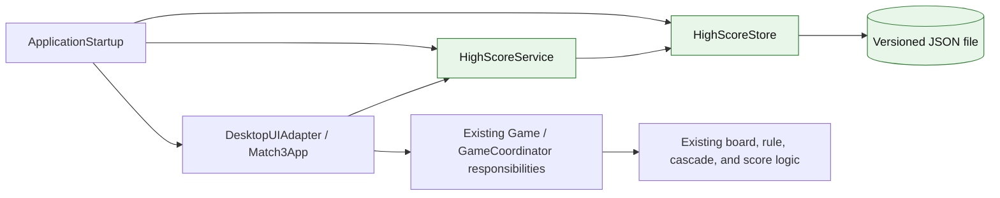
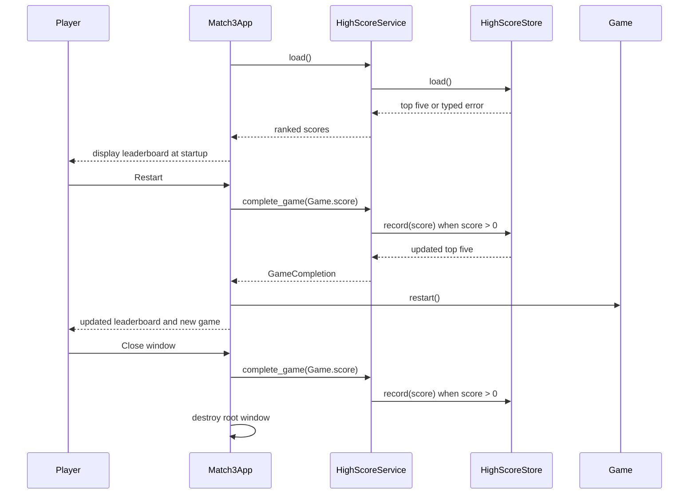

# Exercise 04 - Software Evolution and Integration

## Evolution baseline and decision

Exercise 4 starts from the completed Exercise 1 requirements, the Exercise 2 modular component architecture, and the Exercise 3 baseline of 26 passing automated tests. The existing system is a locally runnable, endless match-3 game. `match3.py` contains the GUI-independent gameplay behavior, while `main.py` contains the tkinter view/controller and startup.

This evolution adds a persistent top-five leaderboard without rewriting or refactoring the match-3 rules. The implementation uses a dedicated high-score component, injects it at startup, and adds lifecycle hooks at application start, Restart, and normal close. The gameplay module `match3.py` remains byte-for-byte unchanged.

## TODO 1 - Analyze Change Impact

### 1. Affected and new components

| Component or artifact | Change | Reason and impact |
| --- | --- | --- |
| `ApplicationStartup` in `main.py` | Modified | Constructs `HighScoreStore` and `HighScoreService` and injects the service into `Match3App`. It still owns no scoring rule or persistence policy. |
| `DesktopUIAdapter` / `Match3App` | Modified | Loads and renders the leaderboard, completes the current game before Restart or normal close, refreshes the displayed ranking, and reports recoverable storage failures. |
| Session lifecycle boundary | Clarified | The existing game is endless, so Exercise 4 defines one game as the interval from application start or Restart until the next Restart or normal window close. |
| `HighScoreService` | New | Owns the completed-game policy, cached leaderboard state, and zero-score exclusion. It exposes GUI-independent operations. |
| `HighScoreStore` | New | Owns versioned JSON validation, descending top-five ordering, duplicate retention, per-user file access, malformed-data recovery, and atomic replacement. |
| `match3.py` gameplay core | Unchanged | Board generation, legal moves, cascades, scoring, restart, and dead-board recovery do not need persistence knowledge. This reduces regression risk. |
| `README.md` | Modified | Documents completion semantics, leaderboard behavior, the storage path, recovery behavior, and the expanded validation command. |
| Automated tests | Extended | Adds persistence, ordering, boundary, recovery, failure, service-policy, path, and presentation-format tests while retaining all Exercise 3 tests. |

### 2. Interface changes

| Interface | Input | Output | Failure behavior |
| --- | --- | --- | --- |
| `HighScoreStore.load()` | None | Immutable descending tuple of at most five scores | Missing file returns an empty tuple; malformed or unreadable data raises a typed recoverable error. |
| `HighScoreStore.record(score)` | Non-negative integer score | Updated immutable top-five tuple | Malformed prior data is replaced by valid data; I/O failure raises `HighScoreStorageError`. |
| `HighScoreService.load()` | None | Cached leaderboard tuple | Propagates a typed high-score error for the UI boundary to translate. |
| `HighScoreService.complete_game(score)` | Current session score | `GameCompletion(scores, saved)` | Zero is not saved; positive scores are delegated to the store. |
| `Match3App(root, high_scores)` | Tk root and injected service | Ready GUI | No file path or JSON logic enters the GUI. |
| `format_leaderboard(scores)` | Ranked score tuple | User-facing leaderboard text | Empty input produces an explicit no-completed-games message. |

### 3. Data storage strategy

The selected strategy is a small local JSON file rather than a database. The feature has one user, one process, at most five integer values, and no query or migration need beyond a schema version. A database would add dependency and operational overhead without a matching benefit.

On Windows, the default path is:

```text
%LOCALAPPDATA%\Match3VibeGame\high_scores.json
```

If `LOCALAPPDATA` is unavailable, the fallback is `~/.match3-vibe-game/high_scores.json`. The stored document is:

```json
{
  "version": 1,
  "scores": [200, 120, 120, 80, 40]
}
```

Only non-negative integers are valid. Normal UI use records only positive completed games. Duplicate values are retained, ordering is descending, and only the first five values remain. The store writes a temporary file in the same directory, flushes it, and atomically replaces the destination so an interrupted update is less likely to corrupt the previous file.

### 4. Change risks and controls

| Risk | Control |
| --- | --- |
| Persistence accidentally changes gameplay rules | `match3.py` is not modified; all 26 Exercise 3 tests remain in the standard regression suite. |
| Endless play has no natural game-over event | Game completion is defined and documented as Restart or normal close. |
| Restart loses the current score before saving | `Match3App.restart` completes the game before calling `Game.restart`. |
| Closing loses the current score | A `WM_DELETE_WINDOW` handler completes the game before destroying the root window. |
| Empty sessions flood the ranking with zeros | `HighScoreService` does not persist a zero-point game. |
| Corrupt data prevents the game from starting | Startup displays an unavailable warning and gameplay continues; a later positive completion replaces malformed data. |
| Read/write failure crashes or blocks gameplay | Typed errors terminate at the UI boundary; Restart and close still complete. |
| A partial write destroys valid data | Same-directory temporary write plus `os.replace` provides atomic replacement on the supported environment. |
| Tests change the real user leaderboard | Every persistence test injects an isolated test path. |

## TODO 2 - Update Architecture

### 1. Architectural decision

Exercise 2 selected a modular component-based architecture with one-way dependencies and predicted persistent high-score storage as a future extension. Exercise 4 realizes that extension as a dedicated GUI-independent high-score component with two cohesive roles in one module:

- `HighScoreService` owns application-level completion policy and the in-memory ranking exposed to the UI.
- `HighScoreStore` is the JSON persistence adapter and owns file format, validation, ordering, limit, and atomic replacement.

Separating these roles prevents JSON and file-system details from entering `Match3App`, while avoiding an unnecessary general repository framework. The existing gameplay components do not depend on either new type.

### 2. Updated component model



Runtime dependency rules are now:

1. `ApplicationStartup` constructs the store, service, and UI adapter.
2. `DesktopUIAdapter` may request leaderboard loading and game completion through `HighScoreService`; it does not open files or interpret JSON.
3. `HighScoreService` depends only on `HighScoreStore` and domain-neutral integer scores.
4. `HighScoreStore` depends only on Python standard-library file and JSON APIs.
5. The existing game core has no dependency on the high-score component, tkinter, or the storage path.
6. No reverse call from persistence into the GUI or gameplay core is permitted.

The existing physical deviation noted in Exercise 3 remains: `Match3App` combines some UI and session-controller responsibilities and still constructs `Game`. Exercise 4 does not refactor that unrelated boundary because the assignment requires incremental change rather than a rewrite.

### 3. Lifecycle interactions



## TODO 3 - Refine Requirements

### 1. Resolved design choices

- The optional leaderboard is included because it gives observable evidence for loading, ordering, updating, and persistence.
- The ranking contains the five highest completed positive scores and no player names or identity data.
- Duplicate scores are separate results and remain in the leaderboard.
- A game ends on Restart or normal window close because the existing gameplay loop is endless.
- A missing file means no previous scores. It is not created until a positive score is completed.
- Malformed data must not block gameplay and may be replaced on the next successful positive-score completion.
- Other I/O failures preserve gameplay and produce a user-visible warning.
- There is no clear-scores UI in this exercise.

### 2. Functional requirements

| ID | Requirement | Verification |
| --- | --- | --- |
| E4-FR-01 | At application startup, the system shall load and display the stored leaderboard before the player begins normal interaction. | Store/service tests plus tkinter startup smoke check. |
| E4-FR-02 | The system shall treat Restart and normal window close as completion of the current game and shall attempt to record the current score before reset or process termination. | Service tests, code inspection, and tkinter Restart/close smoke check. |
| E4-FR-03 | The system shall record a completed positive integer score and shall not add a zero-point game to the leaderboard. | `HighScoreServiceTests`. |
| E4-FR-04 | The system shall sort scores in descending order, retain duplicate scores, and expose at most the five highest values. | Store ordering/limit test. |
| E4-FR-05 | The system shall persist leaderboard values across independent `HighScoreStore` instances. | Store reload test. |
| E4-FR-06 | If no high-score file exists, the system shall display an empty leaderboard and shall not create a file until a positive game is completed. | Missing-file and zero-game tests. |
| E4-FR-07 | If stored data is malformed or uses an unsupported schema, the system shall keep gameplay available and shall allow the next positive completed game to replace it with valid schema-version-1 data. | Malformed/schema tests and UI error handling inspection. |
| E4-FR-08 | If high-score data cannot be read or written, the system shall report the failure without changing match-3 rules or preventing Restart or normal close. | Injected read/replace failures and UI boundary inspection. |
| E4-FR-09 | The displayed leaderboard shall show an explicit empty state or numbered score positions in ranking order. | `LeaderboardPresentationTests` and tkinter startup/update smoke check. |

### 3. Non-functional and data requirements

| ID | Requirement | Verification |
| --- | --- | --- |
| E4-NFR-01 | The evolution shall be incremental: existing gameplay logic in `match3.py` shall not be rewritten for persistence. | File hash comparison and source diff. |
| E4-NFR-02 | A successful update shall be written through a same-directory temporary file followed by atomic replacement. | Source inspection and replace-failure cleanup test. |
| E4-NFR-03 | The feature shall use only the Python standard library and shall require no network service, account, or elevated privilege. | Dependency and source inspection. |
| E4-NFR-04 | Storage location shall be injectable so tests never depend on or modify the real user leaderboard. | Constructor/API inspection and isolated-path tests. |
| E4-NFR-05 | The persistence module shall not import tkinter or gameplay code. | Import inspection and standalone unit execution. |
| E4-DR-01 | The file shall be UTF-8 JSON with integer `version` equal to 1 and a `scores` list containing only non-negative integers. | Schema and invalid-value tests. |
| E4-DR-02 | On Windows, the default file shall be under `%LOCALAPPDATA%\Match3VibeGame`; if that environment value is absent, a per-user home-directory fallback shall be used. | Default-path test and source inspection. |

### 4. Requirement evolution from Exercise 1

| Earlier statement | Exercise 4 evolution |
| --- | --- |
| Persistent high scores were explicitly out of scope for the first prototype. | That scope boundary is intentionally superseded by the new Exercise 4 feature request. |
| NFR-12 prohibited persistent player or game-state data. | Revised: the application may create only the documented high-score JSON file and a transient same-directory update file; it still does not save the board, settings, account, or network data. |
| NFR-08 limited acceptance to the Exercise 1 baseline. | Revised: Exercise 4 adds only the approved persistence evolution while all existing baseline behavior remains regression scope. |
| Exercise 2 `ApplicationStartup` had no persistence responsibility. | Revised: startup may construct and inject the persistence adapter/service, but it still owns no storage policy or gameplay decision. |
| UR-08/NFR-05 maintainability was deferred. | The isolated high-score module and injected path partially realize that deferred quality goal without refactoring the whole game. |

## TODO 4 - Implement the Evolution

### 1. Incremental implementation summary

| File | Incremental change |
| --- | --- |
| `high_scores.py` | New dedicated component containing constants, typed errors, default-path selection, versioned JSON store, atomic update, `HighScoreService`, and `GameCompletion`. |
| `main.py` | Injects the service; adds leaderboard text; loads on startup; saves before Restart and normal close; maps typed persistence failures to player-facing warnings. |
| `tests/test_high_scores.py` | Adds 12 automated tests for the new behavior. |
| `README.md` | Updates user behavior, storage location, recovery rules, architecture note, and compile command. |
| `exercise04_evolution.md` | Records impact, architecture delta, requirements, implementation, tests, regression evidence, prompts, revisions, and reflection. |
| `match3.py` | No change. |
| Existing Exercise 3 tests | No deletion or weakening. |

### 2. Error and recovery behavior

- Missing file: return an empty leaderboard.
- Invalid UTF-8, invalid JSON, wrong schema version, or invalid score values: raise `HighScoreFormatError` on load; the GUI continues; `record` starts a fresh valid ranking.
- Read or write I/O failure: raise `HighScoreStorageError`; the GUI continues and reports the failure.
- Failed replacement: remove the temporary file when possible and retain the pre-existing destination.
- Invalid API input such as negative, boolean, text, or floating-point score: raise `ValueError`; normal UI code never supplies such a value.

This is a controlled extension rather than a rewrite: the feature is added through one new module and narrow lifecycle hooks, and it preserves the existing public gameplay behavior.

## TODO 5 - Extend the Test Suite

### 1. New automated coverage

| Test or group | Main behavior covered | Requirement IDs |
| --- | --- | --- |
| `test_default_path_uses_local_app_data` | Per-user Windows path | E4-DR-02 |
| `test_missing_file_loads_as_empty_without_creating_data` | First-run empty state | E4-FR-06 |
| `test_scores_persist_sort_descending_keep_duplicates_and_limit_to_five` | Save/load across instances, ordering, duplicates, limit, schema | E4-FR-04, E4-FR-05, E4-DR-01 |
| `test_malformed_file_is_reported_and_next_score_recovers_it` | Corrupt-data detection and recovery | E4-FR-07 |
| `test_unsupported_schema_and_invalid_scores_are_rejected` | Schema and value validation | E4-FR-07, E4-DR-01 |
| `test_invalid_score_and_limit_values_are_rejected` | API boundary validation | E4-DR-01 |
| `test_read_failure_is_reported_as_storage_error` | Read failure translation | E4-FR-08 |
| `test_failed_atomic_replace_removes_temporary_file` | Atomic-write failure and cleanup | E4-FR-08, E4-NFR-02 |
| `test_zero_point_game_is_not_added_to_existing_leaderboard` | Completion policy and no unnecessary write | E4-FR-03, E4-FR-06 |
| `test_positive_completed_game_updates_cached_and_persistent_scores` | Service/store integration | E4-FR-02, E4-FR-03, E4-FR-05 |
| `test_positive_game_recovers_after_malformed_startup_data` | End-to-end recovery through service | E4-FR-07 |
| `test_leaderboard_text_handles_empty_and_ranked_scores` | Empty and ranked presentation text | E4-FR-09 |

### 2. GUI integration smoke evidence

A real hidden tkinter root was used with an injected temporary store. The smoke check verified:

1. startup renders the explicit empty-leaderboard text;
2. a 150-point game is saved before Restart;
3. Restart resets the current score to zero and updates status and leaderboard text;
4. a later 90-point game is saved on normal close; and
5. the resulting persisted ranking is `(150, 90)`; and
6. a second application instance reloads and displays both stored scores at startup.

The smoke check uses temporary data and does not touch the user's real leaderboard. It verifies widget wiring and lifecycle calls, not visual aesthetics or human usability.

## TODO 6 - Perform Regression Testing

### 1. Executed evidence on 2026-11-01

| Check | Result |
| --- | --- |
| Pre-change Exercise 3 baseline | **Passed:** all 26 existing tests. |
| Post-change complete automated suite | **Passed:** 38 tests, including the unchanged 26-test regression set and 12 new tests. |
| Compilation | **Passed:** `python -m compileall -q main.py match3.py high_scores.py tests`. |
| Tkinter integration smoke | **Passed:** startup, Restart save/reset/display, normal-close save, and cross-instance reload using an isolated file. |
| Gameplay-core preservation | **Passed:** `match3.py` SHA-256 remained `D6DF8D536026B01C77168E4E18F2D4BA81163EA0AACB3508E5D375712EC6A8A9`. |

### 2. Regression assessment

| Regression concern | Evidence | Assessment |
| --- | --- | --- |
| Match detection, legal/illegal moves, gravity, refill, cascades, exact score, recovery, restart | All 26 prior tests still pass. | No automated regression found. |
| Core/GUI separation | `match3.py` unchanged; `high_scores.py` imports no tkinter or gameplay module. | Preserved and extended. |
| Restart behavior | Prior restart test passes; tkinter smoke confirms save-before-reset and zeroed new game. | Preserved with required pre-hook. |
| Normal close | Tkinter smoke confirms score save and root destruction. | New lifecycle behavior works in the tested environment. |
| First launch | Missing-file test and tkinter startup smoke pass. | Empty leaderboard works without creating data. |
| Corrupt or unavailable storage | Focused store/service tests pass; GUI catches typed errors. | Gameplay remains available; user-data recovery policy is explicit. |

No full visual inspection of the new leaderboard row was performed in this automated run. A final human acceptance pass should confirm that the top-five line remains readable at the supported display scaling and that warning wording is understandable. This remaining presentation check does not weaken the automated gameplay or persistence evidence.

## TODO 7 - Reflect on the Full Workflow

### Requirements to evolution

Across the four exercises, the project followed the sequence requirements -> architecture -> implementation -> testing -> evolution. Exercise 1 converted a vague match-3 idea into traceable behavior and acceptance criteria. Exercise 2 separated logical responsibilities and explicitly anticipated high-score persistence as a future adapter or service. Exercise 3 established a deterministic regression baseline and documented structural deviations instead of refactoring them without need. Exercise 4 then used that evidence to add one bounded feature while keeping the core stable.

The most important evolution decision was not the JSON syntax; it was defining when an endless game is complete. Once Restart and normal close were selected as the lifecycle boundaries, the architecture, UI hooks, requirements, and tests became concrete and mutually checkable.

### Where the LLM-assisted workflow helped

- Recovering and cross-checking the requirements, architecture, implementation, and tests from three earlier exercises.
- Turning ambiguous feature language into explicit choices about session completion, ranking size, duplicates, zero scores, storage location, malformed data, and I/O failure.
- Performing change-impact analysis before editing code.
- Generating a narrow module and test matrix while preserving the gameplay core.
- Re-running baseline, feature, compile, and GUI smoke checks and connecting each result to a requirement.
- Maintaining the documentation, code, and verification evidence as one change set.

### Where human judgment remained necessary

- Deciding that Restart and close are acceptable game-completion events for an endless prototype.
- Choosing top five without player names, which balances the optional leaderboard request against privacy and scope.
- Accepting local per-user JSON instead of a project file, database, cloud service, or account system.
- Deciding that malformed data may be replaced after warning, while ordinary unreadable storage should not be overwritten blindly.
- Preserving known structural deviations rather than expanding Exercise 4 into a risky architecture migration.
- Determining that visual aesthetics still need human review even though widget integration can be smoked automatically.

### Typical failure modes of AI-assisted evolution

- Rewriting working code because a cleaner greenfield design is easier to generate than an incremental patch.
- Adding persistence directly to `Game` and coupling domain logic to file paths or JSON.
- Treating application close as a reliable save point without adding an explicit close handler.
- Saving after `Game.restart`, which would persist zero instead of the completed score.
- Declaring success from new tests while not re-running the old suite.
- Using the real user file in tests and polluting or deleting personal scores.
- Hiding a requirement ambiguity, such as game completion, behind an arbitrary implementation choice.
- Overstating a hidden-window smoke check as a visual usability test.

The final result demonstrates controlled evolution: the requirement change is explicit, the architecture has a bounded persistence component, the implementation is incremental, the new behavior is tested at its failure boundaries, and the original gameplay remains protected by the complete regression suite.

## Prompt and Revision Log

### Prompt 1 - Exercise request

> Continue the Vibe Coding with LLMs course project from Exercises 1, 2, and 3 and complete Exercise 4 using the attached assignment.

Result: recovered the existing repository and prior artifacts, read the complete Exercise 4 assignment, and established the 26-test baseline before editing.

### Prompt 2 - Change-impact and architecture question

> Analyze how a persistent high-score system affects the existing architecture. Identify affected and new components, interface changes, storage strategy, and the smallest incremental integration.

Result: selected a dedicated high-score service/store boundary, kept gameplay unchanged, and limited UI edits to startup, Restart, close, and display behavior.

### Prompt 3 - Requirements refinement

> Write precise, testable requirements for loading, displaying, updating, sorting, limiting, and recovering persistent scores in an endless local game.

Result: resolved the game-end ambiguity, top-five and duplicate policy, zero-score rule, per-user JSON path, schema, atomic update, and failure behavior.

### Prompt 4 - Implementation and tests

> Extend this codebase incrementally with the new component. Do not rewrite the match-3 logic. Add isolated tests for save/load, ordering, limits, malformed data, I/O failures, service policy, and presentation formatting, then run all prior tests.

Result: added `high_scores.py`, narrow `main.py` hooks, 12 new tests, documentation, and complete regression evidence.

### Revisions made after evidence

1. The first persistence-test run used the operating system's default temporary directory. The managed execution environment denied writes there, producing environment errors rather than product failures. Test fixtures were revised to create isolated temporary directories under the writable test directory; all 38 tests then passed.
2. Malformed data was separated from ordinary I/O failure. A malformed file can be replaced on the next positive completion, but an unreadable file is not overwritten blindly.
3. The GUI check was described as a hidden-window integration smoke check, not as visual acceptance, to avoid overstating the evidence.
