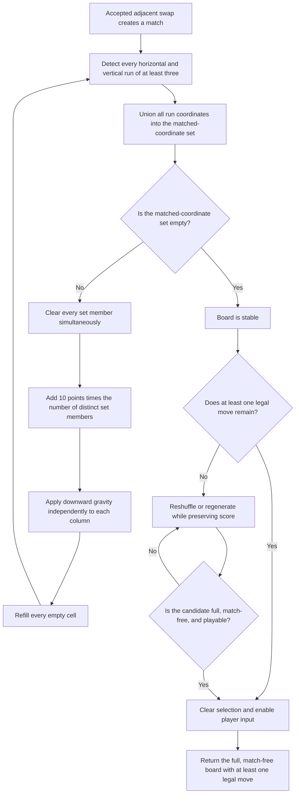

# Exercise 1: Requirements Engineering

## TODO 1: Clarify the Problem Context

### 1. Ambiguous or underspecified aspects

The phrase **"a basic locally runnable match-3 game"** does not fully define the product. The following aspects need clarification:

- The target operating system, required Python version, and permitted third-party libraries are not specified.
- "Locally runnable" could mean a desktop application, a browser application served from the local machine, or a terminal program.
- The intended player and expected session length are unknown.
- The board dimensions, number of tile types, and visual style are unspecified.
- The rules for a legal swap are unclear, including whether swaps that create no match should be rejected or reversed.
- Match detection is not fully defined: horizontal versus vertical matches, runs longer than three, and intersecting matches all need explicit behavior.
- The order of clearing, gravity, refilling, and cascade resolution is unspecified.
- It is unclear whether the initial board may contain matches or have no possible moves.
- There is no defined scoring system, move limit, timer, win condition, or loss condition.
- Input, feedback, restart behavior, sound, accessibility, and error handling requirements are not stated.

### 2. Hidden assumptions

Unless later requirements replace them, the first prototype assumes that:

- One person plays offline on a single computer using a mouse.
- The game does not require an account, network connection, server, installation service, or persistent data.
- The player swaps two orthogonally adjacent tiles; diagonal swaps are not allowed.
- A swap is valid only when it produces at least one horizontal or vertical run of three or more identical tiles. An invalid swap leaves the board unchanged and does not consume a move.
- All matches created in one resolution step are cleared together. Tiles then fall downward, empty cells are refilled, and new matches are resolved repeatedly until the board is stable.
- A run longer than three and every distinct cell in an intersecting match are cleared, with an intersecting cell counted only once for scoring.
- The game generates a starting board with no existing matches and at least one legal move.
- Random results do not need to be identical between normal play sessions, although deterministic randomness may be used for testing.
- Simple shapes, colors, and text are sufficient; polished art and audio are not required to prove the gameplay.

### 3. Unresolved design choices

The following choices remain open for later requirements or implementation planning:

- Desktop GUI framework and exact supported platforms.
- Final board size, tile set, color palette, typography, and window dimensions.
- Final scoring balance and whether cascades receive a multiplier.
- Whether the finished game uses a move limit, timer, score target, levels, or endless play.
- How a board with no legal moves is handled: reshuffle, regenerate, or end the session.
- Whether hints, animations, sound effects, keyboard/touch controls, and accessibility options are needed.
- Whether player settings, high scores, or saved sessions persist between runs.

These choices should not prevent the first prototype from using the temporary baseline defined below.

### 4. Development goal for the first playable prototype

Build a single-screen, offline desktop prototype that can be launched locally and supports one complete match-3 play loop. For this prototype, use an 8 x 8 board with six visually distinct tile types, mouse selection, orthogonally adjacent swaps, and the match-resolution rules stated above. Award 10 points for each distinct tile cleared. The session is endless; it displays the current score and provides a restart control. If the stable board has no legal move, it is reshuffled or regenerated into a valid board.

The prototype is complete when all of the following can be demonstrated:

1. Launching the documented local command opens a usable game screen without requiring a network connection.
2. The initial 8 x 8 board contains no pre-existing match and has at least one legal move.
3. A non-adjacent or diagonal selection cannot be swapped.
4. An adjacent swap that creates no match leaves the board unchanged and does not change the score.
5. A valid swap clears every resulting horizontal and vertical run of at least three tiles.
6. Cleared spaces are filled by downward gravity and new tiles, and cascades continue until no matches remain.
7. The score increases by exactly 10 points per distinct cleared tile across the initial match and any cascades.
8. Play can continue after each resolved move, including after recovery from a board with no legal moves.
9. Restart creates a fresh valid board and resets the score to zero.

### 5. Explicitly out of scope

The first playable prototype will not include:

- Online play, multiplayer, leaderboards, accounts, cloud saves, analytics, or advertisements.
- Mobile or web deployment, touch controls, or gamepad support.
- Multiple levels, a campaign, narrative, tutorials, achievements, daily challenges, or difficulty modes.
- Special tiles, power-ups, blockers, obstacles, lives, boosters, or in-app purchases.
- Production-quality artwork, complex animation, particles, music, voice acting, or a full sound system.
- Persistent settings, saved games, or high-score storage.
- Localization or a complete accessibility suite beyond keeping the six tile types visually distinguishable.
- Packaging, an installer, automatic updates, or distribution through an application store.
- Automated strategy, opponent AI, or a hint system.

## TODO 2: Identify Stakeholders and Elicit Needs

### 1. Stakeholder analysis

#### Player

**Interests**

- Enjoying a recognizable and satisfying match-3 play loop.
- Understanding the board, available actions, score, and results of each action.
- Starting and restarting a game with little effort.

**Expectations**

- Tile selection and swapping feel clear and responsive.
- Valid matches, invalid moves, cascades, scoring, and board recovery behave consistently.
- Tiles are visually distinguishable and the game provides enough feedback to understand what happened.
- The game remains playable without an internet connection.

**Constraints**

- The player may have no prior knowledge of this particular game.
- The player uses the input devices and display available on the local computer.
- The player should not need an account, server, or complicated setup.
- Differences in vision, display quality, or window size may make color-only distinctions difficult.

#### Developer

**Interests**

- Delivering the first playable prototype within limited time and scope.
- Translating the agreed match-3 behavior into logic that can be tested and debugged.
- Keeping gameplay rules separate enough from presentation details to support safe changes.

**Expectations**

- The prototype scope, gameplay terms, and completion criteria are unambiguous.
- Important cases such as intersecting matches, cascades, invalid swaps, and boards with no legal moves have defined outcomes.
- Failures can be reproduced and diagnosed without depending entirely on random play.
- Dependencies and setup steps remain minimal and documented.

**Constraints**

- The developer must work within the available language, libraries, tools, and schedule.
- Random board generation creates edge cases that may be difficult to reproduce.
- A prototype should avoid architecture or features that are unnecessary for its stated goal.
- Implementation choices must remain compatible with the intended local runtime.

#### Maintainer

**Interests**

- Understanding and changing the game safely after the first implementation.
- Locating defects quickly and avoiding regressions in core gameplay.
- Updating dependencies or runtime versions with limited effort.

**Expectations**

- Code responsibilities, gameplay rules, setup, and execution steps are understandable and documented.
- Core behavior can be checked independently of visual presentation where practical.
- Constants and configurable values are not unnecessarily duplicated throughout the implementation.
- Failures are reported clearly enough to support diagnosis.

**Constraints**

- The maintainer may not be the original developer.
- Future maintenance time and knowledge of undocumented decisions may be limited.
- Changes to the runtime or external libraries may introduce compatibility problems.

#### Platform/runtime environment

This is a supporting technical stakeholder representing the local computer, operating system, language runtime, display system, and installed dependencies on which the game relies.

**Interests**

- Running the game within available CPU, memory, display, input, and storage resources.
- Loading only compatible, available dependencies.
- Starting and stopping without damaging the host environment.

**Expectations**

- The game has a documented launch method and supported runtime configuration.
- Normal play does not require network access, elevated privileges, or external services.
- Input events, rendering, and game-state updates are handled promptly.
- The program exits cleanly and handles foreseeable startup problems in an understandable way.

**Constraints**

- Runtime versions, operating systems, screen sizes, permissions, and dependency availability may vary.
- Local machines may have modest processing power and memory.
- The environment cannot compensate for missing dependencies or undocumented setup steps.
- Platform-specific behavior may limit portability unless supported environments are deliberately chosen.

### 2. Initial stakeholder needs

The following statements are elicited stakeholder needs, not yet formal system requirements. **Explicit** needs follow directly from stated stakeholder expectations or the prototype context. **Implicit** needs are necessary to support those expectations even when a stakeholder may not request them directly. Later requirements work should refine, prioritize, and make them fully measurable.

| ID | Type | Source stakeholder | Concern | Stakeholder need |
| --- | --- | --- | --- | --- |
| NEED-01 | Explicit | Player | Gameplay | The player needs to select and attempt swaps between tiles using simple, understandable controls. |
| NEED-02 | Explicit | Player | Gameplay | The player needs valid matches, clearing, gravity, refilling, cascades, and scoring to follow consistent rules. |
| NEED-03 | Explicit | Player | Usability | The player needs clear visual feedback for selection, accepted moves, rejected moves, board changes, and score changes. |
| NEED-04 | Implicit | Player | Usability | The player needs tile types to remain distinguishable without relying only on subtle color differences. |
| NEED-05 | Explicit | Player | Usability | The player needs to see the current score and restart play without restarting the entire application. |
| NEED-06 | Implicit | Player | Reliability | The player needs the game to remain recoverable and playable when the board has no legal move. |
| NEED-07 | Explicit | Player | Local execution | The player needs to launch and play the game offline on the supported local computer without an account or external service. |
| NEED-08 | Explicit | Developer | Gameplay | The developer needs agreed outcomes for invalid swaps, long and intersecting matches, cascades, initial boards, and boards with no legal moves. |
| NEED-09 | Implicit | Developer | Reliability | The developer needs controllable or reproducible game states so edge cases and reported defects can be investigated. |
| NEED-10 | Explicit | Developer | Maintainability | The developer needs a bounded prototype scope and a clear separation between core game behavior and presentation concerns. |
| NEED-11 | Explicit | Developer | Local execution | The developer needs a small, documented dependency and setup footprint compatible with the selected local runtime. |
| NEED-12 | Explicit | Maintainer | Maintainability | The maintainer needs readable structure and documentation for setup, launch, gameplay rules, and important design decisions. |
| NEED-13 | Implicit | Maintainer | Maintainability | The maintainer needs central definitions for changeable gameplay values so routine changes do not require scattered edits. |
| NEED-14 | Explicit | Maintainer | Reliability | The maintainer needs practical checks for core gameplay behavior so changes can be made without silently breaking established behavior. |
| NEED-15 | Implicit | Maintainer | Reliability | The maintainer needs understandable diagnostic information when startup or gameplay processing fails. |
| NEED-16 | Explicit | Platform/runtime environment | Local execution | The local environment needs a documented, compatible runtime configuration and launch method. |
| NEED-17 | Implicit | Platform/runtime environment | Performance | The local environment needs the game to keep input and visual updates responsive during ordinary play on modest hardware. |
| NEED-18 | Implicit | Platform/runtime environment | Performance | The local environment needs board generation and cascade resolution to finish without unbounded processing or excessive resource use. |
| NEED-19 | Explicit | Platform/runtime environment | Reliability | The local environment needs the game to start and exit cleanly without elevated privileges, network availability, or unintended changes outside the game process. |
| NEED-20 | Implicit | Developer; Maintainer; Platform/runtime environment | Portability | The involved technical stakeholders need supported platforms and runtime versions to be identified so compatibility can be evaluated and maintained. |

## TODO 3: Transform Needs into Structured Requirements

### 1. User requirements

User requirements express the outcomes that stakeholders need in language that can be reviewed without reference to an implementation. They remain consistent with the first playable prototype defined in TODO 1.

| ID | Category | Requirement statement | Source need IDs | Verification method |
| --- | --- | --- | --- | --- |
| UR-01 | Player interaction | The player must be able to select tiles and attempt swaps with clear, simple mouse controls. | NEED-01, NEED-03 | Acceptance demonstration using the game screen. |
| UR-02 | Core gameplay | The player must receive a consistent match-3 loop covering valid and invalid swaps, clearing, gravity, refilling, cascades, and scoring. | NEED-02, NEED-08 | Scenario-based acceptance test using controlled board states. |
| UR-03 | Visual usability | The player must be able to distinguish tile types and understand selections, accepted actions, rejected actions, and resulting board changes. | NEED-03, NEED-04 | Visual inspection and usability test. |
| UR-04 | Session control | The player must be able to view the current score and start a fresh session without relaunching the application. | NEED-05 | Acceptance demonstration of scoring and restart. |
| UR-05 | Continuity of play | The player must be able to continue an endless session after each resolved move, including when the board reaches a state with no legal move. | NEED-06 | Acceptance test with a controlled dead-board state. |
| UR-06 | Local execution | The player must be able to launch, play, and close the prototype on a documented supported local environment without an account, network connection, external service, or elevated privileges. | NEED-07, NEED-11, NEED-16, NEED-19, NEED-20 | Installation and execution test in a disconnected, standard-permission environment. |
| UR-07 | Development assurance | The developer must be able to reproduce important game states and check core gameplay behavior after changes. | NEED-09, NEED-14 | Inspection and execution of deterministic test scenarios. |
| UR-08 | Maintenance support | A maintainer must be able to understand the project, locate changeable gameplay values, diagnose failures, and modify core behavior without unnecessary changes to presentation code. | NEED-10, NEED-12, NEED-13, NEED-15 | Documentation and architecture review followed by a small change exercise. |
| UR-09 | Responsiveness | The player must receive prompt input feedback, and ordinary board generation and resolution must not interrupt play with excessive delays. | NEED-17, NEED-18 | Timed acceptance and stress tests on the documented reference environment. |

### 2. System requirements

#### 2.1 Functional requirements

| ID | Category | Requirement statement | Source need IDs | Verification method |
| --- | --- | --- | --- | --- |
| FR-01 | Session initialization | The system shall create an 8 x 8 board containing exactly six tile types at the start of every session. Before accepting input, that board shall contain no existing match and at least one legal move. | NEED-02, NEED-06, NEED-08 | Automated initialization tests across controlled random seeds, plus board-state inspection. |
| FR-02 | Tile input | The system shall allow the player to select a tile with the mouse and attempt a swap only with a horizontally or vertically adjacent tile. | NEED-01, NEED-08 | GUI acceptance tests for each orthogonal direction. |
| FR-03 | Invalid selection | The system shall reject attempts to swap diagonal, non-adjacent, or out-of-board positions without changing the board or score. | NEED-01, NEED-03, NEED-08 | Automated and GUI tests comparing state before and after invalid attempts. |
| FR-04 | Matchless swap | The system shall reject an adjacent swap that creates no match, leaving the board and score unchanged. | NEED-02, NEED-03, NEED-08 | Automated test using a controlled board with a known matchless swap. |
| FR-05 | Match processing | After a valid swap, the system shall identify and clear all matched cells in the current resolution step according to DR-02. | NEED-02, NEED-08 | Automated tests for horizontal, vertical, long, simultaneous, and intersecting matches. |
| FR-06 | Board resolution | After clearing matched cells, the system shall apply downward gravity, refill every empty cell, and repeat match processing until the board is stable. | NEED-02, NEED-08, NEED-18 | Automated cascade tests using controlled board states and tile sequences. |
| FR-07 | Scoring | The system shall initialize the score to zero, add 10 points for each distinct cleared tile in every resolution step, and display the updated score after each step. | NEED-02, NEED-05, NEED-08 | Automated score calculations and GUI display checks for simple, long, intersecting, and cascading matches. |
| FR-08 | Dead-board recovery | When a stable board has no legal move, the system shall reshuffle or regenerate it before accepting further input. The recovered board shall meet DR-04, and recovery shall not change the score. | NEED-06, NEED-08 | Automated test that injects a dead board and validates the recovered state and unchanged score. |
| FR-09 | Gameplay feedback | The system shall visibly indicate the selected tile and whether an attempted move was rejected; accepted moves shall result in a visibly updated board. | NEED-03, NEED-04 | GUI inspection covering selection, rejection, and acceptance scenarios. |
| FR-10 | Restart | The system shall provide a restart control that sets the score to zero and creates a fresh board satisfying FR-01 without restarting the process. | NEED-05, NEED-06 | GUI acceptance test after scoring points and invoking restart. |
| FR-11 | Reproducible test state | The system shall provide a developer-only mechanism to use a fixed random seed or predefined board and refill sequence during automated testing. This mechanism shall not be required during normal play. | NEED-09, NEED-14 | Inspection and repeated test runs showing identical states and outcomes from identical test inputs. |

#### 2.2 Non-functional requirements

The non-functional requirements are categorized as **Product**, **Organizational**, or **External**. Product requirements constrain qualities of the delivered prototype; organizational requirements constrain project practices and artifacts; external requirements constrain interaction with the execution environment.

| ID | Subcategory | Requirement statement | Source need IDs | Verification method |
| --- | --- | --- | --- | --- |
| NFR-01 | Product — Usability | The system shall represent each of the six tile types with a distinct shape, symbol, or pattern in addition to any color difference, so color alone is not required to distinguish tiles. | NEED-03, NEED-04 | Visual inspection of all six tile types, including a grayscale view. |
| NFR-02 | Product — Performance | On the documented reference environment, the system shall display selection or rejection feedback within 100 milliseconds of a mouse action during a stable-board state. | NEED-17 | Instrumented response-time test over 100 input actions. |
| NFR-03 | Product — Performance | On the documented reference environment, initial board generation, dead-board recovery, and the non-visual processing for one complete cascade shall each finish within two seconds. | NEED-06, NEED-18 | Timed automated tests over a documented set of normal and worst-case controlled states. |
| NFR-04 | Product — Reliability | The system shall complete 1,000 controlled board-generation and resolution scenarios without an uncaught exception, unresolved empty cell, pre-existing match on a returned stable board, or stable board with no legal move. | NEED-14, NEED-18 | Automated stress test with recorded seeds and assertions. |
| NFR-05 | Product — Maintainability | The implementation shall separate core board and scoring logic from graphical input and rendering, and shall define board size, tile count, and points per tile once as named configuration values. | NEED-10, NEED-12, NEED-13 | Static code inspection and a change-impact exercise for each named value. |
| NFR-06 | Organizational — Documentation | Project documentation shall identify setup steps, the launch command, dependencies, supported operating system and runtime versions, gameplay rules, test command, and important design decisions. | NEED-11, NEED-12, NEED-16, NEED-20 | Documentation checklist review performed from a clean local setup. |
| NFR-07 | Organizational — Verification | The project shall include repeatable automated checks for initialization, legal and illegal swaps, long and intersecting matches, cascades, scoring, dead-board recovery, restart, and deterministic test setup. | NEED-09, NEED-14 | Execute the documented automated test command and inspect the reported cases. |
| NFR-08 | Organizational — Scope control | The prototype implementation and acceptance evidence shall be limited to the baseline and completion criteria in TODO 1; features explicitly listed there as out of scope shall not be required for acceptance. | NEED-10 | Scope review of implemented features and acceptance evidence against TODO 1. |
| NFR-09 | External — Offline operation | The system shall support normal play with networking disabled and shall not require an account, external service, or elevated operating-system privileges. | NEED-07, NEED-19 | Launch-and-play test with networking disabled under a standard user account. |
| NFR-10 | External — Compatibility | The system shall launch and complete the prototype acceptance scenarios on at least one explicitly documented desktop operating-system and runtime-version combination. | NEED-11, NEED-16, NEED-20 | Execute all acceptance scenarios on the documented supported combination. |
| NFR-11 | External — Startup diagnostics | If a required dependency is missing or the runtime version is unsupported, the launch attempt shall stop safely and present a message that identifies the missing or incompatible prerequisite. | NEED-15, NEED-16 | Negative launch tests with one prerequisite removed or replaced at a time. |
| NFR-12 | External — Host integrity | During normal play, the system shall not create persistent player or game-state data and shall not modify application-owned files outside its project directory; operating-system and runtime temporary artifacts are excluded. | NEED-07, NEED-19 | File-system snapshot comparison before and after a play session. |
| NFR-13 | Product — Reliability | When the player closes the game normally, the process shall terminate within two seconds without an uncaught exception or a remaining game process. | NEED-19 | Timed close test with process and error-output inspection. |

#### 2.3 Domain-specific requirements

These requirements capture rules inherent to the selected match-3 domain and define terms used by the functional requirements.

| ID | Category | Requirement statement | Source need IDs | Verification method |
| --- | --- | --- | --- | --- |
| DR-01 | Match-3 move rule | The system shall treat a swap as a legal move only when it exchanges two orthogonally adjacent tiles and the exchange creates at least one horizontal or vertical match. | NEED-01, NEED-02, NEED-08 | Table-driven tests covering legal, diagonal, non-adjacent, and matchless swaps. |
| DR-02 | Match definition | The system shall define a match as a contiguous horizontal or vertical run of at least three tiles of the same type. Runs longer than three shall be included in full, simultaneous matches shall all be included, and a cell at an intersection shall be included only once in that resolution step. | NEED-02, NEED-08 | Controlled-board tests for runs of three, four, and five; simultaneous runs; and T- or L-shaped intersections. |
| DR-03 | Resolution order | The system shall resolve a step in this order: clear all current matches simultaneously, score each distinct cleared cell once, move remaining tiles downward, refill empty cells, and then search again. The cycle shall repeat until no match remains. | NEED-02, NEED-08, NEED-18 | State-by-state automated cascade test with a predefined refill sequence. |
| DR-04 | Playable stable board | The system shall consider a board ready for player input only when all 64 cells are occupied, no match exists, and at least one legal move exists. | NEED-06, NEED-08 | Automated board predicate tests using valid, matched, incomplete, and dead boards. |
| DR-05 | Dead-board rule | The system shall treat a stable board with no legal move as a dead board requiring recovery rather than as the end of the endless prototype session. | NEED-06, NEED-08 | Controlled dead-board test followed by a continuity-of-play check. |
| DR-06 | Prototype scoring rule | The system shall award exactly 10 points per distinct tile cleared, with no cascade multiplier or special-tile bonus in the prototype. | NEED-02, NEED-05, NEED-08 | Score calculation tests across multiple match sizes and cascade depths. |

### 3. Traceability matrix

Every stakeholder need from TODO 2 maps to at least one user or system requirement. The matrix lists the principal derived requirements; additional supporting links are retained in the source columns above.

| Need ID | Derived requirement IDs |
| --- | --- |
| NEED-01 | UR-01, FR-02, FR-03, DR-01 |
| NEED-02 | UR-02, FR-01, FR-04, FR-05, FR-06, FR-07, DR-01, DR-02, DR-03, DR-06 |
| NEED-03 | UR-01, UR-03, FR-03, FR-04, FR-09, NFR-01 |
| NEED-04 | UR-03, FR-09, NFR-01 |
| NEED-05 | UR-04, FR-07, FR-10, DR-06 |
| NEED-06 | UR-05, FR-01, FR-08, FR-10, NFR-03, DR-04, DR-05 |
| NEED-07 | UR-06, NFR-09, NFR-12 |
| NEED-08 | UR-02, FR-01, FR-02, FR-03, FR-04, FR-05, FR-06, FR-07, FR-08, DR-01, DR-02, DR-03, DR-04, DR-05, DR-06 |
| NEED-09 | UR-07, FR-11, NFR-07 |
| NEED-10 | UR-08, NFR-05, NFR-08 |
| NEED-11 | UR-06, NFR-06, NFR-10 |
| NEED-12 | UR-08, NFR-05, NFR-06 |
| NEED-13 | UR-08, NFR-05 |
| NEED-14 | UR-07, FR-11, NFR-04, NFR-07 |
| NEED-15 | UR-08, NFR-11 |
| NEED-16 | UR-06, NFR-06, NFR-10, NFR-11 |
| NEED-17 | UR-09, NFR-02 |
| NEED-18 | UR-09, FR-06, NFR-03, NFR-04, DR-03 |
| NEED-19 | UR-06, NFR-09, NFR-12, NFR-13 |
| NEED-20 | UR-06, NFR-06, NFR-10 |

### 4. Overlaps, dependencies, and possible conflicts

#### Overlaps

- UR-01 through UR-09 state stakeholder-visible outcomes, while the FR, NFR, and DR entries refine those outcomes into verifiable system behavior. This is intentional refinement, not duplicate scope.
- FR-02 through FR-08 overlap with DR-01 through DR-06. The DR entries define the match-3 vocabulary and invariant rules; the FR entries define when the system applies those rules and what externally observable behavior results.
- NFR-06 and NFR-10 both refer to the supported environment. NFR-06 requires it to be documented, while NFR-10 requires the prototype to work on it.
- FR-11 and NFR-07 both support repeatable testing. FR-11 supplies controllable state; NFR-07 requires checks that use that capability.

#### Dependencies

- FR-01, FR-08, and FR-10 depend on the playable-board invariant in DR-04.
- FR-04 and FR-05 depend on the legal-move and match definitions in DR-01 and DR-02.
- FR-06 and FR-07 depend on the resolution order in DR-03 and the scoring rule in DR-06.
- NFR-02 and NFR-03 depend on NFR-06 identifying a reference environment on which timing is measured.
- NFR-04 and NFR-07 depend on FR-11 so randomized edge cases can be repeated.
- UR-06 depends jointly on documentation, compatibility, offline operation, host integrity, and clean shutdown rather than on a single system requirement.

#### Possible conflicts and resolutions

- **Random play versus reproducible testing:** Normal sessions may remain random, while FR-11 permits fixed seeds or predefined states only for development and automated verification. This preserves player variability without sacrificing defect reproduction.
- **Dead-board behavior versus an endless session:** TODO 1 allowed reshuffling or regeneration. FR-08 retains that implementation choice but fixes the observable outcome: the score is preserved and the replacement board is stable and playable.
- **Responsiveness versus visual effects:** Complex animation is out of scope. NFR-02 measures immediate input feedback, and NFR-03 measures non-visual board processing, so optional presentation delays cannot hide slow logic or violate the prototype scope.
- **Maintainable separation versus limited prototype effort:** NFR-05 requires only separation of core logic from the GUI and centralized baseline values. It does not require a large framework or speculative extension points.
- **Portability versus an unspecified target platform:** Universal portability is not assumed. NFR-06 and NFR-10 resolve the ambiguity by requiring at least one explicit supported desktop OS/runtime combination to be documented and verified before acceptance.
- **Diagnostic output versus no persistent data:** NFR-11 requires an understandable on-screen or console message, not a persistent log file. This remains compatible with NFR-12 and TODO 1's exclusion of saved data.
- **Stress-test termination versus random cascades:** NFR-03 and NFR-04 require bounded, successful processing. An implementation may control refills or regenerate an exceptional state, but it may not hang, return an incomplete board, or accept input on an invalid board.

## TODO 4: Validate and Prioritize Requirements

### 1. Validation criteria

Each requirement from TODO 3 is evaluated against the following criteria:

- **Measurability:** The requirement has an observable outcome or a practical inspection, test, demonstration, or analysis method.
- **Completeness:** The statement contains enough information to verify the intended behavior and is supported by the surrounding requirements where necessary.
- **Correctness:** The statement reflects its source stakeholder needs and the prototype baseline in TODO 1.
- **Consistency:** The statement does not contradict another requirement, the baseline, or an explicitly out-of-scope decision.
- **Unambiguity:** Important terms have one intended interpretation, or the validated interpretation is recorded below.
- **Feasibility:** The requirement can reasonably be implemented and verified for a small local prototype.
- **Traceability:** The requirement names valid source needs, and every source need remains represented in the NEED-to-requirement matrix.

The validation results use **Pass** when the requirement is acceptable as written, **Pass with clarification** when TODO 4 must fix an interpretation without rewriting TODO 3, **Pass with dependency** when the requirement is testable through another identified requirement, and **Deferred** when the requirement is valid but intentionally excluded from the first prototype.

### 2. Systematic validation and prioritization

The MoSCoW labels apply only to the first playable prototype: **Must have** is required for the TODO 6 implementation and acceptance; **Should have** is valuable but may follow the first playable build; **Could have** is optional if time permits; and **Won't have for this prototype** is explicitly deferred beyond the prototype.

| Requirement ID | Validation result | Issue or risk found | Resolution or justification | MoSCoW priority | Priority rationale |
| --- | --- | --- | --- | --- | --- |
| UR-01 | Pass with clarification | "Clear" and "simple" are subjective in isolation. | Interpret this through FR-02, FR-03, and FR-09: mouse selection, orthogonal swaps, safe rejection, and visible feedback constitute the minimum clear interaction. | Must have | The player cannot complete the game loop without selecting and swapping tiles. |
| UR-02 | Pass with dependency | "Consistent" is broad, and this requirement summarizes several behaviors. | FR-04 through FR-07 and DR-01 through DR-03 define the exact behavior and verification cases. | Must have | This is the central match-3 gameplay loop. |
| UR-03 | Pass with clarification | "Understand" is subjective, and visual distinction could otherwise rely on color alone. | Interpret success as identifying all six tile types and recognizing selection, rejection, and accepted board changes; FR-09 and NFR-01 make this observable. | Must have | A playable board requires understandable tiles and action feedback. |
| UR-04 | Pass | The score and fresh-session outcome are observable and fully refined by FR-07 and FR-10. | No correction is needed. | Must have | Score visibility and restart are explicit parts of the TODO 1 baseline. |
| UR-05 | Pass with clarification | "Endless" could be misread as a guarantee of unlimited resources or run time. | It means there is no level, move-limit, timer, or dead-board ending; play continues until the player restarts or closes the application. | Must have | Dead-board recovery is necessary to preserve the baseline's continuing play loop. |
| UR-06 | Pass with dependency | The supported local environment is not named in TODO 3. | NFR-06 and NFR-10 require one desktop OS/runtime combination and its launch procedure to be named and verified before acceptance. | Must have | Local, offline execution is the primary delivery constraint. |
| UR-07 | Pass with clarification | "Important game states" is vague. | Use the explicit state list in NFR-07 and the deterministic mechanism in FR-11 as the validated scope. | Must have | Repeatable checks are needed to establish that the implemented core loop follows the specification. |
| UR-08 | Pass with clarification | "Understand," "unnecessary changes," and the size of a change exercise are subjective. | For later verification, use NFR-05 and NFR-06: documented setup and rules, separated core/UI responsibilities, and one source for baseline values. | Should have | Maintainability matters, but full maintenance validation is not required to demonstrate the first playable loop. |
| UR-09 | Pass with dependency | "Prompt" and "excessive delays" are not measurable here. | NFR-02 and NFR-03 provide the timing thresholds and reference-environment dependency. | Must have | A loop that does not respond or settle promptly is not meaningfully playable. |
| FR-01 | Pass with dependency | "Legal move" and "existing match" depend on domain definitions. | DR-01, DR-02, and DR-04 provide the predicates; all dimensions and tile counts are explicit. | Must have | A valid starting board is required before any play can occur. |
| FR-02 | Pass with dependency | The definition of an allowed swap is external to this row. | DR-01 supplies the orthogonal-adjacency and match-creation rule; GUI tests cover all four directions. | Must have | This is the prototype's primary input action. |
| FR-03 | Pass | Invalid positions and the unchanged-state outcome are explicit and testable. | Treat an out-of-board position as any input coordinate that does not identify one of the 64 cells. | Must have | Safe rejection prevents invalid input from corrupting play. |
| FR-04 | Pass with dependency | Whether a swap creates a match depends on DR-01 and DR-02. | Compare the complete board and score before and after a controlled matchless attempt. | Must have | Rejecting matchless swaps is part of the agreed game rule. |
| FR-05 | Pass with dependency | This intentionally overlaps the domain match definition. | DR-02 defines membership; FR-05 defines when clearing occurs. The overlap is refinement, not duplication. | Must have | Match detection and clearing are indispensable to the loop. |
| FR-06 | Pass with clarification | Random refills could theoretically create a very long cascade, and input during resolution was not stated explicitly. | DR-04 means the board is ready for input only when stable. During resolution, swap input shall not change the board. NFR-03 bounds processing on the acceptance benchmark. | Must have | Gravity, refill, and cascade completion make the board playable after a match. |
| FR-07 | Pass | Initial value, increment, uniqueness rule, cascade coverage, and display outcome are measurable. | DR-03 and DR-06 confirm ordering and the absence of multipliers. | Must have | The score is an explicit baseline feature and feedback mechanism. |
| FR-08 | Pass with clarification | "Reshuffle or regenerate" leaves an implementation choice. | The choice is intentionally flexible; the verified outcome is a DR-04-compliant board, unchanged score, and resumed input. | Must have | Recovery prevents the endless session from becoming stuck. |
| FR-09 | Pass with clarification | "Visibly indicate" does not prescribe a style or duration. | At minimum, the selected cell must have a persistent highlight until the attempt is completed or cancelled, and a rejected attempt must show a visible status change. Exact styling remains a design choice. | Must have | Players need feedback to understand and control swaps. |
| FR-10 | Pass | The control, score reset, fresh valid board, and no-process-restart outcome are explicit. | No correction is needed. | Must have | Restart is explicitly required by the baseline. |
| FR-11 | Pass with clarification | The alternative mechanisms could be mistaken for player-facing configuration or persistent settings. | A fixed seed, injected board, or both may be exposed only to tests or developer launch options; no normal-play control or saved setting is required. | Must have | Deterministic states are necessary for the mandatory core verification in NFR-07. |
| NFR-01 | Pass | The non-color cue and grayscale inspection make visual distinction concrete without requiring a full accessibility suite. | This is consistent with TODO 1, which excludes a complete accessibility suite but retains distinguishable tiles. | Must have | Six usable tile types are necessary for basic board readability. |
| NFR-02 | Pass with dependency | Timing can vary with hardware, operating-system scheduling, and measurement tools. | Measure from event receipt to the first rendered feedback on the reference environment named by NFR-06; all 100 recorded samples must meet 100 milliseconds. | Must have | Immediate input feedback is a small and feasible usability threshold. |
| NFR-03 | Pass with clarification | "Worst-case controlled states" was not enumerated, and visual delays could distort the result. | The acceptance benchmark shall document at least 100 initialization seeds, 10 dead boards, and one predefined cascade of at least 10 resolution steps. Measure logic processing only, excluding intentional display delay. | Must have | Bounded generation and resolution are required for a usable local loop. |
| NFR-04 | Deferred | One thousand scenarios are feasible to automate but disproportionate for the first playable milestone and partially duplicate NFR-07. | Retain it as a later robustness target. The first prototype instead runs the targeted deterministic checks in NFR-07 and the smaller timing set in NFR-03. | Won't have for this prototype | Large stress evidence adds confidence but is not necessary to prove one complete playable loop. |
| NFR-05 | Pass with clarification | "Separate" could be over-interpreted as requiring a large architecture, while "define once" could be read literally across tests and documentation. | Require a clear dependency boundary between core rules/state and GUI event/rendering code, plus a single implementation source of truth for each named value; no framework or minimum file count is implied. | Should have | This reduces maintenance risk but is not essential to the first end-to-end demonstration. |
| NFR-06 | Pass | The documentation checklist is complete, inspectable, and compatible with local execution. | The documented test command shall run the NFR-07 checks; the supported environment shall also serve as the NFR-02/NFR-03 reference environment. | Must have | A local prototype is not reproducibly runnable without environment and launch instructions. |
| NFR-07 | Pass with dependency | The check list is broad, and randomized cases would be unreliable without control. | FR-11 supplies deterministic inputs. Each listed behavior needs at least one repeatable passing check; no coverage percentage is imposed. | Must have | Targeted checks establish core rule correctness without the deferred 1,000-case stress run. |
| NFR-08 | Pass with clarification | "Limited to" could be read as forbidding incidental internal support code, and "not required" alone does not prevent scope growth. | Internal support needed for Must requirements is allowed. No user-facing feature from TODO 1's out-of-scope list is planned, implemented for acceptance, or made a dependency of a Must requirement. | Must have | Scope control keeps TODO 6 focused on the agreed prototype. |
| NFR-09 | Pass | Offline, account-free, service-free, standard-permission execution is directly testable. | Test after required local dependencies are already installed; downloading dependencies is setup, not normal play. | Must have | Offline local play is fundamental to the product context. |
| NFR-10 | Pass with dependency | "At least one" permits limited portability, and the actual platform is still undecided. | This is intentional for the prototype. NFR-06 must name the selected OS and runtime before acceptance, after which all acceptance scenarios run there. | Must have | At least one verified environment is necessary for a locally runnable deliverable. |
| NFR-11 | Pass with clarification | Some missing-runtime failures occur before application code starts, and a polished diagnostic wrapper may add setup work. | A console or dialog message is acceptable if it names the missing dependency or unsupported runtime. A traceback alone is acceptable only if its final message clearly names that prerequisite. | Could have | Helpful startup diagnostics improve support but are not needed when the documented environment is correctly prepared. |
| NFR-12 | Pass with clarification | "Application-owned files" could be confused with OS caches or runtime artifacts. | The prohibition covers saves, scores, settings, analytics, and application logs outside the project. OS/runtime temporary files and dependency caches not controlled by the game remain excluded. | Must have | This preserves the no-persistence baseline and protects the local host. |
| NFR-13 | Pass | The two-second bound, clean termination, and process check are measurable. | Measure from a normal close request on the NFR-06 reference environment. | Must have | A local desktop prototype must close without leaving a broken process. |
| DR-01 | Pass with dependency | "Creates" could be ambiguous if a board already contained a match. | FR-01 and DR-04 ensure input begins only on a match-free board, so a post-swap match is attributable to the swap. | Must have | This is the defining legal-move rule for the prototype. |
| DR-02 | Pass | Contiguity, direction, minimum length, simultaneous matches, and intersection uniqueness are all explicit. | Diagonal runs do not qualify because only horizontal and vertical runs are named. | Must have | A precise match definition is required for clearing and scoring. |
| DR-03 | Pass with clarification | Refill behavior can create further matches indefinitely in theory. | Apply the stated cycle atomically and accept input only after DR-04 holds; NFR-03 supplies the prototype benchmark for bounded processing. | Must have | This ordering defines the complete match-resolution loop. |
| DR-04 | Pass | Occupancy, absence of matches, and existence of a move form a complete, testable ready-state predicate. | This predicate applies before every point at which player swap input is accepted. | Must have | It prevents play on incomplete, already-matched, or dead boards. |
| DR-05 | Pass | The dead-board condition and recovery outcome are consistent with the endless-session baseline. | FR-08 specifies recovery while preserving score. | Must have | Without it, an otherwise valid session can become unplayable. |
| DR-06 | Pass | The exact value, uniqueness rule, and exclusions of multipliers and bonuses are explicit. | Use DR-03 to score each resolution step, including cascades. | Must have | A single scoring rule is necessary for correct score display and tests. |

### 3. Cross-cutting validation findings

- **Vague or non-measurable wording:** Broad user-level terms such as "clear," "consistent," "prompt," and "understand" are accepted only with the concrete FR, NFR, and DR interpretations recorded in the table. NFR-02 and NFR-03 provide numeric performance thresholds.
- **Missing behavior:** The earlier requirements did not explicitly address player input during cascades. The validated interpretation of FR-06 and DR-04 is that swap input cannot change the board until resolution has completed and the board is ready. No other behavior needed for the TODO 1 loop is missing.
- **Contradictions:** No direct contradiction was found. Offline operation is compatible with local dependency installation; deterministic test controls are not normal-play persistence; and the minimal non-color tile cue does not expand into the out-of-scope complete accessibility suite.
- **Duplicate requirements:** UR entries intentionally summarize stakeholder outcomes. FR-05/DR-02, FR-06/DR-03, and FR-08/DR-05 overlap by refinement: each FR triggers behavior whose rule is defined by the paired DR. They should remain linked rather than be treated as conflicting duplicates.
- **Performance and verification realism:** The 100-millisecond and two-second thresholds are feasible on one documented reference environment after the benchmark is fixed. NFR-04's 1,000-scenario stress run is valid but disproportionate, so it is explicitly deferred rather than silently weakened.
- **Traceability:** All 39 requirements have at least one valid NEED source, all 20 needs map to derived requirements, and no orphan need or requirement was found. The deferred NFR-04 remains traceable to NEED-14 and NEED-18.
- **Baseline and scope consistency:** All Must requirements support the 8 x 8, six-tile, endless, offline desktop prototype. No Must, Should, or Could requirement introduces multiplayer, online services, levels, special tiles, persistence, production media, packaging, hints, or another TODO 1 out-of-scope feature.

### 4. Final Must-have prototype scope

The following requirements form the acceptance scope that will be implemented in TODO 6:

- **User requirements:** UR-01, UR-02, UR-03, UR-04, UR-05, UR-06, UR-07, and UR-09.
- **Functional requirements:** FR-01 through FR-11.
- **Product non-functional requirements:** NFR-01, NFR-02, NFR-03, and NFR-13.
- **Organizational non-functional requirements:** NFR-06, NFR-07, and NFR-08.
- **External non-functional requirements:** NFR-09, NFR-10, and NFR-12.
- **Domain-specific requirements:** DR-01 through DR-06.

Together, this Must set provides a locally launchable and closable offline desktop application; a valid 8 x 8 board; mouse-driven legal swaps and safe rejection; complete match, clear, gravity, refill, cascade, and scoring behavior; visible status and score feedback; restart and dead-board recovery; bounded response and processing time; deterministic core checks; and the minimum documentation needed to reproduce execution. It excludes optional product features and the out-of-scope items from TODO 1.

### 5. Deferred requirements

- **Should have:** UR-08 and NFR-05 are deferred until after the first playable loop because stronger maintenance structure and a formal change exercise improve future work but do not add player-visible gameplay. The first prototype still receives minimum documentation through NFR-06.
- **Could have:** NFR-11 is optional for the prototype because a correctly prepared documented environment can launch without exercising missing-prerequisite handling. A clearer diagnostic remains useful for later distribution or broader platform support.
- **Won't have for this prototype:** NFR-04's 1,000-scenario stress target is postponed. Targeted deterministic checks and the smaller performance benchmark provide proportionate first-prototype evidence; large-sample robustness testing can follow once the core behavior stabilizes.

No other TODO 3 requirement is deferred. These deferrals do not remove traceability or cancel the underlying stakeholder needs; they only define what is necessary for the first implementation milestone.

## TODO 5: Structural and Behavioral Models

The following models describe the validated Must-have scope without selecting a programming language structure, algorithm, storage format, or GUI framework.

### 1. Detailed use case: Play one match-3 move

| Field | Description |
| --- | --- |
| Use case ID and name | **UC-01 — Play one match-3 move** |
| Primary actor | Player |
| Goal | Select two tiles, complete one legal match-producing swap, resolve all resulting matches and cascades, and return to a playable stable board with the correct score. |
| Preconditions | The application is running; initialization or restart has completed; the board has 64 occupied cells, no existing match, and at least one legal move; the displayed score equals the current score; no cascade is being resolved; and board-changing input is enabled. |
| Trigger | The player selects a first tile on the board. |

#### Main success scenario

1. The player selects a tile.
2. The system stores its coordinate as the selected coordinate and visibly highlights the tile.
3. The player selects a horizontally or vertically adjacent second tile.
4. The system locks board-changing input while it validates and, if accepted, resolves the move.
5. The system evaluates the tentative exchange and confirms that it creates at least one horizontal or vertical match of three or more identical tiles.
6. The system commits the swap and detects every horizontal and vertical match currently on the board.
7. The system combines all matched coordinates into one set, clears all coordinates in that set simultaneously, and adds 10 points per distinct cleared coordinate.
8. The system moves remaining tiles downward within each column and refills every empty cell.
9. The system detects matches on the refilled board. If another match exists, it repeats steps 7–9 as a cascade until no match remains.
10. The system verifies that the stable board has at least one legal move.
11. The system clears the selected coordinate, displays the stable board and updated score, unlocks board-changing input, and returns control to the player.

#### Alternative and exception flows

**A1 — Diagonal or non-adjacent second tile**

1. At step 3, the player selects a diagonal or otherwise non-adjacent tile.
2. The system rejects the attempt and visibly indicates the rejection.
3. The board and score remain unchanged.
4. After the feedback is shown, the system clears the selected coordinate and returns to the ready-for-input state.

**A2 — Adjacent swap creates no match**

1. At step 5, the tentative adjacent exchange creates no match.
2. The system rejects the attempt and visibly indicates the rejection.
3. The tentative exchange is not committed, so the board and score equal their values before the attempt.
4. The system clears the selected coordinate, unlocks board-changing input, and returns to the ready-for-input state.

**A3 — Long, simultaneous, or intersecting matches**

1. At step 6, detection may find a run longer than three, multiple matches at once, or horizontal and vertical matches that intersect.
2. Every coordinate in every qualifying run is added to the matched-coordinate set.
3. A coordinate shared by multiple runs appears only once in the set.
4. The system continues at step 7, clearing every set member simultaneously and scoring each distinct coordinate exactly once.

**A4 — One or more cascades**

1. At step 9, the refill creates one or more new matches.
2. Board-changing input remains locked.
3. The system repeats detection, set construction, simultaneous clearing, scoring, gravity, and refill for each cascade.
4. When detection finds no match, the system continues at step 10.

**A5 — Stable board has no legal move**

1. At step 10, the system finds no legal move on the full, match-free board.
2. The system keeps board-changing input locked and preserves the current score.
3. The system reshuffles the existing tiles or regenerates the board.
4. It rejects any recovery candidate that is not full, contains a match, or has no legal move, and repeats recovery as needed.
5. When a valid recovery board exists, the system continues at step 11.

**A6 — Restart during normal play**

1. While the system is ready for input or has only the first tile selected, the player activates Restart.
2. The system enters the restarting state, locks board-changing input, clears the selection, and resets the score to zero.
3. The system creates a fresh full, match-free board with at least one legal move.
4. The system displays the new board and zero score, unlocks input, and returns to the ready-for-input state.
5. Restart is not accepted as a board-changing action while validation, cascade resolution, dead-board recovery, or another restart is in progress.

**A7 — Close the application**

1. From any non-terminated state, the player requests a normal close.
2. The system stops accepting input and abandons any incomplete move or recovery work without saving game state.
3. The process terminates cleanly within the required time and leaves no game process running.

#### Postconditions

- **Successful move:** The score includes all distinct tiles cleared by the initial match and cascades; the board is full, match-free, and has at least one legal move; no tile is selected; and input is enabled.
- **Rejected attempt:** The board and score are unchanged; rejection feedback has been presented; no tile remains selected; and input is enabled.
- **Restart:** The score is zero; a fresh board satisfies the playable-board invariant; no tile is selected; and input is enabled.
- **Close:** The game process is terminated and no persistent player or game-state data has been created.

#### Related Must-have requirements

- **Functional:** FR-01 through FR-11.
- **Product non-functional:** NFR-01, NFR-02, NFR-03, and NFR-13.
- **Organizational non-functional:** NFR-07 and NFR-08.
- **External non-functional:** NFR-09, NFR-10, and NFR-12.
- **Domain-specific:** DR-01 through DR-06.

### 2. Finite-state machine

```mermaid
stateDiagram-v2
    [*] --> Initializing: launch / set score to 0

    state "Starting / initializing" as Initializing
    state "Ready for input" as Ready
    state "First tile selected" as FirstSelected
    state "Validating swap" as Validating
    state "Rejecting invalid or matchless swap" as Rejecting
    state "Detecting matches" as DetectingMatches
    state "Clearing matches" as ClearingMatches
    state "Applying gravity" as ApplyingGravity
    state "Refilling" as Refilling
    state "Checking for another cascade" as CheckingCascade
    state "Checking legal moves" as CheckingMoves
    state "Recovering from dead board" as Recovering
    state "Restarting" as Restarting
    state "Closing" as Closing
    state "Terminated" as Terminated

    Initializing --> CheckingMoves: full match-free candidate created
    CheckingMoves --> Ready: [legal move exists] / clear selection; unlock input
    CheckingMoves --> Recovering: [no legal move] / preserve score
    Recovering --> CheckingMoves: reshuffle or regenerate full match-free candidate

    Ready --> FirstSelected: tile click / store coordinate; highlight tile
    FirstSelected --> Validating: second tile click / lock board-changing input
    Validating --> Rejecting: [diagonal or non-adjacent] / show rejection
    Validating --> Rejecting: [adjacent and no match] / discard tentative swap; show rejection
    Validating --> DetectingMatches: [adjacent and creates match] / commit swap
    Rejecting --> Ready: board and score unchanged / clear selection; unlock input

    DetectingMatches --> ClearingMatches: [matched set not empty] / union all matched coordinates
    DetectingMatches --> CheckingMoves: [matched set empty] / board is stable
    ClearingMatches --> ApplyingGravity: clear set simultaneously / add 10 points per set member
    ApplyingGravity --> Refilling: compact each column downward
    Refilling --> CheckingCascade: fill every empty cell
    CheckingCascade --> DetectingMatches: inspect refilled board

    Ready --> Restarting: restart / lock input
    FirstSelected --> Restarting: restart / clear selection; lock input
    Restarting --> CheckingMoves: score = 0 / create full match-free candidate

    Initializing --> Closing: close
    Ready --> Closing: close
    FirstSelected --> Closing: close
    Validating --> Closing: close
    Rejecting --> Closing: close
    DetectingMatches --> Closing: close
    ClearingMatches --> Closing: close
    ApplyingGravity --> Closing: close
    Refilling --> Closing: close
    CheckingCascade --> Closing: close
    CheckingMoves --> Closing: close
    Recovering --> Closing: close
    Restarting --> Closing: close
    Closing --> Terminated: stop work; release resources; exit
    Terminated --> [*]

    note right of DetectingMatches
        From validation through recovery,
        tile clicks cannot change the board.
    end note
```



#### Transition table

| Current state | Event or condition | Next state | Main action | Related requirement IDs |
| --- | --- | --- | --- | --- |
| Not running | Launch | Starting / initializing | Set score to zero and create a full, match-free board candidate. | FR-01, NFR-09, NFR-10, DR-04 |
| Starting / initializing | Candidate created | Checking legal moves | Evaluate whether at least one DR-01 move exists. | FR-01, DR-01, DR-04 |
| Checking legal moves | Legal move exists | Ready for input | Clear selection and enable board-changing input. | FR-01, DR-04 |
| Checking legal moves | No legal move exists | Recovering from dead board | Preserve score and begin reshuffle or regeneration. | FR-08, DR-05 |
| Recovering from dead board | Full, match-free candidate produced | Checking legal moves | Recheck the candidate before exposing it to the player. | FR-08, NFR-03, DR-04, DR-05 |
| Ready for input | Player selects a tile | First tile selected | Store and visibly highlight the selected coordinate. | FR-02, FR-09, NFR-01, NFR-02 |
| First tile selected | Player selects a second tile | Validating swap | Lock board-changing input and evaluate adjacency and match creation. | FR-02, DR-01 |
| Validating swap | Second coordinate is diagonal or non-adjacent | Rejecting invalid or matchless swap | Reject without changing board or score and show feedback. | FR-03, FR-09, DR-01 |
| Validating swap | Adjacent swap creates no match | Rejecting invalid or matchless swap | Discard the tentative exchange, preserve score, and show feedback. | FR-04, FR-09, DR-01, DR-02 |
| Rejecting invalid or matchless swap | Rejection feedback presented | Ready for input | Clear selection and unlock input. | FR-03, FR-04, FR-09 |
| Validating swap | Adjacent swap creates a match | Detecting matches | Commit the swap and detect all qualifying runs. | FR-05, DR-01, DR-02 |
| Detecting matches | Matched-coordinate set is not empty | Clearing matches | Retain the union of all horizontal and vertical matched coordinates. | FR-05, DR-02 |
| Detecting matches | Matched-coordinate set is empty | Checking legal moves | Declare the full board stable and check continued playability. | FR-06, FR-08, DR-03, DR-04 |
| Clearing matches | Matched set ready | Applying gravity | Clear all set members simultaneously and add 10 points for each. | FR-05, FR-07, DR-02, DR-03, DR-06 |
| Applying gravity | Clearing and scoring complete | Refilling | Move remaining tiles down independently in each column. | FR-06, DR-03 |
| Refilling | Gravity complete | Checking for another cascade | Fill all empty cells using the tile source. | FR-06, FR-11, DR-03 |
| Checking for another cascade | Refilled board ready | Detecting matches | Search again while board-changing input remains locked. | FR-05, FR-06, NFR-03, DR-03 |
| Ready for input or First tile selected | Player activates Restart | Restarting | Lock input, clear selection, and discard the current session state. | FR-10 |
| Restarting | Restart processing begins | Checking legal moves | Set score to zero and create a fresh, full, match-free candidate. | FR-01, FR-10, DR-04 |
| Validating through Recovering | Player clicks a board tile | Same state | Ignore or disable the board-changing input; do not alter board, score, or pending resolution. | FR-06, FR-08, DR-03, DR-04 |
| Any non-terminated state | Player requests Close | Closing | Stop accepting input and cancel incomplete work without saving game state. | NFR-12, NFR-13 |
| Closing | Resources released | Terminated | End the process without an uncaught exception or remaining game process. | NFR-13 |

### 3. Conceptual match-resolution model



#### Conceptual data

- **Board:** An 8 x 8 arrangement that associates each of 64 coordinates with one tile type. During clearing and refill it may temporarily contain empty coordinates, but it is never returned for player input in that condition.
- **Tile type:** One of exactly six distinguishable categories. Identity, not display color alone, determines equality for matching.
- **Coordinate:** A row-and-column location on the board. Orthogonal adjacency means a one-cell difference in exactly one axis.
- **Selected coordinate:** Either no value or the coordinate of the first tile selected while awaiting a second selection. It is cleared after acceptance, rejection, restart, or recovery completion.
- **Matched-coordinate set:** The union of coordinates belonging to every qualifying horizontal and vertical run in the current resolution step. Set membership ensures that an intersecting cell is cleared and scored once.
- **Score:** A non-negative session value initialized to zero and increased by exactly 10 for each distinct cleared coordinate. Recovery preserves it; restart resets it.
- **Game state:** The lifecycle and interaction state from the finite-state model. It determines when board-changing input may be accepted.
- **Optional deterministic random source:** A test-controlled source of initial tiles, refill tiles, or seeds. Identical test inputs produce reproducible board sequences; normal play does not require this source to be exposed or persisted.

#### Resolution sequence

1. Starting from an accepted adjacent swap, inspect the whole board for every contiguous horizontal and vertical run containing at least three equal tile types.
2. Add the coordinate of every tile in every run to one matched-coordinate set. Long and simultaneous runs contribute all their coordinates, while intersecting coordinates remain single set members.
3. Clear every coordinate in the set as one conceptual operation so one match is not allowed to change detection of another match from the same step.
4. Increase the score by exactly 10 multiplied by the number of coordinates in the set.
5. For each column independently, move all remaining tiles toward the bottom while preserving their vertical order.
6. Fill every empty coordinate with a tile supplied by the normal or deterministic tile source.
7. Repeat whole-board detection. If a new matched-coordinate set is non-empty, repeat clearing, scoring, gravity, and refill while board-changing input remains locked.
8. When detection returns an empty set, treat the board as stable; only then check for legal moves.
9. If at least one legal move exists, clear any selection and enable player input.
10. If no legal move exists, preserve the score and repeatedly reshuffle or regenerate candidate boards until a candidate is full, has no existing match, and has at least one legal move. Recovery candidates are validated without awarding points.
11. Return control to the player only with a full, match-free board that has at least one legal move. At no point during steps 1–10 may a tile click change the board.

This model defines observable transformations and invariants, not a scanning algorithm, collection implementation, random-number generator, or rendering technique.

### 4. Model consistency and traceability

| Model element | Covered behavior | Related Must-have requirement IDs |
| --- | --- | --- |
| UC-01 preconditions and initialization | Start with the baseline board, zero score, a supported local environment, and a playable ready state. | FR-01, NFR-09, NFR-10, DR-04 |
| UC-01 steps 1–5 and alternatives A1–A2 | Mouse selection, orthogonal validation, safe rejection, visible feedback, and input response. | FR-02, FR-03, FR-04, FR-09, NFR-01, NFR-02, DR-01 |
| UC-01 steps 6–9 and alternatives A3–A4 | Full match detection, distinct-cell clearing and scoring, gravity, refill, and cascades. | FR-05, FR-06, FR-07, NFR-03, DR-02, DR-03, DR-06 |
| UC-01 steps 10–11 and alternative A5 | Stable-board validation and score-preserving dead-board recovery. | FR-08, NFR-03, DR-04, DR-05 |
| UC-01 alternatives A6–A7 | Restart from normal play and clean close without persistent game state. | FR-10, NFR-12, NFR-13 |
| Finite-state input lock | No board-changing click is accepted from swap validation through cascade resolution and recovery. | FR-06, FR-08, DR-03, DR-04 |
| Finite-state initialization, restart, and lifecycle | Launch, fresh-board creation, restart, close, and termination. | FR-01, FR-10, NFR-09, NFR-10, NFR-13, DR-04 |
| Finite-state validation and rejection branch | Legal versus illegal selection and matchless-swap outcomes. | FR-02, FR-03, FR-04, FR-09, DR-01, DR-02 |
| Finite-state resolution loop | Detect, clear, score, apply gravity, refill, and detect again until stable. | FR-05, FR-06, FR-07, NFR-03, DR-02, DR-03, DR-06 |
| Match-resolution flowchart and numbered sequence | Atomic match union, scoring, column gravity, refill, cascade loop, readiness invariant, and recovery. | FR-05, FR-06, FR-07, FR-08, NFR-03, DR-02, DR-03, DR-04, DR-05, DR-06 |
| Conceptual data model | Board, tile identity, coordinates, selection, matched set, score, state, and controllable test data. | FR-01, FR-02, FR-07, FR-11, NFR-01, NFR-07, DR-01, DR-02, DR-04, DR-06 |
| Model boundary | Documentation remains implementation-independent and excludes all deferred and out-of-scope product features. | NFR-06, NFR-08 |

No contradiction was found between the models, the Must-have scope, and TODO 1's prototype baseline. One interaction detail was previously underspecified: the state of the first selection after an invalid or matchless second selection. UC-01 and the state machine resolve it by showing rejection feedback, clearing the selection, and returning to ready for input with the board and score unchanged. This choice is consistent with FR-03, FR-04, FR-09, and TODO 4's validated interpretation. Restart is accepted only during normal play states because it changes the board; Close remains available from every non-terminated state so NFR-13 can be satisfied.

## TODO 6: Generate the First Prototype

### 1. Implementation approach

The prototype uses only Python 3.14 standard-library modules. `match3.py` owns the board representation, generation, move validation, whole-board match detection, distinct-cell scoring, gravity, deterministic or random refill, cascade resolution, restart, and dead-board recovery. It has no dependency on `tkinter`, so controlled boards, seeds, and refill sequences can be exercised without opening a window.

`main.py` is a thin `tkinter` view/controller. Each tile is a mouse-operated button identified by both a color and a letter. The controller tracks the first selection, visibly highlights it, reports accepted and rejected attempts, refreshes the score after each resolution step through a GUI-neutral observer, and disables both tile and Restart controls while a move or restart is being processed. Logic returns control only after the board is full, stable, and playable. Dead boards are regenerated while the current score is preserved.

Board generation fills cells while preventing immediate three-tile runs, then accepts only candidates that contain all six configured tile identities and at least one legal move. Random generation has a bounded candidate count and a validated deterministic fallback. Tests inject fixed `random.Random` instances, predefined boards, and predefined refill sequences for repeatable scenarios.

### 2. File structure

| Path | Responsibility |
| --- | --- |
| `main.py` | Minimum Python 3.14 runtime check, `tkinter` GUI, mouse interaction, feedback, input lock, and application entry point. |
| `match3.py` | GUI-independent board and game logic plus centralized board, tile, and scoring constants. |
| `tests/test_match3.py` | Standard-library `unittest` coverage for generation, moves, matches, scoring, cascades, recovery, restart, determinism, and performance bounds. |
| `tests/__init__.py` | Test package marker. |
| `README.md` | Supported environment, gameplay summary, and exact run/test/syntax commands. |
| `.gitignore` | Excludes IDE data, virtual environments, bytecode, caches, build output, and common generated files. |

### 3. Run and test instructions

The documented reference combination is Windows 11 with Python 3.14 and its bundled `tkinter`. The automated tests and compile check pass in the project virtual environment, and `main.py` accepts Python 3.14 or newer. The GUI has not yet been manually rechecked under the Python 3.14 runtime. No network, account, elevated privilege, external asset, or third-party package is needed.

From the project root in PowerShell, launch the GUI with:

```powershell
.\.venv\Scripts\python.exe main.py
```

Run all automated tests with:

```powershell
.\.venv\Scripts\python.exe -m unittest discover -s tests -v
```

Check syntax without launching the GUI with:

```powershell
.\.venv\Scripts\python.exe -m compileall -q main.py match3.py tests
```

### 4. Must-requirement-to-implementation traceability

| Must requirement(s) | Implementation and verification evidence |
| --- | --- |
| UR-01, FR-02, DR-01 | `Match3App.on_tile_click` implements two-click mouse selection; `Game.attempt_swap` accepts only in-bounds orthogonally adjacent, match-producing swaps. Move tests cover all rejection classes and a legal swap. |
| UR-02, FR-04–FR-07, DR-02, DR-03, DR-06 | `find_matches` unions every horizontal and vertical run; `_resolve_cascades` clears the union, adds 10 points per cell, applies gravity/refill, and repeats. Tests cover long, intersecting, single-step, two-step, and ten-step outcomes. |
| UR-03, FR-09, NFR-01 | Six GUI styles pair distinct colors with letters A–F. Selected tiles use a persistent sunken border; status text and color distinguish accepted and rejected attempts. |
| UR-04, FR-07, FR-10 | The score label displays `Game.score`; a resolution observer refreshes it after every cascade step; Restart calls `Game.restart`, resetting score to zero and generating a new validated board. |
| UR-05, FR-08, DR-04, DR-05 | `ensure_playable` detects a stable dead board and regenerates it without changing score. It is called after every accepted move; deterministic dead-board tests verify continuity. |
| UR-06, NFR-06, NFR-09, NFR-10, NFR-12 | README and this section document Windows 11, Python 3.14, virtual-environment commands, standard-library-only offline operation, and no persistent game data. |
| UR-07, FR-11, NFR-07 | `Game` accepts a seeded random source, predefined board, and refill iterable. `unittest` scenarios reproduce initialization, valid/invalid swaps, long/intersecting matches, cascades, scoring, recovery, and restart. |
| UR-09, NFR-02, NFR-03 | Selection/rejection feedback is rendered directly in the mouse handler. Timed tests exercise 100 generation seeds, 10 dead-board recoveries, and a controlled ten-step cascade with a two-second bound. |
| FR-01 | `generate_playable_board` returns an 8 x 8 board using the six configured tile types, with no match and at least one legal move; generation tests validate the invariant and deterministic seed behavior. |
| FR-03 | Bounds and orthogonal adjacency checks reject invalid, diagonal, same-cell, and non-adjacent coordinates before mutation; automated tests compare board and score snapshots. |
| FR-06, FR-08, DR-03, DR-04 input lock | `Match3App.busy` ignores clicks, disables all tiles, and disables Restart during synchronous resolution/recovery. Controls are restored only after the core returns a ready board. |
| NFR-13 | The GUI uses the normal `tkinter` main loop and creates no worker or background process; closing the root ends the process directly. |
| NFR-08 | The implementation contains only the validated first-prototype loop and its internal verification support; no TODO 1 out-of-scope product feature was added. |

### 5. Known limitations or remaining mismatches

The automated checks cover the core logic and documented processing thresholds, and the startup guard is aligned with the documented Python 3.14 minimum. The OS-level GUI observations in FR-09, NFR-01, NFR-02, and NFR-13, including a manual GUI recheck under Python 3.14, still require the short manual acceptance checks listed in the delivery report. The deferred TODO 4 requirements (UR-08, NFR-04, NFR-05, and NFR-11) were not expanded into additional prototype features.

## TODO 7: Reflection on the Vibe Coding Workflow

This exercise showed me that vibe coding can support the whole Requirements Engineering workflow, but it does not remove the need for deliberate human review. I began with a vague request for a basic local match-3 game. In TODO 1, I clarified what “local,” “basic,” and “match-3” could mean, exposed hidden assumptions, separated unresolved choices from the prototype baseline, and explicitly limited the scope. In TODO 2, I identified the player, developer, maintainer, and runtime environment as stakeholders and translated their interests and constraints into needs. TODO 3 then turned those needs into user, functional, non-functional, and domain requirements with sources and verification methods. In TODO 4, I validated the requirements for measurability, consistency, feasibility, ambiguity, and traceability, then used MoSCoW priorities to define the actual prototype scope. TODO 5 converted that scope into a use case, finite-state model, transition table, and match-resolution model. Finally, TODO 6 implemented the tkinter prototype, separated the game logic from the UI, documented it, and verified it with deterministic tests and manual play.

The coding agent was most helpful when the work involved rapidly organizing a large amount of loosely expressed information. It could take an ambiguous idea and produce categories, identifiers, tables, traceability links, alternative flows, and verification methods much faster than I could draft them manually. That was especially valuable in the structured requirements and validation stages, where omissions and relationships are difficult to see in unstructured prose. The agent also carried the same concepts forward into the models and code: the matched-coordinate set became distinct-cell scoring, the ready-state invariant became board validation, and the deterministic test requirement became seeded random sources, predefined boards, and refill sequences. It also generated the implementation, README, traceability table, and `unittest` coverage as one connected set rather than as unrelated artifacts.

However, human judgment remained essential. I still had to decide whether the agent’s assumptions matched the intended exercise and whether a proposed detail belonged in the Must scope. Generated requirements can look authoritative while still being ambiguous, duplicated, too strict, or partly invented. The validation step therefore mattered as much as the initial generation. I had to review overlaps between user, functional, and domain requirements and distinguish useful refinement from accidental duplication. I also learned that constraints should be challenged when they do not improve the product. Requiring one exact Python version, rather than a suitable supported version, created unnecessary interpreter troubleshooting when the configured runtime changed. The environment was eventually aligned on Python 3.14, but the time spent there did not improve the match-3 behavior. Most importantly, an agent saying “Done” was only a status claim. It did not prove that the board rules, GUI feedback, or acceptance criteria were correct.

Prompt quality strongly influenced the output. Narrow, testable prompts produced better results than broad requests to “make a game.” Naming the exact files, required behaviors, acceptance evidence, standard-library constraint, and prohibited changes reduced scope drift. The TODO 7 instruction to append one section and modify only `writeup.md` is a good example of a safe boundary. At the same time, over-constraining a prompt can force unnecessary work or encode a poor decision before implementation begins.

| Prompt lesson | Effect on the workflow | Revision I would make |
| --- | --- | --- |
| State observable acceptance criteria | The agent could derive tests and trace requirements to evidence. | Keep behavioral outcomes explicit and measurable. |
| Name allowed files and forbidden changes | The change surface stayed understandable and reviewable. | Continue using precise file and scope boundaries. |
| Fix implementation details too early | The exact Python-version rule caused environment work without gameplay value. | Specify a minimum or tested version unless exact compatibility is genuinely required. |
| Treat completion language as evidence | “Done” could hide an untested assumption or GUI issue. | Require automated results and a manual acceptance checklist. |

The agent’s role changed across the stages. During problem clarification, it acted mainly as a question generator and ambiguity detector. During specification, it became a structuring tool that assigned identifiers and built traceability. During validation, it was useful as a consistency checker, but this was also the stage where I needed the most skepticism because the agent was reviewing material it had helped create. During implementation, it became a coding and test-generation partner that could translate validated behavior into modules, state handling, deterministic fixtures, documentation, and verification commands. The closer the work moved to an executable result, the easier it became to challenge claims with concrete evidence.

The repository provides that evidence. Work was divided into incremental Git commits rather than one opaque final change. All 16 standard-library `unittest` tests passed, covering board generation, match detection, invalid and valid swaps, exact scoring, gravity, cascades, dead-board recovery, restart, and deterministic behavior. I also manually tested the GUI for valid and invalid swaps, score changes, cascades, restart behavior, and continued play. These checks were necessary because automated logic tests could not establish that selection highlighting, rejection messages, visual updates, and the overall interaction actually felt correct.

For Requirements Engineering, vibe coding is strong at speed, breadth, consistent formatting, traceability, and turning requirements into executable checks. Its weaknesses are confident over-specification, repetition, invented precision, and a tendency to treat internally consistent text as proof of correctness. It can also amplify a bad constraint very efficiently. Next time, I would begin with a shorter assumption review, ask a human to approve the baseline before expanding the requirements, keep technology constraints outcome-based, and define verification evidence alongside each Must requirement. I would also preserve the incremental commits and combine automated tests with manual acceptance from the start. My final conclusion is that vibe coding is most effective as a fast requirements and implementation partner, while responsibility for scope, judgment, and acceptance must remain with the human.
